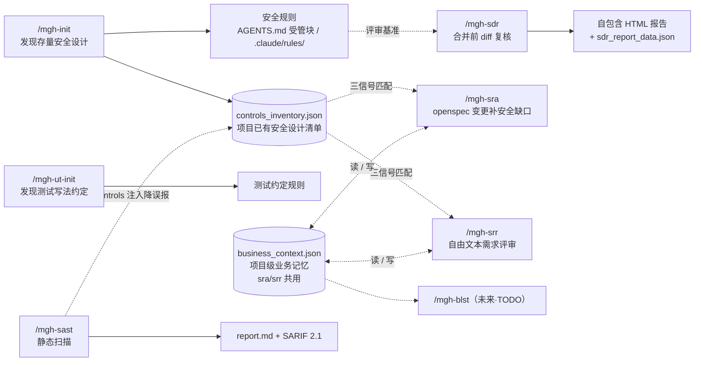

# m3g4h⊿rness — 给 AI 编程助手用的安全工作流工具族

**m3g4h⊿rness**（读作 *megahorn-ness*；双重语义：宝可梦招式「超级角击 / Megahorn」，
隐喻渗透测试的角击；也是 *mega-harness* 之意）是一套装进 AI 编程助手使用的**安全工作
命令集**。安装后，你在 opencode、deepseek-harness、Claude Code 里输入 `/mgh-*` 斜杠
命令，AI 就会按预置的安全工作流干活：发现项目已有的安全设计、评审需求文档、合并代码
前做安全复核、扫描代码找漏洞。其中的确定性脚本（分组、枚举、出报告这类不依赖"智能"的
活）只用 Python ≥3.10 标准库实现——内网不联网、不 `pip install` 任何包就能跑。

## 适用环境（本工具族按这个画像设计）

- **企业内网**：不能访问外网、不能装第三方依赖 → 确定性脚本全部零 pip 依赖（install
  时自检）。
- **算力受限的大模型服务**：内网部署，上下文窗口约 150K、模型较旧较弱、速度慢、有并发
  限制、每 10 分钟约 100 次调用的频控上限 → 机械重活交给确定性脚本，AI 只做判断类工作；
  大任务拆成多个带独立上下文的子任务并行扇出（fan-out），单个请求只看小切片；任务派发器
  内置失活检测、快败冷却、限流风暴止损，适配频控网关。
- **大代码仓**：数百万行、十年迭代历史的项目（Java Web 为主）→ 支持 `--scope` 按模块
  切片跑、`--merge` 合并多片结果、`--resume` 断点续跑、调用图缓存。
- **高安全要求**：银行类项目为主 → 产物一律是"候选 + 证据"供人工复核，不冒充结论；
  每步产物有机器自校验（`--check`），失败即停、不带病前进。

## 命令总览

前两个是**主力入口**，其余按「设计 → 需求 → 合并 → 编码/扫描」的工作阶段排列。所有
产物都是 **AI 生成的候选结果，需人工复核**（详见文末「诚实边界」）。

| 命令 | 状态 | 干什么 | 什么时候用 |
| --- | --- | --- | --- |
| `/mgh-init` | ✅ 主力 | 摸清项目**已有**的安全设计（鉴权/脱敏/加密/输入校验/审计日志…），产出机器可读清单 + AI 可消费的安全规则 | 接手项目或启动安全建设时跑一次；大范围重构后按需重跑 |
| `/mgh-sdr` | ✅ 主力 | 需求分支**合码前**，拿已有安全设计当基准，逐接口复核这支分支的代码改动 | 每支需求分支发起合并前 |
| `/mgh-sra` | ✅ | 对 openspec 变更提案做安全缺口分析，把漏掉的安全要求补进 specs/tasks | 用 openspec 管需求的团队：`propose` 之后、`apply` 之前 |
| `/mgh-srr` | ✅ | 对自由文本需求文档（word/txt/md/excel）出安全评审报告，不要求 openspec | 只有原始需求文档、还没到设计阶段时 |
| `/mgh-sast` | ✅ | 9 阶段静态应用安全测试（SAST，即不运行代码、直接分析源码找漏洞），产出报告 + SARIF | 编码完成后按需扫描 |
| `/mgh-ut-init` | ✅ | 摸清项目**实际**的测试写法约定（框架/mock/断言/夹具/命名），产出 AI 规则 | 想让 AI 写出符合本项目风格的测试时跑一次 |
| `/mgh-blst` | 🚧 TODO | 结合业务接口逻辑设计强耦合的安全测试案例 | 未实现（仅空骨架） |

> 宿主覆盖差异：deepseek-harness（dsh）面目前有上表前 5 个命令；`/mgh-ut-init`、
> `/mgh-blst` 暂未分发到 dsh。

## 命令如何配合



- **`/mgh-init`** 回答「项目**已有什么**安全设计」→ 产出清单与规则，是其余命令的输入。
- **`/mgh-ut-init`** 同理回答「项目**怎么写测试**」。
- **`/mgh-sra` / `/mgh-srr`** 在设计与需求阶段回答「这次变更/需求**漏了什么**安全要求」。
- **`/mgh-sdr`** 在合码前回答「这支分支**有没有漏按安全规矩改**」。
- **`/mgh-sast`** 在编码后回答「代码**哪里可能有问题**」。

## `/mgh-init` — 摸清项目已有的安全设计（主力）

在已有代码库里发现**可复用的安全控制**——输入校验、数据脱敏、鉴权、授权、加密、限流、
CSRF、审计日志——产出两样东西：

1. **`controls_inventory.json`**：机器可读的「本项目已有哪些安全设计」清单，每条带证据
   （文件、行号、代码片段）——是 `/mgh-sra`、`/mgh-srr`、`/mgh-sdr`、`/mgh-sast` 的
   共享输入。
2. **AI 规则**：让 AI 在这个项目里写新功能时自动复用已有安全写法，而不是自己发明。
   opencode 写成根 `AGENTS.md` 的受管块 + 每类一份详述文件（默认）；claude 写成
   `.claude/rules/security-<类别>.md`。两种结构二选一，不混用。

流水线：确定性扫描（正则找注解/工具类）→ LLM 扇出补漏（找正则漏掉的自研控制，按字节
预算分批）→ 逐簇归纳 → 综合出规则 → 一致性校验。

```bash
/mgh-init --target .                        # opencode（默认）:产 AGENTS.md 受管块
/mgh-init --target . --format claude        # claude:产 .claude/rules/security-*.md
/mgh-init --target . --scope path:src/pay   # 大仓按模块切片,跑完多片后 --merge 合并
/mgh-init --target . --resume               # 中断/上下文吃紧后续跑,无需重输参数
```

- **大仓（≥150 万行）**：优先 `--scope` 按模块切片 + `--merge` 合并，勿单次全仓跑。
- **中断恢复**：进度全部落盘在 `<target>/.mgh-init/`——对话被压缩、会话崩溃、主动关掉
  都不丢；新会话里重跑同一命令加 `--resume` 即可从断点继续（已完成单元自动跳过）。
- **（可选）codegraph 富化**：项目已建 `.codegraph/` 索引且机器有 `codegraph` 命令时
  自动启用，用框架路由图解析文本分析漏掉的 DI/AOP/注解鉴权类控制；`--no-codegraph`
  关闭。
- 完整参数表：命令后输 `--help`（零 token 消耗）。

## `/mgh-sdr` — 需求分支合码前的安全复核（主力）

需求分支开发完了、准备合进版本分支之前，让 AI 检查：**这次改的代码有没有漏掉项目里
已经定好的安全规矩**——比如「接口必须配权限」「查询必须校验机构」「SQL 必须参数化」
「敏感字段必须脱敏」。它不是漏洞扫描器（那是 `/mgh-sast`），而是拿 `/mgh-init` 产出的
存量安全设计当**检查基准**，把 `git diff base..branch` 的改动逐个接口对照检查。

流程：diff 按接口维度注解分组 → 按字节预算投影检查基线 →（如存量设计引用了外部前端仓，
先经你授权做受控检索）→ 6 个维度并行复核（垂直/横向/其他越权、SQL 注入、敏感信息、
输入校验）→ 三元组去重 → 渲染报告。

```bash
/mgh-sdr                                    # 零参 = 当前分支 vs master,全 6 维
/mgh-sdr --base master --branch feat/pay    # 显式指定分支
/mgh-sdr --dry-run                          # 只跑分组与基线,不派发评审不渲染
```

多分支批量复核（人/定时任务用的一条命令入口；外部仓检索在启动器进程内完成、不打断
AI 会话）。命令在任意目录都能跑（`--repo` 显式指定项目根）：

```bash
py <项目>/.opencode/mgh-core/scripts/mgh_sdr_launch.py --repo <项目绝对路径> --host opencode --multi-branch branches.txt
py <项目>/.opencode/mgh-core/scripts/mgh_sdr_launch.py --repo <项目绝对路径> --branch-list "feat/pay,feat/b2"   # 内联清单:临时比两三个分支,不必建文件
py <项目>/.opencode/mgh-core/scripts/mgh_sdr_launch.py --repo <项目绝对路径> --dry-run   # 冒烟:只做分支预检+运行域准备,零 AI 调用
```

`branches.txt` **一行一个分支名**，`#` 注释行与空行忽略，重复分支只跑一次（文件缺失或
没有分支 → 退出码 2）。临时比两三个分支时也可不建文件，改用**内联清单**
`--branch-list "feat/pay,feat/b2"`（逗号分隔、引号包住直接写在命令行上）：每项自动去
首尾空白、重复分支只跑一次、无注释语法；空项（`a,,b`、结尾多逗号、全空白）会报出第
几项并拒识（退出码 2）。`--branch-list` 与 `--multi-branch` **二选一**，同给时拒识
（退出码 2），不会猜着取其一；内联清单与单分支 `--branch` 同给时，内联清单优先
（`--branch` 被忽略）。单分支复核去掉 `--multi-branch`、改传 `--branch <分支名>`；
`--open` 让每份报告出完自动在浏览器打开。退出码：`0` 全部成功 · `1` 有分支失败
（stderr 列出 FAILED 分支与原因，其余分支照常跑完）· `2` 用法错误。某分支扇出期间若
发生 AI 服务断连/限流，失败证据落在该分支 run 目录的 `host_error.log`，无需翻全局日志。
（dsh / claude 面脚本路径分别为 `<项目>/mgh-core/scripts/`、`<项目>/.claude/mgh-core/scripts/`。）

**产出**：项目根一份**自包含单文件 HTML 报告**（样式/脚本/数据全内嵌，浏览器双击即读、
离线可用）；机器读的正式数据在 `<项目>/.mgh-sdr/runs/<时间戳>/sdr_report_data.json`。
历史 Markdown 报告不迁移。

**首次运行会问一次**：存量设计引用了外部前端仓时，流程会停下来请你授权「是否允许检索
那个目录」。同意则写入项目内只读授权配置 `<项目>/.mgh/read-roots.json`，以后不再问；
拒绝则跳过该仓继续，报告如实披露覆盖缺口。

## `/mgh-sra` — openspec 变更的安全缺口补齐

接在 openspec `propose` 之后、`apply` 之前，回答：**这个变更的 specs/tasks 在安全维度
上漏了什么？每个漏缺该接哪个既有设计？**

- **9 个安全维度逐维查缺口**（敏感数据/注入/横向越权/纵向越权/认证/完整性/审计/限流/
  密钥配置），产出具体、可锚定到接口的缺口，不是泛泛的 OWASP 清单。
- **三信号匹配存量设计**：维度契合 + 业务域相似 + 业务事实 → 推荐"该复用哪个既有控制"。
- **批量澄清问答 + 项目业务记忆**：判不出的业务事实批量问一次（带默认猜测，可秒批）；
  答案沉淀进项目级 `.mgh-sra/business_context.json`，下轮迭代问得更少、匹配更准。
- **幂等非破坏性**：增补以受管块 `<!-- mgh-sra:begin --> … <!-- mgh-sra:end -->` 追加
  进 specs/tasks，块外内容一字不动，可重跑。

```bash
/mgh-sra --change <变更名>                   # 扫最近/指定 openspec 变更
/mgh-sra --change <名> --rules .mgh-init     # 接入 mgh-init 清单做存量匹配(强烈建议)
/mgh-sra --change <名> --no-interactive      # 澄清全用默认猜测,不暂停问人
/mgh-sra --change <名> --dry-run             # 只解析产上下文,不写任何文件
```

## `/mgh-srr` — 自由文本需求的安全评审（不要求 openspec）

真实世界大量需求是 word/txt/md/excel 的原始文字描述。`/mgh-srr` 读一份这样的文档 →
过一遍与 sra 相同的 9 个安全维度 → 产出一份**普通、简要的评审报告**，完全不碰
openspec。它复用 `/mgh-sra` 的全部分析引擎，只换了输入（自由文本抽取）与输出（普通
报告）两端。

- `.docx`/`.xlsx` 用标准库尽力抽取（日期/格式/列表的损失会如实标注）；抽不好就
  `--text` 直接贴文字，零损失。
- 接口/字段/角色信息是可选的：文档里没有就跳过，AI 直接读全文找缺口并锚到段落标题。
- 与 sra 共享同一份业务记忆，跨命令累积。

```bash
/mgh-srr --doc 需求.docx                     # 评审一份 word 需求
/mgh-srr --doc 需求.md --rules .mgh-init     # 接入存量设计做匹配
/mgh-srr --doc 需求.md --split               # 按 markdown 大标题切多单元并行评审
/mgh-srr --text "粘贴的需求文字"              # 透传兜底(无抽取损失)
```

**产出**（`<项目>/.mgh-srr/`）：`security_review_report.md`（简体中文、面向人读）+
台账 `srr_manifest.json`。

### 维度聚焦（`--focus`，sra/srr 共用）

默认扫全 9 个维度；`--focus` 可收窄到指定维度、甚至维度内某几个子项，省掉无关噪音：

```bash
# 只查越权(横向 + 纵向)
/mgh-sra --change <名> --focus '{"dimensions":["horizontal-authz","vertical-authz"]}'
# 敏感数据只查身份证 + 银行卡
/mgh-srr --doc 需求.md --focus '{"dimensions":["sensitive-data"],"facets":{"sensitive-data":["id-card","bank-card"]}}'
```

收窄运行会在台账里如实标注「范围外维度未覆盖」，避免误当全量结论；可枚举的全部
维度/子项值见 `focus_scope.py --list`。

## `/mgh-sast` — 9 阶段静态代码扫描（SAST）

静态应用安全测试：不运行代码，直接分析源码找安全漏洞。九个阶段：调查 → 威胁建模 →
分解 → 逐块深挖 → 预过滤 → 对抗式验证 → 去重 → 构建利用链 → SARIF 报告。

> **对上游保真**：提示词与工作流逐字移植自 vvaharness（Visa / Project Glasswing，
> Apache-2.0），本包不 import、不调用任何上游代码；逐项对应关系见
> `core/docs/prompt-provenance.md` 与 `docs/upstream-index.md`。

```bash
/mgh-sast --repo <路径>                      # 全仓扫描
/mgh-sast --repo . --diff origin/main       # 增量:只扫相对 main 的变更 + 调用链扩展
/mgh-sast --repo . --path src/payment       # 目录范围
/mgh-sast --repo . --package com.bank.pay   # 包范围
/mgh-sast --repo . --controls .mgh-init     # 注入存量设计:降误报/阻断已被覆盖的链
/mgh-sast --repo . --estimate               # 范围/成本预览,无 AI 调用花费
```

**产物**（`<repo>/security-scan/`）：`report.md` + `report.sarif`（SARIF 2.1.0，可导入
告警平台）+ 检查点（供 `--resume`）+ `run_manifest.json`。批量扫描（`--repo-file` 多仓
清单、按应用分组出报告）与调优 flag 见命令 `--help`。

## `/mgh-ut-init` — 摸清项目实际的测试写法约定

扫描项目的测试源码树，按被测层分组、每组抽样，归纳出「这个项目实际怎么写测试」的约定
——框架、mock 方式、断言风格、夹具、命名——产出 AI 规则（opencode：`AGENTS.md` 惰性
索引 + `docs/test-conventions/<类别>.md` 详述；claude：`.claude/rules/test-*.md`）。
识别出来的"应付式弱测试"会被标记，**不会**被当成项目约定。产物同为 LLM 归纳候选，
需人工复核。

```bash
/mgh-ut-init --target .                      # opencode（默认）
/mgh-ut-init --target . --format claude      # claude
```

## 安装

**工具包与业务仓分离**：本仓库放在自己的路径下，install 脚本把命令壳和运行时（`core/`
以 `mgh-core/` 名义）注入你的**业务仓**，不会把整个工具包拷进去；多个业务仓可共用同一
份工具包，各自安装、互不污染。

```bash
# opencode（推荐）:
bash /path/to/m3g4horness/install.sh --opencode <业务仓路径>
# deepseek-harness:
bash /path/to/m3g4horness/install.sh --dsh <业务仓路径>
# Claude Code:
bash /path/to/m3g4horness/install.sh --claude <业务仓路径>
# Windows PowerShell 等价:
.\path\to\m3g4horness\install.ps1 -Platform opencode -Target <业务仓路径>
```

> 不带宿主 flag 时默认 opencode（与宿主优先级一致；多台机器/CI 里建议仍显式传参，免得
> 依赖默认值）。dsh 面另需 `DSH_HOME` 环境变量指向 dsh 宿主目录。

install 会做三件事：(1) 自检零运行时依赖；(2) 拷贝命令壳 + `core/`（**不**拷 `tools/`、
`tests/`、`openspec/`、`docs/`）；(3) 三端对等注入**运行纪律守卫**——AI 在命令运行期间
临时乱写脚本、往项目目录外写文件、用内联代码翻产物，会被 hook 直接拦下并给出正确做法
提示（`--no-enforce-hook` 可关闭，纪律仍由命令规则 + 各步骤 `--check` 兜底）。

> 企业内网多业务系统、多宿主混用环境的完整分发说明见
> [`docs/分发与使用指南.md`](docs/分发与使用指南.md)。

## 依赖（无需 pip）

全部确定性脚本只用 Python ≥3.10 标准库，经 AST 扫描与单测双重验证**不需要 `pip
install` 任何包**——内网无网也能跑。唯一的"依赖"是宿主 AI 编程助手本身（LLM 阶段由它
执行）。若未来接入 tree-sitter 调用链后端（规划中、未接入）才会新增依赖，届时先行确认。

## 使用统计（遥测）

每条 `mgh-*` 命令在**启动路径的确定性脚本内部**向内网遥测服务上报一条使用记录：本机
用户名（去掉 Windows 域前缀）、本机 IP、命令中文名与原名、执行参数。这是**尽力而为**
的统计通道，对使用者的影响被压到最低：

- **默认完全不上网**：端点由环境变量 `MGH_TELEMETRY_URL` 配置（或由维护方写进内置
  默认值）。两者都没配时，工具不发任何网络请求——装完就是这个状态。
- **发不出去就丢**：网络不通、超时（约 2 秒）、服务端报错，这一条就静默放弃，不重试、
  不排队；命令本身的行为、输出、退出码永远不受遥测影响。
- **同一件事不重复计**：30 分钟冷却窗口内的反复查询（分页、过程查询）只算一次。所以
  统计口径是「活动窗口开始次数」，不是精确的会话数——超过 30 分钟的长任务中途查询会
  多计一条，30 分钟内快速重启会漏计，两条误差都正常。
- **params 原样记录**：可能包含项目路径等内网信息；遥测服务端部署在内网，接收字段与
  口径的完整说明见维护者文档区的遥测接口文档。不想要遥测 = 端点置空，即刻整体停报。
- 当前接入 mgh-init / mgh-sdr / mgh-sra / mgh-srr / mgh-ut-init 五条命令；mgh-sast
  暂未接入。

## 目录布局

```
m3g4horness/
├── README.md                 # 本文件(面向使用者)
├── AGENTS.md                 # 研发与运营手册(面向维护者,必读)
├── CHANGELOG.md              # 版本历史(Keep a Changelog 格式)
├── VERSION                   # 当前版本号
├── install.sh / install.ps1  # 安装脚本(bash / PowerShell)
├── core/                     # 平台中立的单一真相源
│   ├── prompts/              # 阶段 SYSTEM 提示词 + fragments + lenses + baselines
│   ├── scripts/              # 确定性脚本(约 50 个:分组/枚举/校验/渲染/派发器等)
│   ├── profiles/             # 宿主角色配置(default / cli / full / init / sra / srr)
│   ├── contracts/            # 阶段 I/O JSON 契约
│   └── docs/                 # NOTICE 与提示词溯源(Apache-2.0 归属)
├── releases/opencode/        # opencode 壳(command ×7 + agent ×33 + hooks + plugins)
├── releases/claude-code/     # Claude Code 壳(commands ×7 + agents + skills + hooks)
├── releases/dsh/             # deepseek-harness 壳(skills ×5 + agents + plugins)
├── openspec/                 # 规格驱动研发:specs/(能力规格) + changes/(变更记录)
├── docs/                     # 维护者私有资料(man 页/术语表/上游对照/分析笔记),不随安装分发
├── tools/                    # 构建期工具(提示词重抽/发布物生成/各类 lint),不随安装分发
└── tests/                    # 回归单测(66 个文件)
```

## 诚实边界

**所有产物都是 LLM 生成的候选，不是已确认结论；每次运行非确定性。使用前必须人工复核。**

**`/mgh-init`**
- 控制是 LLM 归纳候选；**存在 ≠ 有效**（上游曾披露 `@PreAuthorize` 在参数化类型上被
  绕过的真实案例）。
- 调用图是文本/AST 级，看不懂反射、DI、AOP、框架路由；漏掉的写进 `unresolved[]`
  披露。codegraph 富化能缩小但不归零这个盲区。
- scout 探查是部分覆盖、非全仓（manifest 记录真实数字）；≥150 万行大仓请切片跑。

**`/mgh-sdr`**
- 发现是 LLM 候选、非确认漏洞；接口分组靠 Spring/JAX-RS/Servlet 常用注解启发式，漏
  分组的接口退为独立评审单元（粒度粗、覆盖不丢），非 Java Web 项目整体退化为独立单元
  模式。
- 外部仓检索结论是**检索时点快照**，不保证前端分支同步；未经授权的外部仓零读取，并在
  报告披露。
- 敏感字段清单来自项目配置或缺省模板回退（模板覆盖不到的字段按通用回退规则识别）。
- **配额模式是估算式**（可选）：传 `--quota-calls/--quota-window-s` 后派发器按「每单元
  调用数估算」主动节流——真实调用数在子代理会话内、派发器看不见，估算偏小仍可能吃 429
  （由冷却与限流截断这两层后援接管）；未配置配额参数时派发行为零变化。

**`/mgh-sra` / `/mgh-srr`**
- 增补/评审是 LLM 候选；覆盖取决于变更声明与已记业务事实——没声明、没记的看不到。
- 引用控制断言存在、不断言有效；业务记忆是用户断言、非代码真相（代码与记忆冲突时以
  代码为准）。
- srr 报告质量受输入完整度上界约束：含糊的需求文档只能产出泛化缺口。

**`/mgh-sast`**
- 发现是待复核候选；调用图漏动态分派/反射/DI/框架路由（Spring `@*Mapping`/Feign/AOP/
  `@Autowired`）；`--controls` 注入的控制断言存在、不断言有效。

**运行时守卫的已知边界（opencode / dsh）**
- 守卫靠环境变量或磁盘哨兵文件激活；opencode/dsh 的插件进程**不继承**会话中途 `export`
  的环境变量——因此随包脚本同时写磁盘哨兵兜底，保证整轮可靠激活。
- 长跑确定性脚本可能超过宿主 shell 默认超时：编排器按次传毫秒级 `timeout`（两宿主都
  支持、会话内生效）；opencode 全局默认可用 `OPENCODE_EXPERIMENTAL_BASH_DEFAULT_TIMEOUT_MS`
  调高（须在 opencode 启动前设置，会话中途 export 无效）。

**省调用数**：sast 的 `--estimate` / `--stop-after` / `--budget`；sra/srr 的 `--dry-run`
/ `--no-interactive` / `--focus`；init 的 `--scope` / `--no-scout`。

## 给维护者与贡献者

研发规则、宿主三面镜像纪律、回归测试策略见 [`AGENTS.md`](AGENTS.md)；版本历史见
[`CHANGELOG.md`](CHANGELOG.md)。
