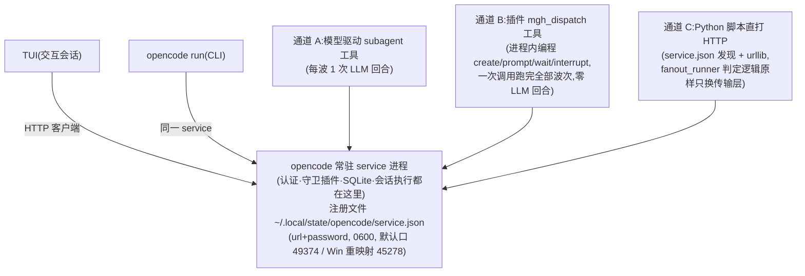

# fanout 原生派发问题清单 5-why 深挖与 opencode 2.1 架构反转(2026-10-20)

> **受众:人类·仅研发仓**(维护者决策文档)。本篇承接同日稍早的
> [docs/fanout-native-dispatch-analysis-2026-10-20.md](fanout-native-dispatch-analysis-2026-10-20.md)(下称「主分析」),
> 是应维护者要求的逐问题深挖:对主分析 §5.3 列出的每个「原生派发可能导致的问题」,用 5-why
> 连锁归因追到根因,源码级论证「是否**只能**靠 fanout_runner(子进程形态)解决」,并探索不用
> runner 的更优解。
>
> **源码基线变化(本篇结论与主分析不同的根源)**:主分析与仓内全部 docs/opencode-*.md 基于
> opencode v1.18.x;本篇全部源码结论基于 **v2.1.0**(C:/DEV/opencode,已确认版本),大版本重构
> 推翻了多项 1.18 时代的前提。证据标注:〔源码 file:line〕= 2.1.0 源码核实;〔档案〕= mgh 仓
> openspec 归档记载;〔推断〕= 分析推论;〔需实测〕= 无法静态核实。
>
> **维护者已拍板的前提**(2026-10-20):企业内网 fanout_runner 子进程派发 >99% 失败且全是
> 鉴权问题,鉴权方式还会持续变——不再可持续修补;转向原生派发;runner 相关内容全部保留但
> 降低优先级、默认不使用。本篇只调研 opencode(dsh/claude 忽略)。
>
> **⚠️ 证据更正(2026-10-20 晚,必读)**:本篇初稿的 P4 曾引用「/mgh-sra 三个月原生直派零事故」
> 作为原生可靠性的存在性证明——**该证据不成立**。近三个月实际只跑过 `/mgh-init` 与 `/mgh-sdr`,
> sra/srr 没有执行记录(无 run 目录、无报告、无 findings,CHANGELOG 无实跑记载),「零事故」的
> 分母是零;而且档案里**有**原生失败记录(2026-08-13 越树读权限中断、2026-08-17 单路径转述
> 盘符根漂移、2026-10-12 手派漫游弹权限中断)。删除伪证据后,P4 从「已证否」降级为
> 「设计上可能、运行时未证」。同时补入维护者确认的真实故障 **P11:权限询问无人应答挂死**
> (子代理越项目目录 → 弹授权 → 无人值守 → 挂到隔夜),并在本机 opencode2 v2.1.0 上实测复现
> 与验证三种处置——完整实测记录见
> [docs/opencode2-native-dispatch-verification-2026-10-20.md](opencode2-native-dispatch-verification-2026-10-20.md)。

---

## 0. 深挖总结论(先读)

1. **十一个问题(含新增 P11),没有一个的最终判定是「只能靠子进程形态」。** 上一轮分析
   (主分析 §5.3)对「失去杀灭/失去零 LLM 波次/限流降级」的悲观评估,是站在 v1.18 源码前提上
   的;逐个 5-why 到底后发现:那些前提在 2.1 大部分已被上游结构性拆除,剩余缺口都有进程内
   出口(第 2 节逐条)。**但 P4 是唯一例外:去掉伪证据后,它只有设计上的可能性,没有运行时
   可靠性证据。**
2. **2.1 架构反转(本次最大的发现,已实测预确认)**:opencode 2.x 里 TUI/CLI 全部变成纯 HTTP
   客户端,核心逻辑住进**常驻后台 service 进程**;交互实例、`opencode run`、插件、HTTP API
   全部连**同一个 service**〔源码 cli/commands/handlers/run.ts:10-12、
   client/effect/service.ts:16-38〕。本机实测 `opencode2 run` 前后 service pid 不变(88380),
   新会话出现在同一服务里——「子进程=独立认证域」这一给子进程形态判死刑的前提,在 2.1 上
   **已不再成立**(企业环境仍需现场复核)。含义:(a) 原生派发是「同 service 继承认证」;
   (b) 旧 runner 的 spawn 形态在 2.1 也可能只需小改即可复活,作为兜底(第 3 节)。
3. **新首选通道**:2.1 插件 API 成了一等公民——插件可注册自定义工具,并**进程内编程式
   create/prompt/wait/interrupt 子会话**〔源码 plugin/src/effect/session.ts:154-174、
   plugin/host.ts:547-590〕。「编排器一次调用 mgh_dispatch 工具 → 插件在进程内确定性跑完
   整个波次循环」= fanout_runner 的进程内等价物:零 LLM 波次回合、认证继承、守卫照过、任务
   文本由脚本构造。
4. **⚠️ 紧急独立发现(先于扇出转向处理)**:2.1 的插件模块 schema 只接受
   `export default {id, effect|setup}`,**mgh 现有守卫插件(v1 具名导出)会被拒载**
   〔源码 plugin/module.ts:82-91、125-134;双向核验:mgh 插件确为
   `export const BlockAdhocScripts`〕。企业升级 2.1 当天,mgh 的 opencode 运行时守卫
   (R5.7 整条防线)就是静默失效的——需要一次独立迁移(default 导出 + 工具名映射
   bash→shell/task→subagent + `tools:` frontmatter → `permissions:` 规则),详见 §4.4。
5. **认证继承比主分析预期更强**:凭证解析发生在**每个 step 边界**(不是进程启动一次),
   env 声明型连接实时读 `process.env`〔源码 integration.ts:723-727〕;401 → 干净失败落盘,
   人在交互主会话重登(验证码人在场)→ 写回 env/凭证库 → **下一步自动吃到新 token,无需重启**
   → 「暂停-重登-续跑」在原生形态下结构性成立(§2 P9)。

---

## 1. 问题清单与判定总表

| # | 问题(主分析出处) | 深挖判定:只能靠子进程 runner? | 一句话依据 |
| --- | --- | --- | --- |
| P1 | 挂死子代理无杀灭/无超时(§5.3.1) | **否(大部分)** | 2.1 三层 HTTP 超时 + `POST /api/session/:id/interrupt` + Job.cancel;残余缺口有进程内看门狗出口 |
| P2 | 波次边界 LLM 回合成本/漂移(§5.3.2) | **否** | sdr 级成本算术触不着压缩;免 LLM 需求由插件派发通道(2.1 新能力)承接 |
| P3 | 限流风暴无即时截断(§5.3.4) | **否,且进程内更优** | 结构化 error.type + retry 事件 + retry hook 否决权 + 逐请求计数,信号质量严格优于扫输出尾部 |
| P4 | 弱模型任务消息构造忠实度(§5.2 A 类) | **否(设计上可能,运行时未证)** | 模板引擎可搬 + 插件可展开;但 sra 无运行记录(伪证据已删),2026-08-17 有单路径转述漂移反例;本机 6 单元试点 6/6 精确只是方向性证据 |
| P5 | 进度不可观测(§5.3 隐含) | **否** | SSE 事件流 + 插件心跳落盘 + HTTP 查询面;粒度(重试中/下次尝试时刻)优于子进程 |
| P7 | 守卫对子代理是否生效(§6.7) | **2.1 源码+实测成立,但守卫插件必须先迁 2.1** | 钩子进程级全局、工具执行单入口;本机实测子会话 read 触发同一 execute.before;但 v1 守卫插件已被 2.1 日志实锤拒载 |
| P8 | 父上下文逐波增长×压缩(§5.3 隐含) | **部分**(非 runner-only) | R5.4 磁盘重派生使进度无损;摘要再定向是弱模型暴露面;init 级正解是插件/HTTP 通道而非子进程 |
| P9 | 认证继承假设(含中途过期)(§6.7) | **源码层面成立,企业 CAS 未实测** | step 边界重解析 + env 实时读 + 401 干净落盘 + 免重启换 token;本机未跑企业 CAS 全链 |
| P10 | 子代理深度锁 / 进程内并发副作用 | **成立/结构性不存在** | depth 默认 1 恰好单层;单 SQLite 连接 + semaphore(1) 串行化,多进程锁崩类在进程内不存在 |
| P11 | 权限询问无人应答挂死(维护者确认的真实故障) | **否(可根治)** | 2.1 `Permission.assert` 无超时;`permission.evaluate` 把 ask→deny 实测让 pending=0;config/agent deny 作 floor;看门狗 `reject+message` 兜底 |

---

## 2. 逐问题 5-why 与判定

### 2.1 P1:挂死与杀灭——判定「否(大部分不成立)」

**5-why 链(合并三形态)**:
1. 为什么原生派发怕挂死?→ 前台 subagent 工具在 `jobs.block` 上无限等待,该等待无 timeout
   参数〔源码 tool/plugin/subagent.ts:234-240〕,子会话不进终态父调用永不返回。
2. 为什么子会话会不进终态?→ v1.18 时 LLM 流零超时(`timeout:false`)使停摆永久化;**2.1 该层
   已修**:等响应头默认 300s + 流内 chunk 间隙默认 900s(设计动机:DeepSeek 类推理可静默 15
   分钟),整请求预算可配〔源码 packages/ai/src/route/transport/http.ts:115-130、
   options.ts:56-62;config 键 `provider.<id>.timeout/headerTimeout/chunkTimeout`,
   schema/src/config/provider.ts:10-14〕。彻底断流最迟 15 分钟自爆为 TransportError。
3. 为什么 v1.18 只能杀进程?→ 子会话无中止接口;**2.1 已有**:
   `POST /api/session/:sessionID/interrupt` 路由〔源码 protocol/src/groups/session.ts:685-703、
   server/src/handlers/session.ts:591-594〕+ 进程内 Fiber 硬中断链(interrupt → drain 纤维 →
   工具纤程连带 → LLM 请求 abort)〔源码 session/run-coordinator.ts:147-167、step.ts:150-152〕,
   中止后父会话的 subagent 工具调用以 `ToolFailure("Subagent cancelled (sessionID:…)")`
   **干净返回,父会话不中断**〔subagent.ts:246-256〕。
4. 为什么外部确定性脚本能触发杀?→ 2.1 常驻 service 的注册文件
   `~/.local/state/opencode/service.json`(url+pid+password,0600)是官方发现契约
   〔源码 cli/src/services/service-registration.ts:24-39、client/effect/service.ts:16-19;
   默认口 0xC0DE=49374,Windows 重映射 0xB0DE=45278,service-config.ts:46-59;HTTP Basic
   鉴权 server/src/auth.ts:28-37〕——Python 脚本读它即可 curl 中止指定子会话。
   **「确定性脚本杀指定子代理」在进程内成立。**
5. 根因层:opencode 的超时语义是「传输层活性」(字节还在不在到)而非「任务层时限」(这个单元
   跑了多久)——任务级 wall-clock 看门狗必须由派发纪律持有(mgh `--call-timeout-s` 的设计动机
   同构),**但持有者不必是子进程**:2.1 的中断原语(interrupt/Job.cancel)都是进程内的。

**残余缺口(诚实)**:① 网关发 SSE keepalive/慢滴流可绕过 chunk 表(任何字节重置计时)〔推断,
需实测企业网关行为〕;② MCP 工具默认执行超时 12 小时(mcp/client.ts:36)——mgh 工作面基本不用
MCP,影响有限;③ 子代理「活着但永不收敛」无 wall-clock 闸,靠每 agent `steps` 上限
(v1/config/agent.ts:59-60,选配)兜;④ 父会话自身是单点(父挂全停)——父只做轻量编排,风险面
远小于 N 个工作子代理。**子进程唯一不可替代的残余 = 杀 opencode 服务进程本身**(服务整体死锁),
这已超出「子代理挂死」范畴,且原生形态下本就无子进程可杀。

### 2.2 P2:波次边界 LLM 回合——判定「否」

1. 为什么每波要一次编排器回合?→ v2.1 里「发下一波 N 个工具调用」只能由模型产生——
   step.ts 只对 provider 流中的 tool-call 事件 fork 执行,无代码路径替模型发工具调用
   〔源码 session/runner/step.ts:107-138〕。
2. 为什么 v1.18 的免 LLM 注入通道没了?→ `SubtaskPartInput` 已随 part 机制整体移除,仅存于
   v1 数据库迁移〔源码 database/v1-migration.bun.ts:317〕——旧「串行 pop」约束连同 part 一起
   消失,但也不再是免 LLM 通道。
3. 但子进程不是唯一免 LLM 形态?→ 2.1 有两条新通道:插件会话编程 API(§3 通道 B)与 HTTP
   驱动(§3 通道 C),都以「同 service 同认证」为前提,循环完全在确定性代码里。
4. 模型驱动波次的成本到底多大?→ 算术(源码级并发 + 单行回执纪律 + 计划器 10 行输出):
   每波边际 ~0.6–1.1K token;sdr 67 单元 ÷3 ≈ 23 波 ≈ **14–25K**,150K 窗口连一次 auto 压缩
   (阈值 ~127.5K,compaction.ts:95-104)都到不了;企业配额(100 调用/10 分钟)下波次 cadence
   被配额锁死,编排器回合占窗口调用预算 3–6%,**被配额等待淹没**。
5. 结论:免 LLM 波次的真实需求场景只剩 init 级超大扇出(900 批 = 300 波 = 180–330K = 3–4 次
   压缩)——而那个场景的正解是插件/HTTP 通道(进程内),不是回到子进程。

### 2.3 P3:限流风暴与配额——判定「否,且进程内更优」

1. 429 在进程内怎么呈现?→ 分类器在 HTTP 层:裸 429/rate_limit 文案 → `RateLimitError`
   (可重试,重试策略硬编码:指数 2s 起步、封顶 10s、**最多 10 次**,约 67–101s 烧完)
   〔源码 packages/core/src/model-retry.ts:25-36;无 config 键可调〕;429 带配额文案
   (insufficient_quota 等)→ `QuotaExceededError`(秒败不重试)〔packages/ai/src/provider-error.ts:235-305〕。
   **企业网关 429 的响应体文案决定命运分叉——需实测**。
2. 重试与失败留下什么痕迹?→ 每次重试发 durable 事件 `session.retry.scheduled`(含 attempt/
   下次时刻);耗尽发 `session.step.failed`,错误是**结构化** `error.type`(provider.rate-limit/
   provider.quota + status + 响应体)〔源码 schema/src/session-event.ts:583-594、
   session-error.ts:7-12、to-session-error.ts:31-32〕——不是文本签名,不会误报也不会漏报。
3. 子代理失败后父看到什么?→ job 终态 error → 工具返回 `Subagent failed (sessionID:…): <原文>`
   → 父落 tool.failed 事件;结构化判别字段完整保留在子会话自己的事件流与 SQLite 消息行
   〔schema/src/session-message.ts:211〕——插件可按 sessionID 关联实时写 `<unit>.failed` 标记,
   reason 用结构化 type,**比 fanout_runner 的输出尾部子串匹配
   (RATE_LIMIT_SIGS=("429","too many requests",…))更准**。
4. 进程内独有的干预点?→ 三个,子进程形态完全没有:① `session.retry` 插件钩子可**否决重试或
   改写延迟**(如等满配额窗 600s)〔源码 session/runner/retry.ts:39-53,decision 字段可变〕;
   ② `session.http.request/response` 钩子包住**每一次模型 HTTP 调用**(含重试每次尝试、含
   title/compaction 暗账,kind 字段可区分)〔model-request.ts:321-349〕→ 配额计数可从 mgh 的
   估算式 K(先验常数 10)**升级为实测滚动值**;③ 事件逐个实时,不必等单元死后看尾部。
5. 边界纪律(不变):TS 插件只做「事件→JSONL 落盘」胶水,风暴分类/准入算术/止损阈值仍沉在
   Python 确定性脚本(与 R5.7 守卫「判定单一来源在 Python」同构)。波次边界(而非槽位补位)
   成为新的止损执行点。

### 2.4 P4:任务消息构造忠实度——判定「否(设计上可能,运行时未证)」

1. 2026-07 手派为什么失败?→ 路径以占位符/相对路径形态经「编排器拼一次+子代理再拼一次」
   两次拼装,弱模型按记忆**概率性复现**而非逐字复制当轮可见字段〔档案:2026-07-07 与
   2026-08-18 归档 change 的 design 归因〕。
2. 为什么提示词护栏拦不住?→ 护栏是生成后劝导;首次生成错误只能靠**由构造保证**(固定模板+
   逐字填充+锚树校验)消除〔档案:2026-08-18 design.md D2〕。
3. 构造保证为什么当时落在子进程 runner 里?→ 「零 LLM 波次循环」需要宿主外执行体,v1.18
   核实宿主内无免 LLM 批量派发面,CLI 子进程是唯一现成通道——**模板引擎与子进程形态是被同一
   脚本顺带捆绑,不是必然捆绑**〔档案:2026-08-17 分析文档 §4;主分析 §2.4 同结论〕。
4. **伪证据更正(重要)**:初稿写「/mgh-sra 三个月原生直派零事故」——**该证据不成立**。
   近三个月实际只跑过 `/mgh-init` 与 `/mgh-sdr`;sra/srr 没有运行记录(无 run 目录、无报告、
   无 findings,CHANGELOG 无实跑记载),「零事故」的分母是零。相反,档案里**有**原生失败记录:
   2026-07-07 盘符根漂移、2026-08-17 编排器把 `checkpoint_path` 拼成 `D:\.mgh-init\...`、
   2026-10-12 手派 scout-merge 漫游到全局目录并弹权限中断。因此「弱模型能可靠转述一个绝对
   路径+一句话」**没有任何正面运行证据**;2026-08-17 恰好是「单路径转述也会漂」的反例。
5. 本机 6 单元试点(2026-10-20 实测,详见
   [verification 文档](opencode2-native-dispatch-verification-2026-10-20.md)):6/6 逐字节转述、
   6/6 子代理读对文件、6/6 nonce 正确、零诱饵命中、76 秒完成。**这是方向性证据,不是认证**:
   只有 6 个样本、用的是本机 GLM-5.3-flash 而非企业弱模型;统计上 6 次零错误的 95% 上界约
   39%,即使 72 次零错误上界仍约 4.2%,不能证明「接近零」。生产路径必须带确定性校验。
6. 残余(单路径错抄)有结构出口吗?→ 有,但**尚未实现/未在 mgh 落地**:2.1
   `tool.execute.before` 的 `input` 字段可改写,消费链用**改写后的 input** 执行,有两个第一方
   先例(subagent 自己的钩子剥字段、tool-input-repair 整体重写)〔源码 tool.ts:272-281、
   tool/plugin/subagent.ts:271-280、plugin/tool-input-repair.ts〕。插件可把「短 unit id /
   task.md 路径引用」**展开为完整任务文本**并对计划校验;更强的形态是
   `mgh_dispatch(wave)`/`mgh_dispatch(unit_ids[])` 让长路径完全不出现在模型输出里。在它落地
   之前,编排器仍需转述路径,「编排器措辞完全不重要」不成立。

### 2.5 P5:进度可观测——判定「否」

SSE `GET /api/event` 全事件流 + `GET /api/session/:id/message` 分页查询 + 插件事件心跳
JSONL + 既有 sidecar 约定,第二终端体验可保住且**粒度更高**:能看到「重试中/第几次/下次尝试
时刻」(retry.scheduled.at)而非只有活着/死了〔源码 handlers/event.ts、event-manifest.ts:70-80〕。
消息投影(含 error 字段)持久在 SQLite,崩溃后进度可从磁盘重派生。注意 durable 事件 payload
默认 persist=false(bus.ts:208)——retry 历史要审计就得靠插件实时落盘(与心跳方案恰好同一条路)。

### 2.6 P7:守卫连续性——判定「2.1 源码+实测成立,但守卫插件必须先迁 2.1」

1. 子代理工具调用必然过钩子?→ 全部工具执行收敛到唯一入口,该入口第一件事就是触发
   `tool.execute.before`〔源码 tool.ts:103-111、272〕;钩子注册表是**进程级全局单例**,按域
   触发、无会话过滤〔plugin/hooks.ts:63-108〕。
2. 子代理会话走同一执行流水线?→ 是:同进程普通 child session,同一 runner(drain→context→
   steps→executeTool),且子会话继承父 location,插件未激活不会跑任何 step
   〔session.ts:279、runner/llm.ts:69〕。
3. 附赠强化:2.1 还有 `permission.evaluate` 钩子 + agent/session 双层权限合成,agent 定义可用
   deny 规则收窄子代理工具面〔permission.ts:158-189〕——原生 agent 定义替代了 v1.18 时代的
   「无问询钉扎」且更细。
4. **但是(紧急)**:2.1 模块 schema 只认 `export default {id, effect|setup}`
   〔plugin/module.ts:82-91,拒绝消息原文 "Plugin must export a default definition with an
   id and an effect or setup function"〕;mgh 守卫插件是 v1 具名导出(已双向核验)——
   **升级 2.1 即静默失去整条 opencode 守卫防线**。迁移面:default 导出改壳 + 工具名映射
   (bash→shell、task→subagent,官方迁移映射 v1/config/migrate.ts:25-29;新增 patch/webfetch)
   + agent 定义 `tools:` 列表 → `permissions:` 规则集 + 哨兵锚点适配(location 语义)。
   **建议独立小 change 先行,不等扇出转向。**
5. **本机实测(2026-10-20)**:v2 插件加载成功;主会话与两个原生子会话的 `read` 工具调用都
   触发同一个 `execute.before`(子会话 ID/agent 均可见);但 mgh 的 v1 守卫插件在 2.1 日志中
   被实锤拒载(`Plugin must export a default definition...`),且只是 WARN 后继续。
   **结论:钩子机制对子代理零降级,但当前守卫本身没有加载——迁移是 P0,不是可选项。**

### 2.7 P8:父上下文增长与压缩——判定「部分」(非 runner-only)

每波边际 ~0.6–1.1K(P2 算术);sdr 级 14–25K 不触压缩;子代理结果(tool-result part)在压缩时
**会被摘要回收**(compaction.ts L107-146,keep 尾 15K 之外全进摘要)——但 R5.4 磁盘重派生使
**进度**无损,残余风险只在「摘要后弱模型再定向波次纪律」的忠实度(init 级 3–4 次压缩=3–4 次
暴露面)。init 级正解=通道 B/C(免 LLM 波次),不是子进程。env-profile 把超大扇出引导到通道 B
而非「回 runner」(CAS 环境下 runner 回不去)。

### 2.8 P9:认证继承(含中途过期)——判定「源码层面成立,企业 CAS 未实测」

1. 子代理不各自登录?→ 认证不是会话属性,是 integration→credential 的**进程级状态**;子会话
   与主会话调同一全局解析管线,子会话创建/prompt 不重跑任何插件初始化
   〔源码 model-resolver.ts:372-377、session.ts:273-311〕。
2. 运行中进程免重启换 token?→ 凭证解析发生在**每个 step 边界**(drain 每步重新 load),env
   声明型连接 resolve 时实时读 `process.env`〔runner/llm.ts:160-177、212;integration.ts:723-727〕。
   企业插件把新 token 写回 env(或 `ctx.integration.connect.key` 写凭证库)→ 下一步自动吃到。
3. 中途过期怎么呈现?→ 401/403 分类为 Authentication,**默认不重试**→ step 干净失败落盘
   〔provider-error.ts:103-104、268-273〕;人在交互主会话看到失败 → 重登(验证码人在场,弹窗
   就在用户眼前,优于无头子进程孤儿)→ 写回 token → `sessions.prompt` 续跑,与 mgh 磁盘
   resume 契约天然对接。插件还能用 `session.retry` 钩子把 Authentication 翻成可重试(等重登后
   自愈)或 http.response 钩子嗅 401 主动触发重登流。
4. 2.1 credential 新体系能接企业网关吗?→ **部分**:通用凭证存储+integration 方法框架
   (oauth/key/command/external/env 五法,oauth 距过期 <5min 自动刷新)可收纳存储与连接管理;
   但 CAS 的验证码人工环节决定 refresh 不可全自动——重登触发留在企业插件。最贴接法是
   `provider.<id>.env: ["AIMAX_AUTH_TOKEN"]` 声明(登录后写 process.env,token 不落盘)或
   external 凭证+插件按请求注入(Azure 同款模式)〔integration.ts:39-53、585-741;
   config/plugin/provider.ts:34-44;model-request.ts:305-319〕。
5. **实测边界**:本机用订阅模型,没有跑企业 CAS;子会话继承与 401-重登-续跑是源码推断 +
   机制实测(子会话共享同一 service),不是企业端到端证据。人工重登仍会停无人值守,这一点
   不因原生形态而消失。

### 2.9 P10:深度锁与进程内并发——判定「成立/结构性不存在」

`experimental.subagent_depth` 默认 1,「编排器→子代理」单层恰好放行,子代理不能再嵌套(与
runner 子进程语义一致)〔subagent.ts:117-133〕。并发:同消息多 tool-call 逐个 forkScoped 并行,
跨会话并发由 run-coordinator 按会话键串行化〔step.ts:122-140、run-coordinator.ts:6〕。
数据库:整个进程**一条 SQLite 连接** + `Semaphore(1)` 把全部 SQL(含事务)串行化
〔database/sqlite.ts:61-71、sqlite.bun.ts:85-95〕——v1.18 时代「多进程 database is locked」
在进程内形态**结构性不存在**;inbox 层 per-session KeyedMutex 保证会话推进互不干扰
〔session/inbox.ts:59-63〕。注意 spawn 动作要过 `permission.assert(action:"subagent")`,
企业权限配置若为 ask 会成无人值守挂起点〔subagent.ts:138-151〕〔需实测〕。本机实测已确认
`permission.evaluate` 可以在 ask 创建前改写为 deny,因此该挂起点可被确定性关闭(见 P11)。

### 2.10 P11:权限询问无人应答挂死——判定「否(可根治)」

**真实故障(维护者确认)**:原生子代理尝试访问项目目录之外 → 没有权限 → 向用户弹授权
请求 → 工具执行过程用户基本不在旁边守着 → 子代理一直卡住,直到隔夜第二天用户回来才看到
那个授权请求。这不是理论风险,是已发生过的故障。

**5-why 链(2.1 源码 + 本机实测)**:

1. **为什么挂?** → `Permission.assert` 在 `effect=ask` 时创建 pending,然后
   `restore(Deferred.await(...))`;**全文件没有超时**〔源码 permission.ts:235-263〕。
   工具 fiber 停在这里,step 等它,session 保持 active。
2. **为什么无人应答?** → 只有 `opencode run` 的客户端带一个非交互应答器(对自己拥有的
   session 树 auto-reject);TUI 默认弹窗等人;纯 server/HTTP 创建的会话**没有应答器**
   〔源码 cli/src/run/noninteractive.ts:141-190;tui/src/routes/session/permission.tsx;
   server/src/handlers/permission.ts〕。TUI 还有一个盲区:路由停在子会话 tab 时,子会话的
   permission 请求不显示、autoaccept 也不生效〔源码 tui/src/routes/session/index.tsx:204-210〕。
3. **为什么守卫没拦住?** → `tool.execute.before` 在 permission 之前执行,但守卫只覆盖它
   HANDLED 的少量工具与它能解析的路径;它拿不到「permission 将判定为 ask」的信息,也不覆盖
   `question`/`webfetch`/MCP/自定义工具〔源码 tool.ts:264-285;permission.ts:235〕。
   **仅靠 tool.execute.before 守卫不够。**
4. **为什么 1.x 会隔夜挂,2.1 能根治?** → 1.x 没有 `permission.evaluate` 这个「ask 创建前」
   的改写点;2.1 有了:钩子可以 `ask → deny` 并附 recipe,`assert` 看到 deny 直接抛
   `BlockedError`,**根本不会创建 pending**〔源码 permission.ts:173-189、241-247;
   plugin/src/promise/permission.ts:9-19〕。
5. **怎么根治?** → 三层叠加:
   ① `permission.evaluate`:运行域内 `effect===ask` → 改 `deny` + recipe;并对
   `question`、`external_directory` 显式 deny(它们可能默认 allow,ask-only 规则拦不到)。
   ② config/agent 硬 `deny` 作插件失败时的 floor(用 deny,不要用 ask——历史 always 记录会
   静默放行 ask)。
   ③ 看门狗对漏网 pending 用 `reject + message`(首选,模型继续本回合)或 `interrupt`
   (最后手段)。

**本机实测(2026-10-20,详见 verification 文档)**:
- 无应答 HTTP 会话复现:越目录读取在 t+20s 出现 pending `external_directory`,无自动应答;
  源码无超时 → 会无限挂。
- `reject + message`:约 10 秒后会话 `succeeded`,模型收到拒绝文案继续。
- `interrupt`:pending 清空,会话 `outcome=interrupted`。
- `permission.evaluate` ask→deny:**pending 数始终为 0**,模型收到 deny 文案后 14 秒内
  `succeeded`。
- `opencode2 run` 自带自动拒绝:输出 `permission requested ... auto-rejecting`,模型继续,
  不挂。

**结论**:P11 不是「只能靠子进程」;2.1 有进程内的确定性根治手段。但**必须显式配置**:
不要依赖默认 allow/ask,不要在运行域内留下任何人类问询面。

---

## 3. 2.1 架构反转:同一个 service,五条派发通道

| 维度 | A 模型驱动工具 | **B 插件派发工具(主推)** | C Python→HTTP | (对照)子进程 runner |
| --- | --- | --- | --- | --- |
| 并行 | ✅ 同消息多调用 | ✅ 任意 N 并发 | ✅ 并发请求 | ✅ |
| 零 LLM 波次 | ❌ | **✅** | **✅** | ✅ |
| 认证同源 | ✅ | ✅(进程内直调,零网络) | ✅(同一 service) | ✅ 2.1 实测:`run` 连同一 service(pid 不变);企业环境待复核 |
| 守卫照过 | ✅ | ✅ | ✅ | ✅(哨兵) |
| 任务文本确定性 | 计划物化+插件展开 | **✅ 脚本直灌** | **✅** | ✅ |
| 运维面 | 无 | 无新面(插件目录自动发现) | 注册文件即契约 | spawn/树杀/孤儿全套 |
| API 稳定性 | 低风险 | 中(2.x 插件 API 演进期,锁版本) | 中(139 端点,审计中) | 低 |
| 实现量 | 最小 | 中 | 中(复用 runner 判定逻辑) | 已有 |

**关键判词**:主分析 §6 的设计(通道 A + 计划物化 + 波次纪律)仍是正确的**首发形态**(实现量
最小、无 API 演进风险);通道 B 是**目标形态**(把 fanout_runner 的「零 LLM 波次+确定性循环」
在进程内完整复刻,治 P2/P8 的 init 级残余);通道 C 是**兜底与延续**(fanout_runner 的判定资产
——状态机/配额算术/冷却分类——原样保留,只把传输层从 spawn 换成 urllib,天然满足「runner 内容
不删、降级保留」的维护者决定)。三条通道共享同一 service、同一磁盘标记、同一 resume 语义,
可按环境画像逐级切换。

---

## 4. 修订后的方案(覆盖主分析 §6 的组件设计)

### 4.1 分阶段路线

| 阶段 | 内容 | 前置闸门 |
| --- | --- | --- |
| 0(紧急,独立) | 守卫插件 2.1 迁移:default 导出+工具名映射+permissions 迁移+哨兵锚点;三端 parity 测试同步 | 实测清单 §5.0 |
| 1(首发,sdr) | 通道 A:计划物化(`--emit-native-plan`)+ 壳直派纪律(N=3 波次屏障/逐字中继/标记自写/波次间重枚举)+ 原生 agent 定义(mode: subagent)+ **P11 的 `permission.evaluate` ask→deny 插件与 config/agent deny floor** | §5.1–5.6 |
| 2(增强) | mgh 事件插件:心跳 JSONL + `.failed` 结构化代写 + prompt 展开/校验(可选) + retry 钩子等窗 | §5.4–5.6 |
| 3(目标) | 通道 B mgh_dispatch 插件工具(进程内波次循环);init 级超大扇出从通道 A 切 B | §5.7–5.9 |
| 4(延续) | 通道 C:fanout_runner 传输层改造(spawn→HTTP),作为通道 B 的确定性兜底;顺带实测「`opencode run` 连共享 service」是否让旧 runner 意外复活 | §5.10 |

### 4.2 不变的部分(与主分析一致)

环境画像 `<项目>/.mgh/env-profile.json`(dispatch_mode 缺省 native,runner 显式 opt-in);
磁盘标记唯一真相源;.failed 终态与至多一轮重派;波次间重枚举;resume/软时限/--check 契约;
遥测零改动;诚实边界披露(波次粒度止损、父会话单点、keepalive 残余)。

### 4.3 新增设计点(2.1 深挖带来的)

1. **看门狗(双形态,不是单一波次边界)**:常驻 Python(detached,run 开始时启动)轮询
   `/api/session?parentID=`、`/api/session/:id/permission`、`/api/session/:id/form`、
   `/api/session/active` 与消息时间戳;对 pending ask → `reject + message`(首选);对超期
   无进展 → `POST /api/session/<childID>/interrupt`;对后台 shell → `DELETE /api/shell/:id`;
   所有动作落 `<run>/watchdog/events.jsonl`,状态原子写 `state.json`。波次边界脚本只做磁盘
   对账,**不能作为唯一看门狗**——前台子代理阻塞父会话时,下一波边界根本到不了。
   agent 定义补 `steps` 上限(治「活着不收敛」);provider `chunkTimeout` 按企业网关实测收紧
   (治慢滴流,权衡误杀)。
2. **mgh 事件插件**(阶段 2):订阅 session.* 事件落 JSONL 心跳(人面 sidecar 由 Python 渲染);
   对 429/401 失败按结构化 error.type 代写 `.failed`(reason=provider.rate-limit/quota+status),
   子代理一次调用都没成功时也有确定性标记(P3 深挖的关键修正——不能依赖子代理模型自己写);
   `session.retry` 钩子按 Python 分类器的磁盘指令 veto/改延迟(只作用于子会话,按 sessionID 过滤)。
3. **实测式配额计数**(阶段 2 可选):http.response 钩子按 kind 分桶计数(含 title/compaction
   暗账)滚动回填 K,准入从估算升级实测。
4. **任务消息插件展开**(阶段 2 可选):tool.execute.before 把「task.md 路径」展开为完整任务
   文本并对 native_plan.json 校验——编排器措辞去敏感化(P4 残余清零)。

### 4.4 守卫插件 2.1 迁移(阶段 0,独立 change)

default 导出改壳 + HANDLED 集合工具名映射(bash→shell、task→subagent、新增 patch/webfetch)
+ 事件 payload 新形 + agent 定义 `tools:`→`permissions:`(dsh/claude 面不动,只 opencode 面)
+ install 自检清单同步 + 三端 parity 回归。**这条不依赖扇出转向,先行走。**

---

## 5. 实测验证闸门清单(合并去重,按优先序)

> **2026-10-20 本机已完成(详见
> [verification 文档](opencode2-native-dispatch-verification-2026-10-20.md))**:
> v1 插件拒载(日志实锤)、v2 插件加载、钩子对主/子会话触发、原生子代理并发(2 个同消息/
> 6 单元试点)、自定义插件工具、service.json + HTTP API、P11 ask 挂起复现及
> reject/interrupt/evaluate-deny 三种处置、6 单元路径转述 6/6、子会话按 parentID 枚举、
> `opencode2 run` 连共享 service。下面的闸门保留为**企业环境/迁移后**的待测项;
> 已完成的条目标注「本机已过」。

0. **守卫插件 2.1 加载**:v1 具名导出被拒载**本机已实锤**;迁移版在 2.1 真机加载 +
   子会话工具调用拦截(Write/Read/shell 越树)+ deny 透传,仍待做。(最高优先,独立于其余)
1. **service.json 发现与 HTTP 通断**:**本机已过**(`%USERPROFILE%/.local/state/opencode`、
   端口 45278、Basic auth、Python 直打 `/api/session` 与 `interrupt`)。企业机路径差异待复核。
2. **CAS 认证继承**:企业环境子会话/插件派生会话零登录弹窗;长会话中途 401 → 暂停-人重登-
   续跑全链(step 边界换 token 生效)。
3. **通道 A 并发忠实度**:**本机部分已过**(2 个同消息并发;6 单元试点 6/6 精确转述);
   企业弱模型仍需 ≥72 次/组的方差测量(承 R5.7 段 A 方法论);
   `permission.assert(action:"subagent")` 的 ask 挂起点用 P11 方案关闭。
4. **429 呈现分叉**:企业网关 429 响应体落入 RateLimit(重试 10 次 ~84-101s)还是
   QuotaExceeded(秒败);有无 retry-after 头;retry 钩子 veto/改延迟生效。
5. **插件 execute.before 改写**:subagent 调用 prompt 展开与路径校验真机生效;mgh shim
   (Python 守卫管道)在新事件形态下行为不变。
6. **通知与中断语义**:**本机部分已过**(interrupt 对 pending ask 有效;模型能看到
   ToolFailure 文案);background:true 完成通知唤醒节奏、interrupt 后同 sessionID 重派/
   续聊语义未测。
7. **`opencode run` 复核**:**本机已预确认**——run 连同一 service、pid 不变;
   企业认证复用与冷启动开销待测(这直接决定旧 runner 是否可作兜底复活)。
   具体怎么做见 [D8 实验手册](opencode2-d8-experiment-2026-10-20.md)(Linux + Windows,
   Windows 不用 PowerShell)。
8. **并发压测**:**本机部分已过**(6 并发子代理完成);≥8 并发、DB 单车道瓶颈、
   通知不丢、弱网网关稳定性未测。
9. **压缩再定向**:模拟 3–4 次 auto 压缩后弱模型继续波次循环的漂移测量(通道 A 的 init 级
   适用边界)。
10. **title/compaction 暗账**:辅助请求触发频率与配额占比、关闭手段。
11. **P11 权限闭环**:**本机已过**——pending ask 复现、`reject + message` 恢复、`interrupt`
    终止、`permission.evaluate` ask→deny(pending=0)。企业配置下 `external_directory`/
    `question` 的 ask 来源待确认(显式 ask 还是 v1 旧配置迁移导致)。

---

## 6. 主分析决策点的更新(D1–D6 重议)

| 决策点 | 主分析建议 | 深挖后更新 |
| --- | --- | --- |
| D1 总路线 | 双模(runner+native) | **维持双模但重定义**:native = 同 service 三通道(A/B/C 分阶段);runner 子进程形态降级默认关(维护者已拍板);通道 C 使 runner 判定资产以新传输层延续——「不删、降级、默认不用」自动兑现 |
| D2 默认策略 | auto:special-auth 在场→native | 维持;env-profile 缺省值倾向 native(opencode 面) |
| D3 .failed 谁写 | 子任务自写 | **修正**:子代理自写为主,但 429/401 类「子代理一次调用都没成功」的场景由事件插件代写(结构化 reason)——两个都按磁盘标记真相源收敛 |
| D4 波次形态 | 前台波次屏障 N=3 | 维持;阶段 3 通道 B 可做真槽位补位(插件并发自管) |
| D5 首发范围 | mgh-sdr | 维持,通道 A 起步;阶段 0 守卫迁移先行 |
| D6 未归档两 change | 照常归档 | 维持;补:阶段 0(守卫迁移)与扇出转向**解耦立项** |

新增待拍板:**D7** 守卫插件 2.1 迁移是否立即立项(建议:**是,立即**,已验证 v1 拒载,不等
扇出);**D8** 是否先花半天做实测 §5.7(`opencode run` 连共享 service 复核)——**本机已预确认
run 连同一 service(pid 不变)**;企业复核仍建议做,因为它决定旧 runner 能否作为兜底复活,
以及双模天平是否需要重算。

---

## 6.5 最终判定:纯原生派发能不能完全取代 runner

**结论:功能面上能;但「取代」不等于「什么都不用加」——runner 的职责要由「插件 + 看门狗 +
确定性计划校验」接走,否则只是把 runner 的问题换成了新的洞。**

| runner 的职责 | 纯原生替代 | 本机实测状态 | 残余 |
| --- | --- | --- | --- |
| 枚举单元 / 待办清单 | 既有 `list_*` 脚本,原样 | 已用于计划物化设计 | 无 |
| 任务消息构造(零弱模型撰写) | 计划物化脚本(复用模板引擎)+ 插件把短 id 展开为完整 task 文本 | 自定义工具/钩子已实测;展开插件未实现 | 编排器仍需转述短 id;长路径不进模型输出后可忽略 |
| 并发派发 | 同消息多 `subagent` 调用(通道 A);插件进程内 create/prompt(通道 B) | **已实测**(2 个同消息、6 单元、自定义工具) | 通道 B 需重实现 subagent 的权限/深度/完成语义 |
| 完成/失败状态机 | 磁盘 `.done/.failed` 仍是真相源;插件按结构化 error.type 代写 `.failed` | 标记逻辑未实现;事件面已实测可见 | 依赖插件与子代理纪律 |
| 挂死检测 / 杀灭 | provider 超时 + `interrupt` + 看门狗 | **已实测**(interrupt 对 pending ask、对会话有效) | 无进程树杀;shell 孙进程/MCP/插件子进程可能泄漏 |
| 权限问询挂死(P11) | `permission.evaluate` ask→deny + config/agent deny + 看门狗 reject | **已实测**(pending=0 / reject 恢复 / interrupt) | 企业 ask 来源待确认 |
| 限流 / 配额 | 波次边界判定 + 插件事件心跳 + `session.retry` 钩子 | 源码结论;未做企业 429 实测 | 无进程内即时截断,退化为波次边界 |
| 断点续跑 | 磁盘标记 + 既有 resume 脚本 | 既有机制原样 | 无 |
| 进度可观测 | SSE/HTTP + 插件心跳 + sidecar | API 已实测 | 人面 sidecar 未实现 |
| 零 LLM 波次 | 通道 B(插件一次调用跑完波次) | 自定义工具已实测;波次循环未实现 | 通道 A 仍是每波一次编排器回合 |

**必须带上的四个前置(缺一不可)**:
1. **守卫插件 2.1 迁移**(P0):否则升级 2.1 当天 opencode 面守卫静默失效(已实锤)。
2. **P11 无问询**:`permission.evaluate` ask→deny + config/agent deny floor;否则无人值守会挂到隔夜。
3. **看门狗**:常驻 Python 轮询 pending/active/消息时间戳;否则「活着不收敛」「等授权」没有出口。
4. **P4 确定性校验**:插件按 `native_plan.json` 校验 unit id/路径;不要依赖「模型抄路径会抄对」。
   更稳的形态是让模型只输出短 id/wave,长路径由插件读计划。

**分场景建议**:
- `/mgh-sdr`(67 单元级):通道 A + 计划物化 + 三件前置,足够;不需要 runner。
- `/mgh-init` scout(数百至上千批):通道 B(插件一次调用跑完波次)才能保住「零 LLM 波次」的
  token 优势;通道 A 会退化为数百次编排器回合 + 3–4 次压缩。
- 非 CAS 环境 / 需要进程树杀 / 超大扇出:runner 仍是更优解;按环境画像保留,默认不用。
- 企业 CAS 环境:原生是唯一可持续路线;且 2.1 的 `run` 连共享 service 意味着旧 runner 也可能
  小改复活,作为兜底。

**一句话**:能不用 fanout_runner;但不能不用「插件化的权限闸门 + 看门狗 + 计划校验」。这三样
在原生形态下替代的正是 runner 当年承担的那部分职责。

---

## 7. 诚实边界(本篇结论的适用范围)

1. 全部源码结论基于 v2.1.0 静态阅读;其中一部分已在本机实测(见 verification 文档),但
   **企业环境、企业网关、企业弱模型、企业 CAS 流程均未在本机复现**。2.x 插件 API 与 HTTP API
   处于演进期(139 端点审计中、/experimental 区),通道 B/C 需锁版本并随版本回归。
2. 企业网关行为(429 文案分叉、keepalive、同 token 高并发驱逐、CAS 后续再变)只能实测,
   本篇只给了结构化呈现面与处置杠杆,不能替代 §5 实测。
3. 通道 B 的插件里若放任何判定逻辑都会侵蚀「判定单一来源在 Python」铁律——设计约束已写明
   (TS 只做 create/prompt/wait/interrupt/落盘胶水),实现时须守住。
4. 「TUI 模式下常驻 service 默认可用」与「standalone 模式注册文件缺席」的边界以实测为准;
   standalone 下通道 C 退化为不可发现,需 fallback 提示。
5. 本篇只调研 opencode;dsh/claude 面的同类问题(主分析 §5.1 标注的常识推论)未被本篇覆盖。
6. **P4 试点只有 6 个样本、本机 GLM-5.3-flash**,不是企业弱模型;6/6 精确不能外推为
   「企业弱模型也 6/6」,更不能证明错误率接近零。生产必须带确定性校验,见 §6.5 前置 4。
