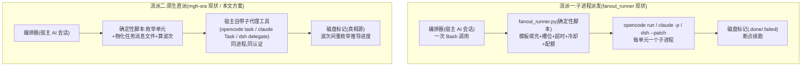

# fanout_runner 去留与「原生直派」可行性分析(2026-10-20)

> **受众:人类·仅研发仓**(维护者决策文档)。本文自包含:假定读者不了解 fanout_runner 的历史,
> 所有术语首现处给一句白话解释;词条版见 [docs/glossary.md](glossary.md)。
> 起因:`fix-mgh-sdr-fanout-auth-isolation`(凭证注入 + 数据目录隔离,已完成未归档)在企业内网
> 实跑仍有各种失败,鉴权体系比已知更复杂。本文回答三个问题:当初为什么要造 fanout_runner、
> 它今日承担什么、能不能改用「宿主原生子代理直派 + 规范化」来绕开鉴权问题。

> **⚠️ 深挖补篇(2026-10-20 晚,读本文结论前必读)**:本文的宿主能力前提基于 opencode v1.18.x;
> 同日稍晚的逐问题 5-why 深挖([docs/fanout-native-dispatch-5why-2026-10-20.md](fanout-native-dispatch-5why-2026-10-20.md))
> 基于 **opencode 2.1.0** 源码与本机实测,多项结论被强化或反转:①§5.3 的问题经 5-why 溯源后,
> 绝大多数不再「只能靠子进程形态」;②2.1 架构反转——TUI/CLI 全成 HTTP 客户端、核心住进常驻
> service,本机实测 `opencode run` 也连**同一个已登录 service**(pid 不变),给子进程形态判死刑
> 的「独立认证域」前提在 2.1 已不成立;③新增**插件派发通道**(进程内编程 create/prompt/wait/
> interrupt 子会话,零 LLM 波次回合的进程内等价物)与 **Python 直打 HTTP 通道**(fanout_runner
> 判定逻辑原样保留、只换传输层);④**紧急独立发现(已实测实锤):mgh 守卫插件 v1 具名导出形状
> 被 2.1 拒载**——企业升级 2.1 当天,opencode 面整条 R5.7 运行时防线静默失效,须独立先行迁移;
> ⑤新增 **P11:权限询问无人应答挂死**(子代理越项目目录 → 弹授权 → 无人值守 → 隔夜挂起),
> 本机已复现并验证三种处置;⑥**证据更正**:本文初稿的「sra/srr 三个月原生直派零事故」是伪
> 证据(近三个月只跑过 init/sdr,sra/srr 无执行记录),P4 已降级为「设计上可能、运行时未证」。
> 完整实测记录见
> [docs/opencode2-native-dispatch-verification-2026-10-20.md](opencode2-native-dispatch-verification-2026-10-20.md)。
> 本文 §4/§5/§6/§7 的部分判定以补篇为准。

---

## 0. 结论先行

1. **史实**:fanout_runner(确定性派发脚本,以子进程方式拉起 opencode/claude/dsh 的命令行跑扇出子任务)诞生于 2026-08-25。诞生**之前**的扇出形态恰恰就是「编排器用宿主原生 task 工具直派子代理」;当时被记录在案的失败是**每波边界烧编排器 token + 弱模型手写任务消息导致路径漂移**。**档案里没有把原生通道判为「不可用」的记录;但确实有原生通道失败的记录**(2026-07-03 簇数内省、07-07 盘符根漂移、08-13 越树读权限中断、08-17 单路径转述漂移、10-12 手派漫游中断)。准确说法是:**不是通道不可用,而是原生+裸奔不可靠**。选子进程脚本形态是为了把纯机械的派发循环从 LLM 回合里拿出来,当时的决策文档([docs/opencode-subagent-fanout-analysis.md](opencode-subagent-fanout-analysis.md)「实现路径对比」一节)明确把「纯提示词增强(保留原生直派)」列为可行路径 A,因弱模型漂移与 token 成本淘汰。
2. **今日职责三分**:fanout_runner 主规格 20 条 requirement 按成因分三类——**A 类**治「LLM 管派发」的病(任务消息漂移、波次 token、回执解析),**B 类**治「子进程形态自带的病」(进程树杀、失活检测、数据库锁、XDG 隔离、CAS 再登录、凭证注入、孤儿清理),**C 类**治「与环境有关、与形态无关」的病(限流风暴、配额节流、失败终态、断点续跑)。**B 类占其代码与加固史的大头**——即 runner 最难攒出来的那部分资产,相当比例是在给它自己的子进程形态擦屁股。
3. **鉴权判断**:企业 CAS(单次有效票据 + 本地回调端口独占 + 插件不读预设环境变量 + 验证码人工 + 无 token 有效期信息)对「N 个子进程各自持凭证」这条路的打击是结构性的。auth-isolation 变更把「必败」修成了「概率性可活」(设计修复与单测结论;**企业真仓 6 单元并发重跑尚未回**,见 §4.1 第 5 条),但仍留 13 项断裂点(归并为第 4 节的 8 个主题),且核心未知数(同一 token 高并发呈递是否被网关驱逐、过期表象是什么)只能靠现场试错收敛——**这条路不收敛,每修一层露一层**。而原生子代理与主会话**同进程/同 service 共享认证**,由「N 个子进程各自认证」派生的那一类问题消失(人工重登、令牌落地等非派生问题仍在)。
4. **可行性**:「原生直派 + 规范化」**在源码与设计上能**承接 runner 的 A 类职责(用确定性脚本物化任务消息 + 磁盘标记做真相源,构造性消除漂移,而非靠提示词护栏),**自动消灭** B 类,**保留 C 类的决策层**(配额算波次尺寸、失败标记终态、波次间确定性重枚举),代价是**失去 C 类的反应层**(单元级杀灭/超时/中途截断/槽位补位)与「零 LLM 波次」——波次边界回到编排器回合,但在企业配额(每 10 分钟 100 次调用 ≈ 每 window 约 10 个单元)面前,这点回合成本被配额等待淹没。**代码路径证据(非运行证据)**:`/mgh-sra`、`/mgh-srr` 的逐能力扇出在代码上确实由编排器原生直派、未接 runner;但近三个月没有 sra/srr 的执行记录(无 run 目录/报告/findings),维护者确认近期只实跑过 init 与 sdr——这只证明「原生形态已被设计采用」,不证明「生产在跑且可靠」。P4 的运行时可靠性仍待验证(详见补篇)。
5. **建议**:不做「全面废 runner」,做**双模派发**——runner 模式原样保留(非 CAS 环境、超大扇出场景仍是它强),新增 native 模式(确定性计划物化 + 壳直派纪律 + 环境画像选择),按环境画像选形态。决策点与优缺点对比见第 7 节。

---

## 1. 背景:一次扇出是怎么跑的,两个流派

**fan-out(扇出)**= 把大任务拆成许多独立子单元,每个单元交给一个**子代理**(有自己独立上下文窗口的子任务执行者)并行处理。比如 `/mgh-sdr` 把一次代码改动按接口分成 67 个评审单元,每单元一个子代理对照安全基线复查。

两个流派:



关键差别在**子任务进程与编排会话的关系**:runner 拉起的是独立操作系统进程,每个都要自己完成「我是谁、我用哪个模型网关、我怎么登录」;原生直派的子代理活在宿主进程里,编排会话怎么登录的它就怎么用,**认证天然继承**。

---

## 2. 史实:fanout_runner 是为什么、按什么问题清单造出来的

### 2.1 诞生前:原生直派时代的三次实锤失败(2026-07)

runner 之前的扇出 = 编排器(宿主 LLM)自己用原生 task 工具逐波手派:跑枚举脚本拿待办清单 → **亲手撰写** 5 个子任务的消息文本 → 同回合并发派发 → 看回执 → 重跑枚举 → 下一波。三次被 change 档案记录在案的失败:

| 日期 | 归档 change | 失败现象 |
| --- | --- | --- |
| 2026-07-03 | fix-mgh-init-cluster-fanout | 编排器手搓 `py -c` 内省 clusters.json,**对 wrapper 字典数错了簇数**(数了顶层键数 3,实际簇列表 360 项),偏题调试 |
| 2026-07-07 | harden-mgh-init-fanout-output-paths | 子任务把 checkpoint **写到 Windows 盘符根目录**;下划线目录名被弱模型概率性拼成分隔符对(`acme_wing` → `acme\wing`) |
| 2026-07-31 | improve-mgh-init-partial-fanout-tolerance | 单单元失败 → 完成数永小于总数 → 千单元级流水线**永久阻塞** |

前两次的修复(producer 物化绝对路径、提示词护栏)都只在契约层打补丁,创建 change 的 proposal 原文承认:这些「只治了输入的有界性与树内性,都没治『任务消息本身由弱模型逐次撰写』」。

### 2.2 决策点:2026-08-17 的四路径对比

[docs/opencode-subagent-fanout-analysis.md](opencode-subagent-fanout-analysis.md)(探索会话产物,runner 的直接出生证明)解剖 opencode 源码后列出四条路:

| 路径 | 机制 | 编排器 token/波 | 结论 |
| --- | --- | --- | --- |
| A. 纯提示词增强(= 保留原生直派) | 壳指示「每回合发 N 个 task 调用」 | ~1-3K | 淘汰:弱模型波次漂移(既有失败形状) |
| **D. 脚本 spawn CLI** | 确定性脚本线程池并发拉子进程 | **0** | **采纳** |
| B. 脚本驱动 serve HTTP API | urllib 打 HTTP 接口注入子任务 | 0 | 备选:运维面(端口/鉴权/API churn) |
| C. 插件注入 subtask parts | 插件 hook 注入 | 0 | 出局:该通道**天然串行**(源码核实) |

三个要点:

- **原生 task 通道本身被源码级核实是好的**:同一条 assistant 消息里的多个 task 工具调用**并发执行**、子会话独立上下文、权限继承合并。淘汰它的理由是**质量与成本**(波次边界必经一次编排器 LLM 回合;任务消息由弱模型自由文本撰写会概率性拼错路径),不是功能不可用。
- 路径 D 当时的风险清单是「进程 spawn 开销 1-2 秒/批 + 并发多进程 SQLite 锁需 spike」;**认证当时被一句「auth 走盘上 auth.json」带过**——在个人/消费级环境这成立,在企业 CAS 环境这正是后来断裂的承重假设(第 4 节)。
- claude 侧当时做过双路 spike:项目级 agent 定义**经 Task 子代理自然拾取实证可行**,最终选 inline JSON 子进程只是因为「等价性更直接」——再次佐证原生通道从来不是死路。

### 2.3 诞生后:多次加固时间线(每次都是新失败形状)

| 日期 | change | 加的能力 | 治的病 |
| --- | --- | --- | --- |
| 08-25 | add-mgh-init-scout-fanout-runner(+2) | runner 本体:模板填充/宿主探测/回执状态机/resume/软时限/三级超时 | 2.1 的三类失败 + 首跑 15 分钟零输出被宿主 900 秒硬杀循环 |
| 09-01 | improve-…-lifecycle | liveness 登记 + kill-stale + stderr 心跳 | 会话中断后子进程树不死继续烧 token、双跑互覆 checkpoint |
| 09-14 | harden-…-stall-containment | 槽位补位 + 失活检测 + 进程树杀 + 运行留痕 | T1 实测连续卡死 1 个子代理全员陪等;内网 SSE 流停摆 = 子进程**永久挂死**(opencode 源码 `timeout:false`);Windows 杀进程只杀到 shim 层留孤儿 |
| 09-17 | harden-…-crash-storm-resilience(+2) | 快败冷却 + 限流风暴截断 + 有界退避 + 失败终态有界重派 | 配额网关 429 快败风暴(秒级失败零延迟回队);静默误杀(排队被当卡死,盲阈值两难);Linux 树杀自杀 |
| 09-23 | add-mgh-dsh-subagent-fanout | dsh 第三宿主形(MGH_TASK_TEXT env 注入) | dsh 无头面无 stdin 任务通道 |
| 10-12 | harden-…-scout-merge-dispatch | 第六 tier scout-merge + 预算收紧 | 265KB 分片撑爆 150K 窗口;最后一个手派节点实测「翻全局目录→向人弹权限→无人值守中断」 |
| 10-13 | fix-…-recovery / dispatcher-hygiene | wmic→CIM 回退/树杀校验/投毒拒识/卫生修 | Win11 删 wmic 假成功;退避自旋 100% CPU;路径投毒响应竟是执行投毒 |
| 未归档 | fix-…-quota-adaptive-fanout | 配额准入三 flag + 窗口重置冷却 + 96KB 默认 | 真仓 67 单元 × 每单元 5-10 次调用,并发 5 瞬间打穿 100 次/10 分钟配额 |
| 未归档 | fix-…-auth-isolation | --cred-file 静态凭证注入 + --isolate-data 每单元 XDG 数据目录 | 企业 CAS:每个子进程自己弹浏览器登录,票据一次有效 + 回调端口互抢,**6 单元只活 1**;并发子进程共用数据目录踩 `database is locked` |

### 2.4 史实修正(对「能不能不加」最重要的一条)

**没有任何档案把原生通道记为「不可用」,也没有档案把「通道不可用」列为造 runner 的直接原因;但档案确有原生直派失败的记载**(见 §2.1 与 2026-08-13 越树读权限中断、2026-08-17 单路径转述漂移、2026-10-12 手派漫游中断)。造 runner 的三个史实理由全部是经济性与可靠性:

1. **token 经济**:波次边界零 LLM 回合(大仓 scout 层可达数百上千批,每波省 1-3K);
2. **构造性可靠**:任务消息由「固定模板 + 枚举脚本 stdout 逐字填充」生成,把弱模型手写路径的失败从构造上消除;
3. **宿主无免 LLM 的批量派发面,但 CLI 有**:源码确认子代理创建不需要 LLM 参与,于是把「拉起子代理」这一步换成确定性脚本。

同时注意一个反向事实:**runner 后来最重的那些加固(树杀/失活/孤儿/凭证/隔离),治的全是子进程形态自己的病**——这些病在原生直派下结构性不存在。

---

## 3. fanout_runner 今日承担的完整职责(20 条 requirement 三分)

主规格 [openspec/specs/fanout-dispatch/spec.md](../openspec/specs/fanout-dispatch/spec.md) 共 20 条 requirement / 107 个 scenario。按「病因」三分(这是本文分析的主轴):

### A 类:治「LLM 管派发」的病 —— 原生模式下必须由规范化等价承接

| Requirement(白话) | 病因 | native 模式下的等价物(见第 6 节设计) |
| --- | --- | --- |
| 任务消息由固定模板 + 逐字字段填充构造 | 弱模型手写消息 → 格式不一/盘符根漂移/下划线幻觉/跨目录漫游 | **保留**:同样的模板引擎改跑在「计划物化」脚本里,任务消息落成文件,编排器逐字中继文件路径,弱模型仍然零撰写 |
| 波次循环零 LLM 驱动(token 经济) | 每波 1-3K 编排器回合 | **降级但受限**:回到每波一次编排器回合;企业配额下波次本身被配额节流,回合成本占比小;超大扇出场景保留 runner 模式 |
| 回执(ack)状态机解析 | 弱模型回执文本不可靠 | **升级为不解析**:磁盘标记是唯一真相源(本来已是),波次间用确定性脚本重枚举推导状态,编排器连回执都不用读 |
| 零推进收敛熔断 | 同集单元确定性反复挂死/身份漂移 | **决策层保留**:波次间重枚举连续零进展 → 计划器报停滞并披露 |
| 失败终态 + 有界重派 | 模型礼貌回 failed 造成覆盖洞 | **保留**:.failed 终态语义不变(改由子任务自写,见 D3);至多一轮重派纪律写进壳 |
| agent 定义与 stage 提示词镜像 | 一面立法一面违法 | **保留**:三面镜像纪律原样延伸到原生 agent 定义 |

### B 类:治「子进程形态自带的病」 —— native 模式下整类消失

| Requirement / 机制 | 在 runner 里治的病 | native 下为何消失 |
| --- | --- | --- |
| 宿主 CLI 探测 + headless spawn 映射(argv/.cmd shim/PWD 剥离/dsh 预检) | 三家 CLI 方言与 Windows shim 截断 | 不再有子进程;宿主自己的子代理工具就是原生面 |
| liveness 登记 + kill-stale 孤儿清理 | 会话死后子进程树继续烧 token | 无子进程;子代理生命周期即宿主会话生命周期 |
| 失活检测(字节级静默)+ 进程树杀 + 假杀自证宽限 | SSE 流停摆永久挂死(`timeout:false`)、杀进程留孤儿、误杀排队单元 | **病根消失大半**:挂死主因(登录/子进程网络栈/数据库锁)不在了;残余挂死见第 5.3 节诚实清单 |
| 每单元 XDG 数据目录隔离 | 并发子进程共用 opencode 数据目录 → `database is locked`/EPERM | 同进程内子会话由宿主自己串行化管理 |
| --cred-file 静态凭证注入 + 子配置目录物化 + 凭证过期分类 | CAS 子进程自登录互杀(6 单元只活 1) | 同进程同认证,凭证问题整类不存在 |
| 无问询钉扎(headless 权限显式 deny) | 子进程弹权限问询无人应答永挂 | 子代理继承运行域守卫与哨兵机制(R5.7 原样) |
| stderr 心跳(TUI 可见) | Bash 工具长跑零输出难辨慢/死 | 进度面改为波次间查询脚本输出 + 既有 sidecar |

### C 类:治「环境的病」,与形态无关 —— 决策层保留,反应层降级

| Requirement / 机制 | native 模式下的去向 |
| --- | --- |
| 槽位补位(挂死只占自己的坑) | **降级为波次屏障**:一次派 N 个、全收完再派下一批(理由与代价见 5.3/D4) |
| 快败冷却(2 分钟窗口 ≥3 次秒败 → 暂停) | 决策层保留(波次间计数),反应层从「进程内暂停」降级为「计划器指示等窗口」 |
| 限流风暴截断(连续全限流特征 → 立即停) | 同上:特征来自失败标记的 reason 字段(子任务自写),波次间判定 |
| 配额准入估算(窗内×K+K≤N 步进) | **完整保留**:同样的纯函数算术,用于计划器的波次尺寸与等待指示 |
| 磁盘标记真相源 / resume / 软时限 partial / stdout 契约 | **完整保留**:枚举、标记、重派生、--check 全部原样,只是消费方从 runner 主循环换成「计划器 + 编排器波次循环」 |
| 四级超时不变式(内层先于外层触发) | 思想保留:native 的「外层」= 宿主会话本身与人工监督,无进程可杀(诚实边界) |

---

## 4. 企业 CAS 现实:为什么子进程扇出的鉴权修不干净

### 4.1 鉴权体系五条硬事实(私档记载)

来源:[docs/enterprise-environment.md](enterprise-environment.md) 与根目录 `mgh-special-auth.md`(均不入 git,维护者私档):

1. **CAS 单次票据 + 回调端口独占**:opencode/dsh 启动时企业插件弹浏览器走 CAS 登录(验证码人工),票据一次有效,本地 127.0.0.1 回调端口独占——N 个子进程各自走登录闭环**结构性必败**(最先一个收敛,其余 300 秒零输出转停滞;降并发到 2 无改善已实测)。
2. **插件不读预设环境变量**:预先设好 token 再启动,插件仍自走登录(私档以 NEVER 标注的事实)。
3. **token 载体平台分裂**:Windows 只写登录进程的环境变量(内存、子进程可继承);Linux 落盘全机唯一文件。全局配置里的 apikey 是占位符。
4. **无有效期(TTL)信息**:两份私档均无 token 寿命数值,只知「长时间登录后服务端可能强制重登」;无主动校验手段。
5. **网关配额**:每 10 分钟 100 次调用;同 token 多进程高并发呈递**是否触发服务端驱逐,正反证据皆无**(全部验证只到单单元,6 单元并发重跑在企业侧交接未回)。

### 4.2 auth-isolation 变更修好了什么、还剩什么

修好的(结构性必败 → 概率性可活):一次性取证(credential center 三模式,收敛 N 路登录为一次)+ 每单元 XDG 隔离(数据库锁消失)+ dry-run 真零写 + 过期特征快停。

剩余断裂点(变更文档自认 + 缺口分析,归并为 8 主题):

| # | 主题 | 后果 |
| --- | --- | --- |
| 1 | 同 token 高并发呈递未验证 | 若网关按会话限并发,表象是限流/静默拒绝而非 401,被配额/冷却机制吸收,**永远诊断不到凭证头上** |
| 2 | 过期表象未知(特征集未实测校准) | 若失效表现为 302 跳登录页或不含 401 字样,扫描漏报 → 每单元烧满失活超时 |
| 3 | 裸 `401` 子串误报 | 任何输出尾部出现 401(行号/字节数/ID)→ 全 run 暂停要人工重取证,高频假警报 |
| 4 | 陈旧 token 零拦截(inherit 模式) | 宿主被强制重登后 env 里是死 token,第一波全灭才收口,一次烧光整个配额窗口 |
| 5 | 重取证必有人(验证码人工 + 回调端口恰在最需要时被占) | 夜间多分支 sweep 中途过期 = 停摆等人 |
| 6 | login-process 全局配置变异窗口 | 窗口期无辜 opencode 进程加载探针插件被 `exit(0)` 自杀 |
| 7 | token 明文两处落地,Windows ACL 无处理 | 银行环境暴露面;长期驻留的 run 目录是风险点 |
| 8 | dsh 形整条不通 + 三目录(state/cache/bin)仍全局 | dsh 宿主扇出无解;残余争用表象会误导排查方向 |

### 4.3 判断:这条路不收敛

这 8 个主题的收敛方式并不完全相同:多数(并发驱逐、过期表象、TTL、dsh 注入)确实只能靠企业现场
试错收敛;裸 401 误报、ACL、配置变异窗口是工程修复,不属于「只能试错」。对比原生直派:**凡由
「N 个子进程各自认证」派生的断裂点(1/2/3/4/6 等)在原生形态下不再存在;但 #5 人工重登、
#7 令牌落地、#8 dsh 面仍需单独处理**——「全部不存在」只对子进程认证派生类成立。且该判断基于
opencode 1.18 的独立认证域;本机 2.1 实测 `run` 连同一 service,企业环境需按补篇 §5.7 重审。
这就是环境变化导致的决策前提翻转——2026-08 选子进程形态时,「认证走盘上 auth.json」成立;
今天在这个企业环境,它不成立。

---

## 5. 客观分析:能不能不用 runner

### 5.1 三宿主原生派发能力盘点

| 维度 | opencode | claude code | dsh(deepseek-harness) |
| --- | --- | --- | --- |
| 原生机制 | `task` 工具按名选 agent 定义(.opencode/agent/*.md),创建独立子会话 | Task 工具 subagent_type 选 .claude/agents/ 定义【常识,需实测】 | 最完整:具名 delegate 工具(spawn-in-process 后端)+ persona + 工具白名单 + maxDepth |
| 并行 | **已源码核实**:同一条 assistant 消息多个 task 调用并发执行 | 同消息多 Task 并行【常识,需实测】 | 一轮内工具调用并发执行(机制文档明确);另有后台 job 形态 |
| 父会话控制 | 前台等完成;**无中途杀/超时**(实验性后台子代理不做人依赖) | 无 per-task 超时;用户可打断整轮 | **有**:`job_kill` 杀后台 job / AbortSignal 取消 / `interrupt_agent` |
| 认证继承 | 同进程共享客户端认证 | 同进程 | spawn-in-process「共享本进程的 LLM 服务与工具服务」(官方文档原文) |
| 已知失败模式 | 子进程路线的 DB 锁/挂死与其无关;原生面**有**失败记载:08-13 越树读权限中断、08-17 单路径转述漂移、10-12 手派漫游弹权限中断 | 有记载但不同形:08-17 双宿主、08-05 claude 权限询问中断 resume;没有 Task 并行不可用的记载 | 原生 spawn 后端未被 mgh 大扇出用过,扇出规模未验 |

### 5.2 逐类对照结论(承接第 3 节三分法)

- **A 类(LLM 管派发的病)——规范化能治,且是构造性治**:runner 当年治这类病的手段(固定模板、枚举脚本供路径、磁盘标记)全部与「子进程」无关,把它们搬进「计划物化脚本 + 壳直派纪律」即可。用户设想的「模板化固定子代理提示词派发」正是这个:**任务消息由确定性脚本生成落盘,编排器逐字中继文件路径,弱模型零撰写**。「固定 3~5 并发」= 波次屏障尺寸,写进环境画像,壳纪律引用之。
- **B 类(子进程形态的病)——直接消失**:不需要等价物,见第 3 节 B 表。这是净收益最大的一块,而且覆盖当前企业 CAS 实跑中**已归因于子进程形态**的那部分故障源(CAS 互杀、数据库锁、孤儿进程、凭证明文);launcher/编排器层的失败(探针语义、报告认领、PWD、错误信封、守卫误伤)不会因换形态自动消失。
- **C 类(环境的病)——决策层保留、反应层降级**:配额算术、失败终态、重枚举、resume 原样保留在确定性脚本里;失去的是「进程内即时反应」(中途截断、即时冷却、单元级杀灭),退化为「波次边界反应」。在配额 100 次/10 分钟的环境里,波次边界本来就频繁(每 window 约 10 个单元),反应延迟的代价有限。

### 5.3 诚实清单:native 模式真正失去什么

1. **单元级杀灭与超时**(opencode/claude):2.1 有 `POST /api/session/:id/interrupt`,可以中止
   指定子会话(本机实测对 pending ask 有效),但粒度是整会话、不是进程树杀;shell 孙进程/
   MCP/插件子进程可能泄漏(补篇 P1)。缓解:波次小(3-5)+ 常驻看门狗;挂死无标记 → 重枚举
   后重派。**无人值守长跑的自愈能力仍低于 runner**,但挂死主因(登录/锁/孤儿)在原生形态下
   已消失。注意:runner 的失活杀灭在企业网关上本来就两难(误杀排队单元的教训史),实际收益
   要打折。
2. **零 LLM 波次**:每波一次编排器回合。缓解:每回合动作被压到最小(读计划器输出 → 逐字派
   N 个任务 → 等完),子任务只回单行回执,父上下文每波增长约 0.6–1.1K token(补篇算术);
   进度由磁盘重派生,compaction 不损进度(R5.4 机制本来如此)。但 init scout 级(数百上千批)
   的非企业大仓场景,runner 模式的 token 优势仍然成立——所以不全面替换;CAS 环境的 init 级
   正解是插件通道 B(零 LLM 波次)。
3. **槽位补位**:波次屏障下一个慢单元拖住全波。缓解:配额环境下波内单元本就被同一 window 节流,同质化程度高,快慢差有限;dsh 后续可用后台 job 做真补位。
4. **限流风暴的即时截断**:从「秒级停派」退化为「波次边界判定 + 等窗指示」。缓解:波次尺寸本身按配额算出,打穿配额的概率先被计划层压低。
5. **跨宿主统一性**:三宿主原生机制不同(opencode task / claude Task / dsh delegate),壳纪律要三面镜像维护。缓解:agent 定义与标记契约共享,镜像纪律已有 R5.1/克隆对账测试先例。
6. **新引入的风险(需实测)**:①弱模型对「一回合发 N 个 task 调用」的忠实度(N=3 起步);
   ②子会话的工具调用是否同样过 `tool.execute.before` 守卫插件——**本机已实测成立**(主会话与
   两个子会话的 read 都触发同一钩子),但迁移后的守卫插件是否真的拦住越树写/读仍需实测;
   ③opencode 子代理深度锁默认 1 对「编排器→子代理」无碍(单层),但需确认部署面;
   ④**P11 权限询问挂死**必须显式关闭(见补篇),否则无人值守会挂到隔夜。

### 5.4 代码路径证据与反例对冲(原「存在性证明」已更正)

- **代码路径证据(不是运行可靠性证据)**:`/mgh-sra` 的 a3 与 `/mgh-srr` 的同引擎扇出在
  代码上确实采用编排器原生直派(未接 runner),通道与任务模板均已落地;但仓内**没有**
  2026-07-20 之后的 sra/srr 运行记录(无 run 目录/报告/findings,CHANGELOG 无实跑记载),
  维护者确认近期只实跑过 init 与 sdr。故只能证明「原生形态被设计采用」,不能证明「生产在跑、
  无人值守可用性可接受」;原「三个月零事故」是分母为零的观察。
- **运行反例**:2026-07-07 盘符根漂移、2026-08-17 编排器把 `checkpoint_path` 拼成盘符根
  (单路径转述也会漂)、2026-10-12 手派 scout-merge 漫游到全局目录弹权限中断。这些是原生
  形态的真实失败记录,说明「裸奔原生」不可靠。
- **规模对冲**:sra/srr 的扇出规模**估计**为逐能力十几个单元(无运行记录,档案未记 capability
  数),小于 sdr(约 67 单元)更小于 init scout(数百至上千);「原生可行」不等于「全场景原生
  最优」——这是设计判断,不是实测排序。双模结论仍然成立:sdr 在 CAS 环境选 native,init 超大
  扇出在非 CAS 环境保留 runner(或走插件通道 B)。

### 5.5 「能不能不加」的三段式答案

1. **当初能不能不加?** 源码层面能(通道并发与 agent 选择已核实,且 sra 的代码路径没接
   runner);但「sra 没加」只证明存在另一条设计选择,不证明该选择在运行中可靠。历史上的原生
   失败(07 月路径漂移、08 月单路径漂移、10 月手派漫游)说明裸奔不可靠,所以当时不加 runner
   的前提是「原生 + 规范化」,而不是「裸奔原生」。
2. **现在能不能不用?** 在 CAS 企业环境:能,且应该。A 类病如今可用「确定性计划物化 + 壳纪律」构造性治(这套资产正是 runner 时代攒下的,形态无关);B 类病消失;C 类决策层保留。鉴权问题从「修不干净」变成「不存在」。
3. **能不能全面废掉?** 不建议。非 CAS 环境、超大扇出、需要单元级杀灭与零 LLM 波次的场景,runner 仍是更优解。**双模并存,按环境画像选择**。

---

## 6. 方案设计:双模派发(runner 保留 + native 新增)

### 6.1 总架构

```mermaid
flowchart TB
    EP["环境画像<br/><项目>/.mgh/env-profile.json<br/>(dispatch_mode / 并发 / 配额)"] --> SEL{形态选择}
    SEL -->|runner 模式<br/>(默认,行为零变化)| RU["fanout_runner.py 现状全保留<br/>含 quota/cred-file/isolate-data"]
    SEL -->|native 模式<br/>(CAS/继承认证环境)| PL["① 计划物化(确定性,零 spawn)<br/>fanout_runner.py --emit-native-plan<br/>复用 TIERS/模板/锚校验/配额算术<br/>产出: 每单元 <unit>.task.md + native_plan.json"]
    PL --> ORCH["② 编排器波次循环(壳纪律段)<br/>读计划 → 同回合并发派 N 个原生子代理<br/>任务=「逐字执行 <task.md 绝对路径>」"]
    ORCH --> SUB["③ 原生子代理<br/>opencode task / claude Task / dsh delegate<br/>按 tier 选用原生 agent 定义"]
    SUB --> MK["④ 磁盘标记自写<br/>.done / .failed(reason 进标记体)"]
    MK --> Q["⑤ 波次间确定性重枚举<br/>(既有 list_* / resume 脚本)<br/>下一波 / 完成 / 失败 / 等窗指示"]
    Q -->|还有待办| ORCH
```

### 6.2 组件一:环境画像(env profile)

新文件 `<项目>/.mgh/env-profile.json`(与既有 read-roots.json 同目录同风格:手工可编辑、缺文件=零变化、坏 JSON=fail-closed):

```json
{"v":1, "dispatch_mode":"auto", "native_concurrency":3,
 "quota":{"calls":100,"window_s":600,"calls_per_unit":10}}
```

- `dispatch_mode ∈ {auto, runner, native}`;`auto` 策略:安装树存在 special-auth 私档(即企业定制环境)→ native,否则 runner。**默认不写此文件 = 全部行为与今天逐字节一致**(零回归承诺)。
- 消费方:各命令壳 step 0(选择调 fanout_runner 还是走 native 计划)、计划物化脚本(并发与配额参数单源)、resume 脚本(下一步指引随形态)。
- 用户说的「用户环境画像说明」落在两层:机器可读的这份 JSON + 私档里的人话环境说明(已有,不进 git)。

### 6.3 组件二:确定性计划物化(runner 的形态无关资产复用)

`fanout_runner.py` 增加 `--emit-native-plan`(或独立薄入口复用其函数):

- 跑**与 runner 模式完全相同**的路径:tier 枚举器 → pending 清单 → 模板加载 → `_fill_template` 逐字填充 → 路径锚树校验 → 配额算术(纯函数 `_quota_admission` 原样)→ 波次划分(尺寸 = min(native_concurrency, 配额算术结果))。
- 产出:每单元任务消息文件 `<run>/inputs/<unit>.task.md`(runner 的审计副本机制**本来就在写这个文件**,3210-3215 行,等于零新逻辑)+ `native_plan.json`(波次表:每波的单元 id、task 文件绝对路径、agent 名、预期标记路径)+ stdout 一行摘要。
- **零 spawn、零凭证、零子进程环境**——runner 里所有 B 类机制不进入此路径。
- 这就是「模板化固定子代理提示词」的落点:**由构造保证**,弱模型零撰写。

### 6.4 组件三:壳的直派纪律段(「对子代理的规范化要求」)

三面壳镜像新增一段(措辞按 R5.5 recipe 化),核心纪律:

1. **波次循环**:读计划器/重枚举输出 → 取当前波 N 个单元 → **同一条消息**发出 N 个子代理调用(opencode task / claude Task / dsh delegate)→ 等全部返回 → 跑重枚举 → 重复。**NEVER** 跨波合并、NEVER 自增并发、NEVER 自己拼任务文本。
2. **任务体逐字中继**:每个子代理调用的任务文本 = 固定一句话「读取并逐字执行 <task.md 绝对路径>;完成后只回单行回执」。路径来自计划器 stdout,逐字透传(承接 R5.3b 扇出路径契约)。
3. **回执与标记**:子代理成功 touch `.done`、失败**自写** `.failed`(reason 进标记体)——磁盘是唯一真相源,编排器**不解析**子代理回执文本,只把它当人面回显。
4. **失败处置**:波次间重枚举发现失败单元 → 至多一轮重派(重枚举输出带 retry 指示)→ 再失败接受缺口并披露(与 runner 的 retry-failed 纪律同构)。
5. **限流/配额**:重枚举输出若带「等窗指示」(连续全败且 reason 含限流特征、按配额算术算出恢复时刻),编排器按指示等待后重查询;诚实边界:这是 advisory,弱模型不听话的残余风险由人工监督兜底。
6. **停滞披露**:连续两波零磁盘进展 → 重枚举报停滞,编排器如实上报并停(等价零进展熔断的决策层)。

### 6.5 组件四:原生 agent 定义(三面镜像)

- opencode:每 tier 增 `mode: subagent` 的原生孪生定义(现有 fanout 孪生是 `mode: primary + hidden`,那是给 `opencode run --agent` 子进程用的;原生 task 通道需要 subagent 形态)。正文与现有孪生共享 stage 提示词(克隆对账测试扩面)。
- claude:`.claude/agents/` 定义本就是 Task 形态,直接复用/微调。
- dsh:`gen_dsh_tiers.py` 已能把 `kind: delegate` 编译成具名 delegate 工具(sast/sra 单元步在用)——给 fanout tier 补 delegate 编译即可,dsh 面结构改动最小。

### 6.6 C 类病的 native 等价物小结

| runner 机制 | native 等价物 | 落点 |
| --- | --- | --- |
| 配额准入步进 | 计划器波次尺寸 + 等窗指示 | 计划物化脚本 |
| 失败终态不自堵 | 子任务自写 .failed | 任务模板增一条义务 |
| 限流风暴截断 | 波次间判定(失败标记 reason 聚类) | 重枚举/查询脚本 |
| 零进展熔断 | 连续两波零进展 → 报停滞停派 | 重枚举/查询脚本 |
| retry-failed | 重枚举输出带至多一轮重派指示 | 查询脚本 + 壳纪律 |
| resume/partial | 磁盘标记重派生,原样 | 既有 list_*/resume 脚本 |

### 6.7 守卫、遥测与安装连续性

- **守卫(R5.7)**:原生子代理与编排器同 service,`tool.execute.before` 插件对其工具调用同样
  触发——**本机已实测**(主会话与两个子会话的 read 都触发同一钩子,子会话 ID/agent 可见);
  磁盘哨兵照写(write_runconfig 副作用/launcher step 0),激活路径与今天一致。但
  **2.1 的守卫插件必须先迁移**:v1 具名导出已被 2.1 日志实锤拒载(fail-soft,仅 WARN),
  不迁移就等于没有守卫;且仓内已有原生子代理越树读/漫游触发权限询问的记录
  (2026-08-13/08-17/10-12),native 模式必须把「迁移后的守卫对每个原生子代理工具调用真正
  生效」列为实跑闸门,不能只凭钩子触发就写「不降级」。
- **遥测**:埋点在启动路径确定性脚本内,与派发形态无关,零改动。
- **安装**:env-profile 不随 install 分发(目标项目侧文件);原生 agent 定义与 task 模板随三面安装走;install 自检清单相应扩展。

### 6.8 实测验证清单(先证后扩,全部过再扩范围)

1. opencode:一条消息 3 个 task 调用真并发;子会话工具调用过守卫插件;子会话认证继承(CAS 环境不出登录弹窗)。
2. claude:Task 并行度与 subagent_type 拾取;PreToolUse 对子代理工具调用的拦截。
3. dsh:delegate 工具一轮多调用的实际并发;job_kill 树杀完整性。
4. 弱模型忠实度:隔离小仓跑 sdr native 全链(计划物化 → 3 并发直派 → 标记 → 重枚举 → 报告),对照 runner 模式产物一致性。
5. 故障注入:单单元失败/全波限流特征/挂死(人工打断后 resume),验证 .failed 自写、等窗指示、零进展披露。
6. 企业真仓:CAS 环境 6 单元对照实跑(原失败场景),验证认证继承与零凭证依赖。

### 6.9 与既有在途 change 的关系

| 在途 change | 处置建议 |
| --- | --- |
| fix-mgh-sdr-fanout-auth-isolation(已完成未归档) | **照常归档**。它修的是 runner 模式的真实失败,runner 模式保留则其资产保留;在 CAS 环境改走 native 后,它的消费面自然收缩,不是浪费 |
| fix-mgh-sdr-quota-adaptive-fanout(已完成未归档) | **照常归档**。其配额算术(纯函数)正是 native 计划器复用的同一份代码 |
| adopt-mgh-shared-fanout-dispatcher(提案阶段) | **清点判据升级**:从「接入/不接入 runner」二选一,升级为「按命令 × 按环境选 runner / native / 不接入」;其第 1 步清点交付物直接吸收本分析结论 |

---

## 7. 决策点(待拍板,优缺点对比)

### D1 总路线

| 选项 | 优点 | 缺点 |
| --- | --- | --- |
| **双模并存(推荐)** | CAS 环境立刻止血;runner 资产保留;按环境/命令灵活;零回归承诺容易守 | 两套派发面并存,壳纪律与测试面翻倍;三宿主原生差异要各自维护 |
| 全面转 native | 单一形态,维护面最小;鉴权/锁/孤儿问题全消失 | init 级超大扇出退化(token 经济/杀灭);丢弃 runner 时代最硬的加固资产;风险一次暴露 |
| 维持 runner + 继续修鉴权 | 不动架构 | 第 4 节已论证不收敛;每修一层露一层,且 dsh 形无解 |

### D2 native 的默认策略

| 选项 | 优点 | 缺点 |
| --- | --- | --- |
| **auto:special-auth 在场→native(推荐)** | 企业环境零配置正确 | 隐式切换,行为可惊讶;需在壳与报告里显著披露当前形态 |
| 显式 opt-in(dispatch_mode:native 才生效) | 完全显式,无惊讶 | 企业用户要多做一步配置,漏配则继续撞 CAS 墙 |

### D3 .failed 标记谁写

| 选项 | 优点 | 缺点 |
| --- | --- | --- |
| **子任务自写(推荐)** | 磁盘真相源闭环,编排器零解析;与 runner 语义同构 | 任务模板加一条义务,子代理不写时退化为「无标记=待重派」(可接受,重枚举兜底) |
| 编排器代写 | 模板不加义务 | 弱模型解析回执文本 = 复活 2026-07 的病;**不推荐** |

### D4 波次形态

| 选项 | 优点 | 缺点 |
| --- | --- | --- |
| **波次屏障 N=3(推荐,可配 3-5)** | 弱模型忠实度最高(一回合固定 N 个调用);爆炸半径有界;实现最简 | 慢单元拖全波(配额环境下波内同质性高,代价有限) |
| 仿槽位补位 | 吞吐最优 | 原生面无「完成即补位」的调度钩子,只能靠编排器自管在飞表 = 弱模型高风险;**不推荐**(dsh 后台 job 可作后续增强) |

### D5 首发范围

| 选项 | 理由 |
| --- | --- |
| **mgh-sdr 先行(推荐)** | 当前痛点所在;单元量级(数十)适配波次屏障;企业主力场景 |
| 六域齐上 | 一次到位 | 暴露面过大,与「先证后扩」相悖 |

### D6 未归档两 change 的归档节奏

建议:auth-isolation 与 quota-adaptive 按其既有验收结论照常归档(它们各自真实兑现了 runner 模式的修复);本分析的落地另立新 change(候选名 `add-mgh-dual-mode-dispatch` 或 `add-mgh-native-dispatch`),不倒灌改写已完成的两个。

### D7 守卫插件 2.1 迁移(新增,紧急)

**建议立即立项,独立于扇出转向。** 2.1 已实测拒载 v1 具名导出(日志实锤);不迁移则升级
2.1 当天 opencode 面守卫静默失效(fail-soft 仅 WARN)。

### D8 `opencode run` 共享 service 复核(新增)

**本机已预确认**:`opencode2 run` 前后 service pid 不变,新会话出现在同一服务里——2.1 上
「子进程=独立认证域」的前提已不成立。企业环境仍建议实测一次:它决定旧 runner 能否作为
native 模式的兜底复活,以及双模天平是否需要重算。

---

## 8. 风险与诚实边界(预登记,进壳与报告)

1. native 模式**无单元级杀灭/超时**(opencode/claude):真挂死需人工打断 + resume;无人值守长跑韧性低于 runner——以「挂死主因(登录/锁/孤儿)已消失」对冲,但不敢称等价。
2. 限流处置是 **advisory**(波次边界判定 + 等窗指示),弱模型不遵从的残余风险由人工监督兜底。
3. 三宿主原生面差异(opencode task / claude Task / dsh delegate)带来**镜像维护成本**;claude 面并行度与守卫拦截属常识推论,**实测前不写进承诺**。
4. 波次边界回归编排器回合:父上下文每波增长(单行回执纪律压到数百 token/波),超大扇出场景**明确不推荐 native**(env-profile 引导回 runner)。
5. opencode 子会话深度锁默认 1:单层「编排器→子代理」无碍,但意味着 native 子代理**不能再嵌套派发**(与现状 runner 子进程语义一致,非退化)。
6. 环境画像 auto 判据(special-auth 在场)是**启发式**:非 CAS 用户误放该文件会被切到 native——以披露与显式覆盖(dispatch_mode 显式值)兜底。

---

## 9. 后续步骤建议

1. 维护者拍板 D1-D8(本文第 7 节);**D7(守卫迁移)建议先行,D8 企业复核可与 propose 并行**。
2. 按选定路线开 openspec change(propose 会话):能力面 = fanout-dispatch 增「native 派发形」
   requirement 族 + 各命令接入判据升级;sdr 首发范围;实测验证清单(6.8)进 tasks 作为闸门
   任务;P11 权限闸门与看门狗作为独立前置项。
3. 与 adopt-mgh-shared-fanout-dispatcher 的清点交付物合并推进,避免两份重叠清点。
4. 企业侧先跑 6.8 第 6 条(CAS 真仓 6 单元对照)——这一条通过,「鉴权问题不存在」的核心论断即闭环。
