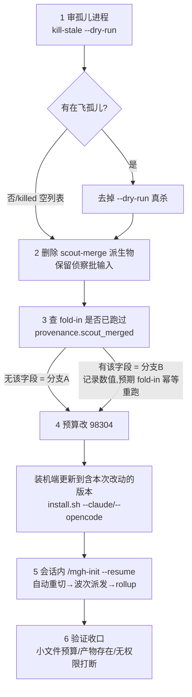

# 存量现场 re-entry 执行手册(Linux · 无 root · `/mgh-init` scout-merge 重切)

适用:某台 Linux 机器上有一个跑到一半停住的 `/mgh-init` 现场(目标仓 `<TARGET>` 下的
`.mgh-init/` 目录),要按新的 96KB 聚合预算把「侦察结果合并」这一步(scout-merge)退回
切分点重来。全程只用普通用户权限;不删任何已烧过 token 的侦察批产物。

先明确三个路径变量(后文直接使用):

```bash
TARGET=/abs/path/to/被扫描项目          # 目标仓根
INSTALL=/abs/path/to/被扫描项目         # mgh 装机落在此根的 .claude/ 或 .opencode/ 下
# 确定性脚本目录(三选一,按装机宿主):
SCRIPTS=$INSTALL/.claude/mgh-core/scripts     # claude 端
# SCRIPTS=$INSTALL/.opencode/mgh-core/scripts # opencode 端
# SCRIPTS=$INSTALL/mgh-core/scripts           # dsh 端
```

Python 命令:下文统一写 `python3`;若你的环境提供 `py` 别名,替换即可。

## 流程总览



## 步骤 1 — 审孤儿(无在飞进程则整步跳过)

上一次运行可能被宿主硬杀,留下仍在烧 token 的派发器/子进程。先**只审不杀**:

```bash
python3 "$SCRIPTS/fanout_runner.py" --kill-stale --dry-run \
  --checkpoints "$TARGET/.mgh-init/checkpoints/scout"
```

看 stdout JSON 的 `killed` 数组:
- `"killed": []` → 无孤儿,直接下一步;
- 非空 → 确认列出的 PID 确属本次现场后,去掉 `--dry-run` 重跑同一命令真杀。

## 步骤 2 — 删除 scout-merge 派生物(逐条执行)

只删「合并这一步的中间产物」;**保留** `checkpoints/scout/<batch>.json` 及其 `.done`
——侦察批产物是本次重跑的输入,删了就要重烧几百次 subagent 的 token。

```bash
rm -rf  "$TARGET/.mgh-init/inputs/scout-merge"        # 物化的 shard 输入(大 .input.json + .task.md 审计拷贝)
rm -rf  "$TARGET/.mgh-init/checkpoints/scout/shards"  # shard 摘要 checkpoint 与 .done/.failed marker
rm -f   "$TARGET/.mgh-init/checkpoints/scout/merge.json"
rm -f   "$TARGET/.mgh-init/checkpoints/scout/merge.json.done"
rm -f   "$TARGET/.mgh-init/scout_candidates.json"
rm -f   "$TARGET/.mgh-init/fanout_progress.scout-merge.json"
```

## 步骤 3 — 判断级联分支(只读,不改动)

查 fold-in(把 scout 候选并入总候选集)是否已经跑过:

```bash
grep -o '"scout_merged"[^,}]*' "$TARGET/.mgh-init/controls_candidates.json"
```

| 结果 | 分支 | 含义与预期 |
|---|---|---|
| 无输出(字段不存在) | **A** | fold-in 没跑过(常见:上次中断在合并/派发阶段)。直接下一步,无额外预期。 |
| 有输出,如 `"scout_merged": 12` | **B** | fold-in 已跑过。记下该数值:重跑后 `merge_scout.py` 会按 `(文件, 锚点, 类别)` 去重,幂等不会重复追加;若并入数新增 >0,它会自动删除下游 t2/t3/t4 的完成标记并打印 `invalidated_tiers[]`,随后这些层会在 resume 时重跑——这是**预期行为**,不要手工干预。 |

## 步骤 4 — 预算改为 98304(人改一行)

`run_config.json` 是本次运行**起始态意图**的记录,脚本不会自动回迁旧值,需手改:

```bash
# 先看现值(旧装机常见 262144 = 256KB)
grep -n '"max_aggregate_bytes"' "$TARGET/.mgh-init/run_config.json"
# 用编辑器把该值改为 98304(= 96KB),改完自检 JSON 仍可解析:
python3 -c "import json;print(json.load(open('$TARGET/.mgh-init/run_config.json'))['budgets'])"
```

注意:这里的 `python3 -c` 只用于**人自检 JSON**,不是流水线动作;流水线内禁止此类内省脚本。

## 步骤 5 — 更新装机并 resume 实跑

1. 在研发仓把新版本装进目标仓(Linux 需 bash;无 root 只写用户目录,天然满足):

   ```bash
   cd /path/to/m3g4horness
   ./install.sh --claude   "$TARGET"     # 或 --opencode / --dsh,与原装机一致
   ```

2. 回该目标仓的宿主会话(claude code / opencode TUI),执行:

   ```
   /mgh-init --resume
   ```

   预期磁盘派生:合并完成标记缺失 → 步骤仍判回 scout 步 → 先跑预算闸门
   (`plan_aggregate.py --node scout-merge`,输出 `needs_reduce:true` + `pending[]` 分片清单)
   → 波次派发(`fanout_runner.py --tier scout-merge`)→ 全部分片完成后单步 rollup
   → `merge_scout.py --check` → 审计 + fold-in → T1–T4 照常推进。

3. 长跑观察(编排器会自动做,人只需知晓):
   - 派发命令带软时限三件套,合规组合为 `--time-budget-ms 720000 --call-timeout-s 540
     --stall-timeout-s 300`(宿主单次 Bash 上限 600000ms 时用 `480000/360/300`);
   - stderr 每 60 秒一行在飞进度(`inflight=<k> unit=<id> idle=<s>s done=<d>/<total>`);
   - 需要脱离宿主限时长跑时,可在**另一个终端**用同一 `fanout_runner` 命令直跑
     (进度标记都写磁盘,两侧天然互斥),跑完回会话再 `/mgh-init --resume`。

## 步骤 6 — 验证收口

```bash
# ① 每个派发给模型的 shard 输入 ≤ 98304B(应无输出 = 无超限文件)
find "$TARGET/.mgh-init/inputs/scout-merge" -name '*.input.json' -size +98304c

# ② 终态产物与完成标记存在
ls "$TARGET/.mgh-init/scout_candidates.json" \
   "$TARGET/.mgh-init/checkpoints/scout/merge.json.done"

# ③ 分片数/批切分/瘦身痕迹已披露(人读报告与机器清单各一)
grep -o 'scout-merge[^"]*' "$TARGET/.mgh-init/init_manifest.json" | sort -u | head
grep -n -i "scout" "$TARGET/.mgh-init/report.md" 2>/dev/null | head
```

通过标准:①无输出;②两文件都在;③披露里能看到 shard 数与(若有)瘦身记录;全程
**无权限弹窗打断、无人工翻页派发**。发现偏差(超预算 shard、卡住熔断 `stalled:true`、
某 shard `.failed`)→ 按编排器给出的诊断 recipe 处理后 `--resume`,并把现象反馈回研发仓
修订本手册。

## 回滚

纯代码回退:用上一版装机重跑 `./install.sh` 即可。标记文件格式前后兼容,但旧代码会把新
shard 目录判为全部待重派,所以**回滚应与步骤 2 的删除一同执行**。

## 常见失败速查

| 现象 | 处置 |
|---|---|
| `--check`/闸门退出码 2,stderr 含 `atomic-oversize` | 某条侦察候选瘦身后仍超 96KB:闸门零派发零副作用;按 stderr 给出的来源记录路径人工查看该批记录,必要时调大 `--budget` 或缩批重跑侦察步 |
| stdout `stalled:true` + `stalled_pending[]` | 零推进熔断:停止盲目重派,跑 `python3 "$SCRIPTS/resume_state.py" --target "$TARGET" --check` 诊断磁盘标记,查清后 `--resume` |
| stdout `rate_limited:true` | 上游配额限流:等满一个配额窗口(如 10 分钟)再 `--resume`,不要改写输入/删标记 |
| 某 shard `.failed` | 终态、不自动重试;map 未全完成时编排器**不会** rollup(防静默丢候选)——披露缺口;若属 provider 瞬断可用 `--retry-failed` 至多重派一次 |
