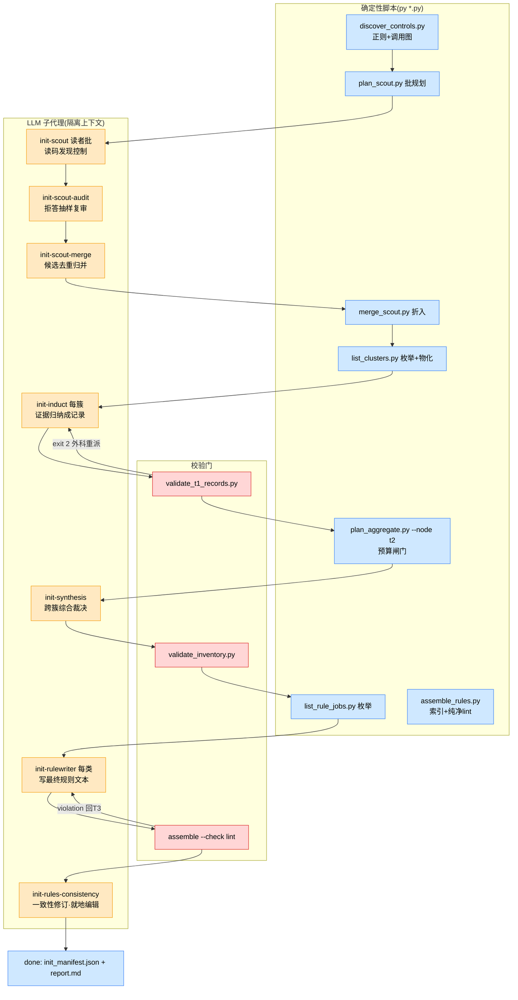

# mgh-init 产出质量评审计划(2026-10-22)

> **受众:人类(维护者)**。本文是评审战役的执行计划:定目标、定方法、定阶段、定拍板项。
> 评审本身尚未开始;本文获认可 + 拍板项落定后,按「实施阶段」一节逐卡执行。

> **人话开场**:mgh-init 当初的设计赌注是「模型能力会越来越强——工具族只要保住流程稳、
> 脚本确定性、无人值守成功率,分析准确度交给模型自己」。几个月过去,企业内网的主力模型
> 仍是被阉割到 150K 上下文窗口的 DeepSeek V4 Flash 0731,赌注没有兑现。而过去所有评审
> (2026-10-13 的 97 文件全量战役、历次实机闸门)都只验过「流程机制对不对」,**从未验过
> 「最终生成的规则文件质量好不好」**——锚点是不是真的、规则是不是可用的、漏了多少真实
> 控制,这些从未被测量过。本计划补这块:以终产物质量为唯一目标,按流水线逐阶段独立
> 评审,用头脑风暴、FMEA、5why、追溯审计等成型方法系统排查「弱模型在哪个环节、以什么
> 方式、把质量悄悄弄丢」,汇总成带根因分类的缺陷登记册与修复提案清单。过程不限手段,
> 终产物质量是唯一准绳。

## 1. 背景与动机:一次没有兑现的设计赌注

**原赌注**。工具族为企业内网「大仓、慢模型、限频」环境设计,应对策略是:机械重活下沉
确定性脚本、LLM 只做判断类工作、上下文隔离扇出、resume 全磁盘化。在这套策略之上还叠了
一层隐含假设:**随着模型能力发展,只要流程规划好 + 辅助脚本保住全程无人值守,剩下的
准确度问题靠模型能力自然解决**。

**现实**。项目数月后的今天,企业内网主力仍是 DeepSeek V4 Flash 0731(上下文窗口阉割到
150K)。模型没有变强,赌注的兑现遥遥无期。流水线里每个「交给模型判断」的环节,现在要
按「这个判断对这个模型是否过重」重新审一遍。

**评审空白的三个事实**(2026-10-22 盘点核实):

1. 2026-10-13 的 97 文件全量评审及其后 7 批修复战役(版本 0.1.68–0.1.74 全部归档落地)
   以及历次实机闸门,验证的全部是**机制与形状**(步骤状态机、派发、resume、schema 闸门、
   纯净 lint)——**终产物的语义质量(锚点真伪、规则可用性、漏检率)零评估**。
2. 研发铁律 R5.7 段 A 定义的「baseline ≥5 次 + blind A/B」提示词评估方法论,**从未被
   完整执行过**(两处 archive 任务均延后未勾)。
3. 企业内网真仓的**交接清单从未勾选**——原生路径的企业侧真跑与产物质量回填从未发生,
   仓内没有任何一条关于「规则写得对不对」的企业侧观察记录。

**双重身份放大风险**:这个弱模型既是流水线的工人(读码、归纳、写规则),也是终产物的
消费者(AGENTS.md 索引块与详述文件就是给项目里的 agent——同一个弱模型——读的)。工人
弱导致产物弱,产物弱又超出消费者的消化能力,两头都要审。

**与既有评审的边界**:2026-10-13 战役管「机器转得稳不稳」,本战役管「磨出来的面粉好
不好」。机制面已清,本计划不重复;已知未修的机制类问题(见「缺陷登记册(预置)」一节)
只收录、不再展开评审。

**目标声明(唯一准绳)**:保证 `/mgh-init` 最终产出的规则产物质量,即 opencode 面的
`<target>/AGENTS.md` 安全控制受管索引块 + `<target>/docs/security-controls/<类别>.md`
详述文件(claude 面 `.claude/rules/security-*.md` 与之同源)。中间产物只作为终产物质量
的因来审。**过程不限手段**:静态读码、动态实跑、破坏性实验、企业取证均可。

## 2. 先把「质量」说清楚:六维质量标尺

「AGENTS.md 质量好」不可直接测量,按 GQM(目标—问题—度量:先把目标拆成要回答的问题,
再给每个问题配一个可测的指标)拆成六维。**初始参考线是占位建议,Phase 0 拍板后定稿**;
量出首测值后再校准。

| 维度 | 一句话定义 | 怎么测 | 初始参考线(待校准) |
| --- | --- | --- | --- |
| Q1 事实准确 | 每条规则说的控制真实存在,锚点(文件:行)有效可点 | 反向追溯:抽样规则逐条回源码核对(例:抽 50 条,验锚点文件存在、行号落在合理范围、描述与代码相符) | 锚点有效率 ≥95%,零凭空控制 |
| Q2 覆盖 | 仓库里真实存在的安全控制,被发现并进了终产物的比例 | 正向追溯:金标仓人工清点控制清单 → 跑全链 → 对照召回(例:30 个人工确认的控制,终产物收了几条) | 金标召回 ≥85%,且每条漏检有归因 |
| Q3 可用 | 消费者(同一个弱模型)读了规则后,做安全相关任务的行为真有改进 | 下游 A/B:同一仓同一任务集,带/不带规则产物两组,盲评结果 | 带规则组通过率或控制复用率显著更高 |
| Q4 结构合规 | 受管块/详述文件格式正确、纯净(无工具内部行话)、体量在预算内 | 既有确定性 lint(assemble 纯净检查、尺寸 lint)+ 新增对账检查 | lint 全绿;索引块与详述文件一一对应 |
| Q5 稳定 | 同样的输入重复跑,产出漂移小(弱模型的方差大概率偏高,先量化再谈治理) | 固定 discover 产物,LLM 阶段重复跑 N=5,对终产物规则集做集合比对 | 关键规则集合相似度 ≥0.7 |
| Q6 组织 | 分类合理、粒度适中(不过碎不过泛),每条规则对读者有行动价值 | 人工评审:按固定 rubric(可定位/可执行/不夸大/不重复)过一遍全部规则 | 人工评审通过,无「正确但无用」规则 |

六维的优先级:**Q1/Q2 是底线(错了就是错的),Q3 是终极目的(产物存在的意义),Q4 是
既有能力(只需补缺口),Q5/Q6 是质量上限的放大器**。

## 3. 评审的核心透镜:弱模型五问

每个阶段的评审都拿同一组问题照一遍(5why 的「第一问」就从这里取):

| # | 问题 | 一句话解释 |
| --- | --- | --- |
| L1 指令遵循负担 | 该阶段提示词的规范密度(RFC-2119 动词数、NEVER 条数、输出 schema 字段数)是否超出该模型稳定遵循的能力?违背时有确定性校验兜住,还是静默垃圾? | 弱模型对长指令清单会「选择性失明」,越靠后的条目越容易丢 |
| L2 判断复杂度 | 该阶段要模型做的判断(发现?归纳?跨簇裁决?找矛盾?)对弱模型是否过重?能否再分解,或部分下沉确定性脚本? | 例:让弱模型「跨 8 个文件找规则矛盾」大概率走过场 |
| L3 上下文预算 | 输入切片 + 指示词 + 要求的输出,在 150K 窗口内余量多少?软预算(只披露不拦截)路径会不会静默超窗? | 超窗不报错——模型自己截断,丢的是整块输入 |
| L4 压缩保真 | 该阶段的压缩/裁剪决策(证据片段截断、摘要归并)丢的是什么信息?丢了之后下游还能不能补回来? | 每一层「省字」都是潜在的质量漏点,且丢得无声 |
| L5 消费者匹配 | 该阶段的产出文本是写给谁读的?弱模型读者需要的形态(短句、锚点直给、正例)与实际产出形态差多远? | 工人与消费者是同一个弱模型时,「写得专业」可能不如「写得直白」 |

**模型画像表(Phase 0 由维护者填写,填不全就按保守假设审)**:

| 待填项 | 现状 | 影响 |
| --- | --- | --- |
| 模型版本 / 冻结情况 | DeepSeek V4 Flash 0731,上下文窗口阉割至 150K | 已知;0731 后无升级计划? |
| 频控 / 并发 | (企业口径:每 10 分钟 100 次量级?) | 决定动态腿的节奏参数 |
| temperature / 输出长度上限 | 待填 | 影响方差与长文本产出能力 |
| 是否支持 JSON mode / 函数调用 | 待填 | 决定输出契约能否从「提示词约束」升级为「机制约束」 |
| 实测指令遵循水平(有无失败样例) | 待填 | 有样例可直接做 5why 素材 |
| 企业侧是否可能升级模型 | 待填 | 决定修复方向是「适配弱模型」还是「双轨」 |

## 4. 方法箱:哪个方法用在哪一步

| 方法 | 一句话 | 在本计划中的位置 | 产物 |
| --- | --- | --- | --- |
| GQM | 目标拆成问题、问题配上度量 | 已用于「六维质量标尺」 | 六维 + 初始参考线 |
| 事前验尸(pre-mortem) | 假设「三个月后企业用户骂产物是垃圾」,倒推所有 plausible 死因 | Phase 1 开场(一次) | 死因清单(映射到阶段) |
| 头脑风暴 | 先发散不批判,穷举失效可能 | 每张评审卡开场 | 候选失效模式清单 |
| FMEA(失效模式与影响分析) | 每个失效模式:影响→根因→现有防线→可探测性→优先级,结构化收敛 | 每张评审卡主体 | 逐阶段 FMEA 表 |
| 5why | 对实证缺陷连问为什么,追到根因 | 对每条实证缺陷(静态可证或动态复现) | 根因归类(A–E,见下) |
| 追溯审计 | 双向对账:正向(已知控制→终产物在不在)、反向(终产物规则→源码真不真) | Phase 3(金标仓 + 企业真实产物) | Q1/Q2 首测值 + 丢失点定位 |
| 重复运行方差分析 | 固定输入重复跑,量漂移 | Phase 2 | Q5 首测值 |
| 强模型对照腿 | 本机较强模型跑同一管线,作「管线应然产物」基线,分离「结构问题」与「模型能力问题」 | Phase 2 | 对照基线 + 差异归因素材 |
| 下游 A/B | 带/不带规则产物各做一组同任务,盲评差异 | Phase 3(按拍板) | Q3 结论 |

**5why 根因分类(A–E,每条缺陷必须落类)**——分类即修复方向,这是评审结论能直接变成
修复提案的枢纽:

| 类 | 根因 | 对应修复策略 |
| --- | --- | --- |
| A | 模型能力边界(任务对该模型本质过重) | 任务再分解、判断下沉确定性、换消费形态,而不是改措辞 |
| B | 提示词/契约设计缺陷 | 按 R5.7 段 A 做 baseline + blind A/B 改提示词 |
| C | 输入切片与信息保真缺陷(喂给模型的已经缺/坏) | 调切片/预算/物化策略 |
| D | 校验硬度缺口(坏产物静默通过确定性门) | 扩 --check / 新增 validator / 对账脚本 |
| E | 确定性脚本自身缺陷 | 修脚本 |

每条登记项还要标**证据等级**:[S] 静态推断(读码推论)/ [L] 本机实证(本机复现)/
[E] 企业实证(真实环境产物)。只有 [L]/[E] 的项才有资格直接进修复提案;[S] 项必须先
过动态验证。

## 5. 流水线现状与「质量承诺」地图

下图是 mgh-init 当前形态(蓝=确定性脚本,红=校验门,黄=LLM 子代理;原生/子进程两种
派发形态下,各阶段的判断内容相同,只是派发载体不同):

每阶段「欠终产物什么」与语义兜底现状(静态实测,2026-10-22;指令规模=stage 提示词+
任务模板+agent 定义三段叠加的中位 token 估算):

| 阶段 | 白话 | 执行者 | 欠终产物的质量承诺 | 语义偏差的确定性兜底 |
| --- | --- | --- | --- | --- |
| discover | 正则+调用图扫全仓出候选 | 纯确定性 | 召回地板:扫不到的全压给 scout | 无(它自己是确定性的,但**没人测过它的召回率**) |
| scout 读者批 | 读正则漏掉的源码找控制(开放发现+分类) | LLM,每批一上下文,指令约 4.2–4.7K tok,NEVER 32 条(全流程最高) | 正则盲区的召回 + 低误报 | **几乎为零**:category 选错/片段伪造/置信虚高全靠提示词 |
| scout 自审 | 抽样 15% 复读「说没有控制」的批 | LLM | 对 scout 漏报的唯一自纠 | 零 |
| scout-merge | 跨批候选去重归并 | LLM(+硬预算分片) | 候选不丢不误并 | 输出复过边界检查,去重正确性零校验 |
| T1 归纳 | 每簇证据→结构化记录(含描述/用法/缺口文本) | LLM,每簇一上下文,指令约 4.5–5.0K tok(最深) | **终产物文本的信息源头**:T1 记录是 T2/T3 的全部输入 | 形状闸最强(validate_t1_records),但锚点存在性/prose 质量/纯净零校验 |
| T2 综合 | 跨簇聚类、canonical/competing 裁决、去重 | LLM(96KB 预算下单上下文;超则 map-reduce) | 每条控制的唯一性与归属;竞争裁决正确 | validate_inventory 只查枚举字段,**role 裁决零校验**;单上下文路径超窗无人拦 |
| T3 规则写作 | 每类控制→最终规则文本(详述文件) | LLM,每类一上下文,指令叠加最多(约 4.3–5.2K tok) | 终产物文本的直接书写者 | 纯净 lint + opencode 围栏;**覆盖完整性无对账**、锚点可点击性零校验 |
| T4 一致性 | 读全部规则文件找矛盾,就地编辑修订 | LLM,edit 权限开放(可就地改已产出的规则文件) | 只许微调不许改坏 | **全流程最弱:编辑后零确定性复检** |
| assemble | 建索引块 + 纯净 lint | 纯确定性 | 最后一道确定性防线 | 只防「形状脏」,不防「内容错」(裸词泄漏已披露为 lint 盲区) |

横切事实(影响多阶段,详见横切评审卡):evidence_snippet 三级截断(正则 160 字符 →
merge 瘦身 4096 → T2 记录字段帽),锚点永不截但人读线索会断;T2 双路径(单上下文
vs map-reduce)裁决视野不同且产物不标注走了哪条路;重派至多一轮后**接受缺口**,缺口
进 report 但**不达终产物的消费者**(agent 拿到的是「有什么」,不知道「少什么」)。

## 6. 缺陷登记册(预置)

评审开始前已知的、与产物质量相关且未修的项(2026-10-22 核实;评审只往里加,不重复
评审):

| # | 项 | 等级/类 | 来源 |
| --- | --- | --- | --- |
| 1 | pack 会话违共享任务模板写「包级账本 JSON」(2/11 pack 真会话违例;模板至今无明示禁令) | [E] B | `archive/2026-10-21-fix-mgh-init-native-aggregate-dispatch/real-machine-notes.md` §2 |
| 2 | `validate_t1_records` 用 `*.json` glob 把包级账本误读为记录(13 假违例) | [E] E | 同上 §2;`core/scripts/validate_t1_records.py:248` |
| 3 | 纯净 lint 只盖高精度形状;裸通用词/层级词/通用脚本名非确定性可测 | [S] D | 根 AGENTS.md 诚实边界 |
| 4 | scout-merge 超预算分片时 evidence_snippet 等人读字段截断(锚点不截) | [S] C | 根 AGENTS.md 诚实边界 |
| 5 | 任一分片失败不 rollup → 候选缺口仅报告披露、静默少候选 | [S] C | 根 AGENTS.md 诚实边界 |
| 6 | opencode 惰性索引是语义性加载:消费 agent 跳过 Read 就漏可用控制 | [S] B | 根 AGENTS.md 诚实边界 |
| 7 | opencode `edit: deny` 权限面可能拦住规则写作的落盘(未 live 验证) | [S] D | 2026-10-13 战役交接文档拍板项 A |

## 7. 逐阶段评审卡(核心工作包)

九张卡 = 九个独立工作包,每卡一个会话执行,产物落
`docs/reviews/init-quality-2026-10/`(卡片文件 + 登记册增补)。卡内「FMEA 预填」是静态
盘点出的初始行,评审会话负责扩充、核实、定级——**预填行未经动态验证前一律标 [S]**。
卡片按流水线顺序编号;**建议执行顺序按危险度**(见表后),危险度依据 = 指令负担 ×
判断难度 × 兜底弱点的静态评估。

### C1 · discover 确定性发现(+可选 survey/resolve 轻阶段)

- **做什么**:正则+调用图扫全仓出候选清单与簇骨架;survey(可选)逐文件富化摘要;
  resolve(可选)消解调用图未解析项。
- **分工**:主链唯一纯确定性阶段;survey/resolve 是轻 LLM(无独立校验门,advisory)。
- **质量承诺**:召回地板——正则扫不到的控制全部压给弱模型 scout 补,它的盲区大小直接
  决定 scout 的有效工作量与终产物的覆盖上限。
- **弱模型五问命中**:L4(候选 snippet 160 字符截断,关键上下文可能不在场)。
- **头脑风暴开场题**:哪些真实控制形态正则天生扫不到(自定义框架、XML/配置声明的控制、
  AOP 切面、动态注册)?金标仓里数出占比,就是 scout 的真实压力值。
- **FMEA 预填**:新框架注解不在特征表→静默漏检(B);snippet 截断丢判定上下文→T1 误读
  (E/B);调用图框架路由盲区→本应一簇的控制碎成多簇(C)。
- **5why 触发**:正向追溯发现金标控制缺失时,第一问落在这层(是 discover 没扫到,还是
  scout 没兜住?)。
- **动态实验**:金标仓跑 discover,对照人工清点,量正则召回率与误报率。
- **退出标准**:正则召回/误报首测值成文;「必须靠 scout 的盲区清单」成文。

### C2 · scout 读者批 + 自审抽样(危险度第 2)

- **做什么**:读正则未覆盖的源码文件,自主发明搜索词,判断「这是不是被共享使用的安全
  控制」,从 8 类里选 category、6 类选 kind,精确优先压制误报;自审批对「说没有控制」
  的批按 15% 抽样反向复查。
- **分工**:plan_scout 确定性切批(默认 96KB/批、每批 ≤40 文件);判断全在模型。
- **质量承诺**:正则盲区的召回 + 低误报。漏报=覆盖直接损失;误报=伪控制一路进 T1→T3
  变成终产物里的假规则(污染比漏检更伤可信度)。
- **弱模型五问命中**:L1(指令栈 4.2–4.7K tok、NEVER 32 条全流程最高,叠开放词汇发现
  这一最重判断)、L4(snippet ≤120 字符还要 JSON 安全)。
- **头脑风暴开场题**:弱模型会怎么「合规地走过场」?(例:每批都只报 0–1 个最显眼的,
  把需要跨文件理解的控制在置信度上自我压制——所有字段都合法,门全绿,覆盖悄悄塌)。
- **FMEA 预填**:真控制漏报→静默覆盖损失(A/B);误报进簇→终产物假规则(A/B);
  category 选错→分簇错→T1 归纳上下文混装(A/B);evidence_snippet 与文件不符/伪造——
  merge 边界只查字段存在不查内容(A/D);自审走过场(反向怀疑是弱模型短板)(A/B)。
- **5why 触发**:金标仓控制 discover+scout 双双漏;或终产物出现源码里不存在的控制。
- **动态实验**:固定批输入重复跑 N 次量方差(漏报/误报漂移);自审纠错率实测(它到底
  推翻过几次 reader——若为零,自审机制对弱模型形同虚设)。
- **退出标准**:漏报/误报首测值;自审有效性结论;FMEA 表定稿。

### C3 · scout-merge 候选归并(低危)

- **做什么**:跨批结构化候选按锚点元组去重、枚举分歧归一;超 96KB 硬预算时确定性分片
  (map-reduce),病态单候选瘦身投影(锚点不截、留痕)。
- **质量承诺**:候选不丢不误并;分片路径下 competing 线索不被瘦身截没。
- **弱模型五问命中**:L4(4096 截断丢 competing 成员——已披露,核对 _slimmed 留痕与
  摘要丢失是否如实)。
- **FMEA 预填**:跨批去重误并→候选丢(A/B);kind 归一选错(B);分片失败不 rollup→
  静默少候选(预置 #5)(C)。
- **动态实验**:强模型腿产物上做去重对账(合并前后候选数逐条可追溯)。
- **退出标准**:去重正确性抽检通过或问题入册。

### C4 · T1 per-cluster 归纳(危险度第 3)

- **做什么**:读单簇证据文件,归纳「该控制是什么/开发者该怎么用/缺口在哪」,产出 12
  字段结构化记录;小簇可选 pack 打包逐成员处理;超大簇切 shard。
- **分工**:枚举/物化/checkpoint 确定性;读码归纳、写 description/usage/gaps 规范文本
  全在模型——指令栈全流程最深(4.5–5.0K tok)。
- **质量承诺**:**终产物文本的信息源头**。T2/T3 不再读源码,只读 T1 记录;T1 的 prose
  空洞或失真,终产物规则必然空洞失真,且无人再能发现。
- **弱模型五问命中**:L1(深指令栈+Form B 双形态模板)、L2(existence vs effectiveness
  细判断)、L5(usage 文本要写给弱模型读者却常写成散文)。
- **头脑风暴开场题**:弱模型写出的 description/usage 会以什么方式「正确但无用」?
  (例:只复述证据片段不含使用条件;usage 缺前置步骤;gaps 一律留空。)
- **FMEA 预填**:prose 空洞/散文→T3 规则空洞(A/B);锚点 file:class:method 编造——
  validate 不查存在性(A/D);existence/effectiveness 误判→规则夸大(A/B);pack 形态
  漏成员/写包级账本(预置 #1/#2)(B/E);shard 归纳丢成员——指望 T2 兜但 T2 同弱(C)。
- **5why 触发**:终产物规则锚点无效→追到 T1 记录锚点错→为什么门没拦(D 类修复候选:
  锚点存在性是纯确定性可验的)。
- **动态实验**:固定簇输入重复 N 次;强/弱对照 description/usage 质量(rubric 盲评)。
- **退出标准**:prose 质量 rubric 定稿并有首测;锚点存在性问题定性入册。

### C5 · T2 跨簇综合(危险度第 4)

- **做什么**:全部 T1 记录(无源码)上跨簇聚类、按证据锚点去重、名字归一、给每竞争组
  裁决 canonical/competing/duplicate/possibly-dead;96KB 预算内单上下文,超则 map-reduce。
- **质量承诺**:每条控制的唯一性与归属——误并=终产物丢一类控制,canonical 选错=终规则
  指向次优实现。
- **弱模型五问命中**:L2(竞争裁决是典型弱模型短板)、L3(**96KB 是软预算**:单上下文
  路径超窗无人拦,历史上有单批 269KB 撑爆 150K 窗口的实录)、L4(rollup 只见分片摘要,
  跨片裁决视野天然残缺,且产物不标注走了哪条路径)。
- **头脑风暴开场题**:弱模型的「去重」会怎么失控?(例:名字相似就并、把兜底实现当
  canonical、competing 组里全标 duplicate 了事。)
- **FMEA 预填**:软预算超窗→模型自截断→丢簇(C/D);role 裁决错——validator 不查
  role(A/D);误并两类控制(A/B);双路径产物不对称无标注(C)。
- **5why 触发**:终产物两条规则实为同一控制,或一类控制整体消失。
- **动态实验**:同输入强制走两条路径(单上下文 vs map-reduce),产物 diff 定量。
- **退出标准**:双路径不对称定量入册;超窗风险处置建议成文。

### C6 · T3 rulewriter 规则写作(危险度第 5)

- **做什么**:每 category 一上下文,把 inventory 条目转写成最终规则文本:opencode 面独立
  H1 详述文件(禁 frontmatter/禁哨兵/锚点 `file::Class.method`),claude 面
  `paths:`-scoped 规则文件;剔除无实现控制、措辞中性。
- **质量承诺**:**终产物的直接书写者**——它写什么,项目 agent 就读到什么。
- **弱模型五问命中**:L1(多 fragment 叠加,指令总量全流程最高 4.3–5.2K)、L5(写给弱
  模型读者的规则文本,措辞形态与读者消受能力的匹配从未验证)。
- **头脑风暴开场题**:规则文本会以什么方式「格式全对、内容失真」?(例:把「存在」写成
  「有效」、锚点格式对但指向错文件、漏写该类一半控制——**没有任何 inventory↔规则
  对账门**。)
- **FMEA 预填**:漏写某控制→静默丢(A/D);锚点不可定位(A/B);存在写成有效/夸大
  (A/B);claude frontmatter 结构错——lint 只查 token 不查结构(B/D);详述文件与索引
  块失配(B)。
- **5why 触发**:详述文件里某控制相对 inventory 凭空消失/凭空多出。
- **动态实验**:inventory 条数 vs 规则覆盖条数手工对账(评审期手工,对账脚本作为 D 类
  修复候选入册)。
- **退出标准**:覆盖对账缺口定性;规则文本人工评审 rubric(Q6)定稿。

### C7 · T4 一致性修订(危险度第 1——兜底最弱)

- **做什么**:读全部规则文件(无源码),查命名一致、锚点悬挂、跨类重复、格式纯净,就
  地 Edit 修订;「flag 但不静默改」只是提示词承诺。
- **质量承诺**:本应只做微调;实际一次跑偏可把已 lint 干净的规则改坏,且**编辑后无任何
  确定性复检**(checkpoint 无 schema、assemble 的 lint 在 T4 之前已经跑完)。
- **弱模型五问命中**:L2(跨文件找矛盾恰是弱模型短板)、L3(全规则聚合仅 96KB 软披露)。
- **头脑风暴开场题**:T4 的存在价值 vs 风险怎么摆?(它全程零确定性产出契约;若弱模型
  在这一层只会制造新伤,`--skip-consistency` 现成可用——但这是修复提案的结论,评审先
  拿证据。)
- **FMEA 预填**:改坏已 lint 文本(A/B/D);漏检真矛盾走过场(A);flag 同时静默改——
  违提示词但零检测(A/B)。
- **5why 触发**:T4 前后规则文本 diff 中任何一处语义劣化。
- **动态实验**:强模型腿跑 T4,前后 diff 全量人审;弱模型腿(按拍板)同测对照。
- **退出标准**:「T4 加复检门 / 降级 / 缺省跳过」三方向证据齐,形成决策建议。

### C8 · assemble 终门 + 纯净 lint

- **做什么**:扫详述文件目录建 AGENTS.md 受管索引块;纯净 lint(工具内部 token、schema
  字段、扫描器散文、opencode 禁 YAML 围栏)fail-loud;违例不写盘回 T3。
- **质量承诺**:最后一道确定性防线——当前只防「形状脏」,不防「内容错」。
- **头脑风暴开场题(本卡核心问法:终门还能零 LLM 地拦住什么?)**:锚点存在性检查
  (拿规则里的锚点回源码验文件/行存在——纯确定性可做而未做);inventory↔规则覆盖
  对账;受管块与详述文件一一对应;**覆盖缺口向消费者披露**(现在缺口只进 report,
  消费 agent 不知道「哪些区域没扫」)。
- **FMEA 预填**:裸词泄漏(预置 #3)(D);索引显示名/孤儿错(E);锚点存在性零检查
  (D);缺口不达消费者(B/D)。
- **退出标准**:「终门扩容候选清单」成文(全部零依赖可实现的确定性检查),作为修复
  提案素材。

### C9 · 横切面(编排纪律 / 原生标记 / 消费者匹配 / 参数预算)

- **审什么**(跨阶段的结构性主题):
  - **弱模型当编排器**:页循环重物化、看门狗先行、令牌派发、至多一轮重派——派发
    fragments 的 NEVER 密度(21–22 条)对弱模型编排者的遵循度,大多只有 hook 越界读
    兜底;错翻页/跳 gate = 整页覆盖静默损失。
  - **原生孪生自写标记**:错写 `.failed`/漏写 `.done` → 回待派烧配额或卡页循环。
  - **消费者匹配(L5 总验)**:索引块语义性加载的跳读风险(预置 #6);规则文本对弱模型
    读者是否过度「专业腔」;RFC 措辞密度、正例缺失。
  - **参数族换算**:192KB 单元上限 ≈ 5 万多 token 输入,150K 窗内;但 96KB 软预算聚合
    路径与 T2 单上下文路径的实际窗口占用要实测一遍。
  - **缺口披露链**:每层「接受缺口」的决策点(重派一轮后放弃、分片不 rollup)最终在
    终产物上对消费者不可见。
- **FMEA 预填**:编排器跳 gate/跳页→静默丢层(A/B/D);缺口接受后终产物无感知(B);
  消费 agent 不读详述文件(B)。
- **退出标准**:横切主题各一条结论入册;消费者匹配问题定性(进 Q3 终评素材)。

**建议执行顺序**(危险度 × 终产物距离;可并行两卡一会话):**C7 → C2 → C4 → C5 →
C6 → C8 → C1 → C3 → C9**。C9 虽排最后,但其中「消费者匹配」素材要在 Phase 3 终评前
就绪。

## 8. 实施阶段(Phase 0–4)

| Phase | 内容 | 入口 | 出口 | 预估会话 |
| --- | --- | --- | --- | --- |
| **P0 定标与取证** | 拍板下一节四个决策点;填模型画像表;金标仓定档 + 人工控制清点;回收企业真实产物(若有) | 本计划获认可 | 参考线定稿、金标与取证素材就绪 | 1 |
| **P1 静态逐阶段评审** | 事前验尸开场一次;C1–C9 各自一会话(按建议顺序),头脑风暴+FMEA+静态 5why | P0 完 | 缺陷登记册 v1(全项标 A–E + [S/L/E]) | 3–9,可交错 |
| **P2 动态基线** | 强模型对照腿:本机较强模型跑金标仓全链,产「应然基线」;固定输入重复腿:scout/T2/T3 各 N=5 量方差;弱模型腿(按 D1 拍板) | 金标就绪 | 六维中 Q1/Q2/Q4/Q5 首测值(可测维度) | 2–3 |
| **P3 追溯与终评** | 双向追溯审计(金标仓 + 企业真实产物);下游 A/B(按 D3 拍板) | P2 产物在手 | Q1/Q2 定量报告;Q3 结论(或降级结论) | 1–2 |
| **P4 汇总与修复提案** | 登记册定稿分级([L]/[E] 优先);按 A–E × 阶段产出 openspec 修复 change 候选清单;「赌注撤销清单」(哪些原设计假设正式撤销、代之以什么) | P1+P3 齐 | 修复提案清单,供逐个 propose | 1 |

P1(静态)与 P2(动态)可交错:静态评审出的高危假设可提前插队动态验证。评审产物统一落
`docs/reviews/init-quality-2026-10/`(每卡一文件 + `register.md` 登记册)。

**证据腿说明**:评审要回答「弱模型下产物质量如何」,弱模型行为证据有三个来源——
①本机强模型对照(永远可做,用于分离结构问题与模型问题,不能代表企业表现);②弱模型
动态腿(来源按 D1 拍板);③企业真实产物取证(按 D2 附带,证据等级最高)。

## 9. 待拍板决策点(Phase 0)

**D1 弱模型证据腿怎么来**(对比):

| 选项 | 保真度 | 成本/前置 | 风险 |
| --- | --- | --- | --- |
| ① 授权用 DeepSeek 官方 API(本机 `DEEPSEEK_API_KEY`,付费,须明确授权后评审才碰) | 中:模型同源,但窗口/频控/网关与企业阉割版不同 | 低:本机即可跑 | 结论只能标 [L],需注明与企业版差异 |
| ② 企业侧跑金标仓 + 真实仓,产物取回 | 高:[E] 级证据 | 高:需要企业侧配合跑一轮并拷回 run 目录与终产物 | 依赖人力;金标仓要能带进内网 |
| ③ 不做弱模型动态腿 | 低:弱模型行为只能静态推断 + 既有实机记录外推 | 零 | Q1/Q2/Q5 的弱模型首测值缺失,修复提案依据变薄 |

**D2 金标仓选什么**(覆盖 Q2 的基准;可组合):

| 选项 | 优 | 缺 |
| --- | --- | --- |
| ① 自建玩具 Java Web 仓(手植 30 个左右已知控制) | 完全可控、清点零成本、可版本化进仓(tests fixture) | 真实性弱——弱模型的失误模式要在真码里才暴露 |
| ② 开源真实 Java Web 项目 | 真实代码形态 | 人工清点 30 个控制成本高;边界真值有争议 |
| ③ 企业脱敏样本仓 | 最优代表(真实技术栈+真实写法) | 可得性与保密约束 |

建议:①打底(必做,进仓可回归)+ ③可得则加跑一轮;②视精力。

**D3 下游 A/B 终评(Q3)做不做**:

| 选项 | 优 | 缺 |
| --- | --- | --- |
| 做(金标仓上 6–10 个安全相关开发任务,带/不带规则两组,盲评) | 直接测出产物存在的意义;是「过程无限制」的最大兑现 | 最贵:要弱模型腿就位 + 盲评人力;任务集设计本身要防偏 |
| 降级(只做规则文本的静态可用性评审 + 消费者匹配分析) | 便宜,C9 素材即可支撑 | Q3 无定量结论 |
| 不做 | — | 终极目的未验证 |

**D4 修复提案节奏**:

| 选项 | 优 | 缺 |
| --- | --- | --- |
| 全部评完集中提(P4 一批) | 全局排序最优,避免跨卡重复提案 | 修复启动晚 |
| 每卡评完即提 | 修复快 | 可能返工(后卡推翻前卡假设);违背先证据后提案的证据等级纪律 |

建议:D4 取「集中提」,但 [E] 级且修法明确的项(如预置 #1/#2)允许提前立项,不等战役。

## 10. 评审自身的诚实边界

- 本机强模型对照腿只能定位**结构问题**,不能代表企业弱模型表现;两腿差异本身是归因
  素材,不是结论。
- 静态评审产出的是**假设**;[S] 级登记项未经动态验证不得直接进修复提案。
- 金标仓的人工清点本身有误差(金标不是真理),Q2 数值要带清点置信说明。
- 若 D1 选 ①,官方 API 与内网阉割版的行为差异(窗口、频控、网关队列)会系统性偏移
  结论,所有 [L] 证据须附差异说明。
- 评审有真实成本(会话 token + 动态腿费用 + 企业侧人力);P1 静态卡的性价比最高,
  动态腿按拍板量力。

## 11. 产出物清单

1. 每阶段评审卡填写稿(`docs/reviews/init-quality-2026-10/C*.md`,含 FMEA 定稿表与
   5why 记录)。
2. 缺陷登记册 `docs/reviews/init-quality-2026-10/register.md`(预置 7 项起步,全项
   A–E 分类 + [S/L/E] 证据等级 + 阶段归属)。
3. 质量基线报告(六维首测值 + 测量方法记录,便于日后回归比对)。
4. 修复提案清单(按 A–E × 阶段排序的 openspec change 候选,含「赌注撤销清单」)。
5. 金标仓 fixture(若 D2 选自建,进 `tests/` 可回归,成为质量回归的地基)。

## 12. 背景阅读(执行评审卡前)

- [mgh-init 命令人话说明](mgh-init.md) / [mgh-init 产物字段级参考](mgh-init-artifacts.md)
  ——阶段与产物的通俗与字段级两套参考。
- [2026-10-13 全量评审报告](review-mgh-init-full-pipeline-2026-10-13.md) 与
  [同战役交接文档](mgh-init-review-campaign-handoff-2026-10-13.md)——上一轮机制评审
  的范围与结论(本计划不重复其覆盖面)。
- 根 [AGENTS.md](../AGENTS.md) 的「诚实边界」一节——已披露的 init 产物局限清单
  (登记册预置 #3–#6 的原文)。
