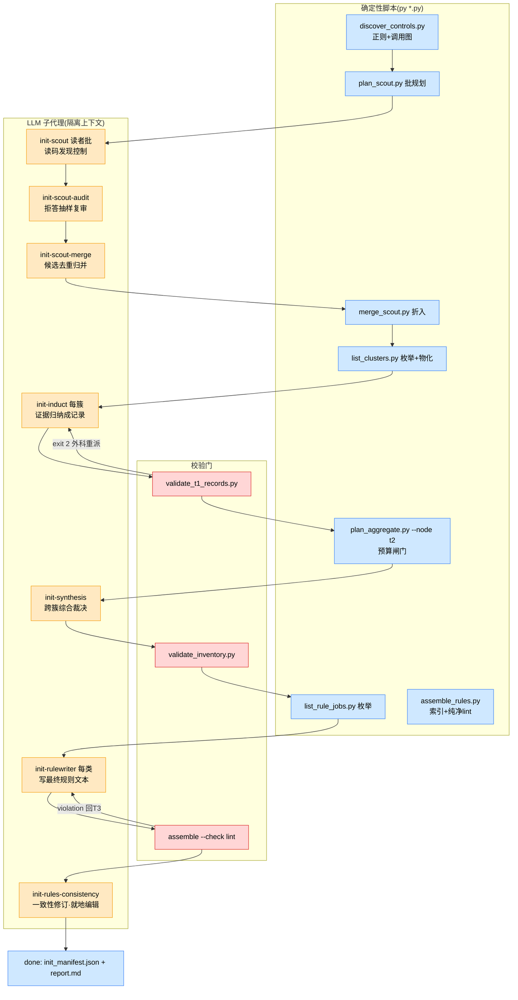

# mgh-init 产出质量评审计划(2026-10-22)

> **受众:人类(维护者)**。本文是评审战役的执行计划:定目标、定方法、定阶段、定拍板项。
> 评审本身尚未开始;本文获认可 + 拍板项落定后,按「实施阶段」一节逐卡执行。

> **人话开场**:mgh-init 当初的设计赌注是「模型能力会越来越强——工具族只要保住流程稳、
> 脚本确定性、无人值守成功率,分析准确度交给模型自己」。几个月过去,企业内网的主力模型
> 仍是被阉割到 150K 上下文窗口的 DeepSeek V4 Flash 0731,赌注没有兑现。而过去所有评审
> (2026-10-13 的 97 文件全量战役、历次实机闸门)都只验过「流程机制对不对」,**从未验过
> 「最终生成的规则文件质量好不好」**——锚点是不是真的、规则是不是可用的、漏了多少真实
> 控制,这些从未被测量过。本计划补这块:以终产物质量为唯一目标,按流水线逐阶段独立
> 评审,用头脑风暴、FMEA、5why、追溯审计等成型方法系统排查「弱模型在哪个环节、以什么
> 方式、把质量悄悄弄丢」,汇总成带根因分类的缺陷登记册与修复提案清单。过程不限手段,
> 终产物质量是唯一准绳。

> **2026-10-23 修订(先读,含两轮修正)**:①**弱模型不可得**——原生 DeepSeek V4 Flash 0731
> 在公网经长期使用实测很强,企业内网 150K 部署版在公网找不到替代;但维护者长期观测表明
> 企业版**确实弱**,弱在**执行保真**(路径/标识转写错、NEVER 仍尝试、指定必读被漏过),
> 而非推理深度。②**内外网交互实况**——内网→外网**只允许手抄短文**(此前归档问题均由人工
> 手抄带出);外网→内网可传 **≤100MB 文件**。评审据此改为「管线免疫 + 保真脚手架」,
> 内网取证改为「带仪器进去、手抄裁决出来」。③文中所有**未验证假设**集中登记于 §13.10,
> 不得单独作为方法选择或优化优先级的依据。第 1–12 节保留为背景与静态评审卡,其中 §8 阶段
> 表、§9 决策点已按修订替换。

## 1. 背景与动机:一次没有兑现的设计赌注

**原赌注**。工具族为企业内网「大仓、慢模型、限频」环境设计,应对策略是:机械重活下沉
确定性脚本、LLM 只做判断类工作、上下文隔离扇出、resume 全磁盘化。在这套策略之上还叠了
一层隐含假设:**随着模型能力发展,只要流程规划好 + 辅助脚本保住全程无人值守,剩下的
准确度问题靠模型能力自然解决**。

**现实**。项目数月后的今天,企业内网主力仍是 DeepSeek V4 Flash 0731(上下文窗口阉割到
150K)。模型没有变强,赌注的兑现遥遥无期。流水线里每个「交给模型判断」的环节,现在要
按「这个判断对这个模型是否过重」重新审一遍。

**评审空白的三个事实**(2026-10-22 盘点核实):

1. 2026-10-13 的 97 文件全量评审及其后 7 批修复战役(版本 0.1.68–0.1.74 全部归档落地)
   以及历次实机闸门,验证的全部是**机制与形状**(步骤状态机、派发、resume、schema 闸门、
   纯净 lint)——**终产物的语义质量(锚点真伪、规则可用性、漏检率)零评估**。
2. 研发铁律 R5.7 段 A 定义的「baseline ≥5 次 + blind A/B」提示词评估方法论,**从未被
   完整执行过**(两处 archive 任务均延后未勾)。
3. 企业内网真仓的**交接清单从未勾选**——原生路径的企业侧真跑与产物质量回填从未发生,
   仓内没有任何一条关于「规则写得对不对」的企业侧观察记录。

**双重身份放大风险**:这个弱模型既是流水线的工人(读码、归纳、写规则),也是终产物的
消费者(AGENTS.md 索引块与详述文件就是给项目里的 agent——同一个弱模型——读的)。工人
弱导致产物弱,产物弱又超出消费者的消化能力,两头都要审。

**与既有评审的边界**:2026-10-13 战役管「机器转得稳不稳」,本战役管「磨出来的面粉好
不好」。机制面已清,本计划不重复;已知未修的机制类问题(见「缺陷登记册(预置)」一节)
只收录、不再展开评审。

**目标声明(唯一准绳)**:保证 `/mgh-init` 最终产出的规则产物质量,即 opencode 面的
`<target>/AGENTS.md` 安全控制受管索引块 + `<target>/docs/security-controls/<类别>.md`
详述文件(claude 面 `.claude/rules/security-*.md` 与之同源)。中间产物只作为终产物质量
的因来审。**过程不限手段**:静态读码、动态实跑、破坏性实验、企业取证均可。

## 2. 先把「质量」说清楚:六维质量标尺

「AGENTS.md 质量好」不可直接测量,按 GQM(目标—问题—度量:先把目标拆成要回答的问题,
再给每个问题配一个可测的指标)拆成六维。**初始参考线是占位建议,Phase 0 拍板后定稿**;
量出首测值后再校准。

| 维度 | 一句话定义 | 怎么测 | 初始参考线(待校准) |
| --- | --- | --- | --- |
| Q1 事实准确 | 每条规则说的控制真实存在,锚点(文件:行)有效可点 | 反向追溯:抽样规则逐条回源码核对(例:抽 50 条,验锚点文件存在、行号落在合理范围、描述与代码相符) | 锚点有效率 ≥95%,零凭空控制 |
| Q2 覆盖 | 仓库里真实存在的安全控制,被发现并进了终产物的比例 | 正向追溯:金标仓人工清点控制清单 → 跑全链 → 对照召回(例:30 个人工确认的控制,终产物收了几条) | 金标召回 ≥85%,且每条漏检有归因 |
| Q3 可用 | 消费者(同一个弱模型)读了规则后,做安全相关任务的行为真有改进 | 下游 A/B:同一仓同一任务集,带/不带规则产物两组,盲评结果 | 带规则组通过率或控制复用率显著更高 |
| Q4 结构合规 | 受管块/详述文件格式正确、纯净(无工具内部行话)、体量在预算内 | 既有确定性 lint(assemble 纯净检查、尺寸 lint)+ 新增对账检查 | lint 全绿;索引块与详述文件一一对应 |
| Q5 稳定 | 同样的输入重复跑,产出漂移小(弱模型的方差大概率偏高,先量化再谈治理) | 固定 discover 产物,LLM 阶段重复跑 N=5,对终产物规则集做集合比对 | 关键规则集合相似度 ≥0.7 |
| Q6 组织 | 分类合理、粒度适中(不过碎不过泛),每条规则对读者有行动价值 | 人工评审:按固定 rubric(可定位/可执行/不夸大/不重复)过一遍全部规则 | 人工评审通过,无「正确但无用」规则 |

> **可评审性硬约束(2026-10-23)**:目标仓库的开发人员**不会**审阅过程文件(T1/T2/T3
> 记录、checkpoint、`synthesis.json` 等),最多粗看最终 `AGENTS.md`,而且他们对具体实现
> 不熟、意见未必准确(仓大、历史久)。因此 Q1/Q2 不能用"开发人员确认"来测,只能靠确定性
> 检查与植入真值仓;Q6 只评"最终产物是否可读、可定位",不评"内容是否正确";开发人员的
> 意见记为 **[H] 弱信号**(人读、低置信),只用于发现"明显离谱",不参与数值计算,不作
> ground truth。

六维的优先级:**Q1/Q2 是底线(错了就是错的),Q3 是终极目的(产物存在的意义),Q4 是
既有能力(只需补缺口),Q5/Q6 是质量上限的放大器**。

## 3. 评审的核心透镜:执行保真六问

每个阶段的评审都拿同一组问题照一遍(5why 的「第一问」就从这里取)。**L0 是 2026-10-23
新增**,依据是企业内网模型的实际观测(见 §13.3)——它比其余五问更贴近本次评审的根因:

| # | 问题 | 一句话解释 |
| --- | --- | --- |
| L0 执行保真负荷 | 该阶段要求模型**逐字复现**多少信息(路径/短号/文件名/命令)?要求它**记得做**多少动作(读文档/跑 gate/写标记)?要求它**不碰**多少事(NEVER)?每一项有没有确定性兜底? | 企业模型可观测的弱点是"照做"不可靠:给对了路径仍写错、写了 NEVER 仍尝试、指定必读仍漏过 |
| L1 指令遵循负担 | 该阶段提示词的规范密度(RFC-2119 动词数、NEVER 条数、输出 schema 字段数)是否超出该模型稳定遵循的能力?违背时有确定性校验兜住,还是静默垃圾? | 弱模型对长指令清单会「选择性失明」,越靠后的条目越容易丢 |
| L2 判断复杂度 | 该阶段要模型做的判断(发现?归纳?跨簇裁决?找矛盾?)对弱模型是否过重?能否再分解,或部分下沉确定性脚本? | 例:让弱模型「跨 8 个文件找规则矛盾」大概率走过场 |
| L3 上下文预算 | 输入切片 + 指示词 + 要求的输出,在 150K 窗口内余量多少?软预算(只披露不拦截)路径会不会静默超窗? | 超窗不报错——模型自己截断,丢的是整块输入 |
| L4 压缩保真 | 该阶段的压缩/裁剪决策(证据片段截断、摘要归并)丢的是什么信息?丢了之后下游还能不能补回来? | 每一层「省字」都是潜在的质量漏点,且丢得无声 |
| L5 消费者匹配 | 该阶段的产出文本是写给谁读的?弱模型读者需要的形态(短句、锚点直给、正例)与实际产出形态差多远? | 工人与消费者是同一个弱模型时,「写得专业」可能不如「写得直白」 |

> **2026-10-23 权重修订**:五问的重心按证据排——**L0(执行保真)是主因线**,L3/L4/L5
> 次之,L1/L2 仍要在静态卡里过(它们决定"注入哪些缺陷"),但不再作为主要结论线。依据是
> 企业模型的失败形态集中在"照做"而不是"想明白"(§13.3)。

**模型画像表(Phase 0 由维护者填写,填不全就按保守假设审;2026-10-23 起优先填"环境
约束"列,模型能力列可为空)**:

| 待填项 | 现状 | 影响 |
| --- | --- | --- |
| 模型版本 / 冻结情况 | DeepSeek V4 Flash 0731,上下文窗口阉割至 150K | 已知;0731 后无升级计划? |
| 频控 / 并发 | (企业口径:每 10 分钟 100 次量级?) | 决定动态腿的节奏参数 |
| temperature / 输出长度上限 | 待填 | 影响方差与长文本产出能力 |
| 是否支持 JSON mode / 函数调用 | 待填 | 决定输出契约能否从「提示词约束」升级为「机制约束」 |
| 实测指令遵循水平(有无失败样例) | 待填 | 有样例可直接做 5why 素材 |
| 企业侧是否可能升级模型 | 待填 | 决定修复方向是「适配弱模型」还是「双轨」 |

## 4. 方法箱:哪个方法用在哪一步

| 方法 | 一句话 | 在本计划中的位置 | 产物 |
| --- | --- | --- | --- |
| GQM | 目标拆成问题、问题配上度量 | 已用于「六维质量标尺」 | 六维 + 初始参考线 |
| 事前验尸(pre-mortem) | 假设「三个月后企业用户骂产物是垃圾」,倒推所有 plausible 死因 | Phase 1 开场(一次) | 死因清单(映射到阶段) |
| 头脑风暴 | 先发散不批判,穷举失效可能 | 每张评审卡开场 | 候选失效模式清单 |
| FMEA(失效模式与影响分析) | 每个失效模式:影响→根因→现有防线→可探测性→优先级,结构化收敛 | 每张评审卡主体 | 逐阶段 FMEA 表 |
| 5why | 对实证缺陷连问为什么,追到根因 | 对每条实证缺陷(静态可证或动态复现) | 根因归类(A–E,见下) |
| 追溯审计 | 双向对账:正向(已知控制→终产物在不在)、反向(终产物规则→源码真不真) | P3/P5(植入仓 + 内网) | Q1/Q2 首测值 + 丢失点定位 |
| 重复运行方差分析 | 固定输入重复跑,量漂移 | P2 | Q5 参照值 |
| 强模型对照腿 | 本机较强模型跑同一管线,作「管线应然产物」基线,分离「结构问题」与「模型能力问题」 | P2 | 对照基线 + 差异归因素材 |
| 下游 A/B | 带/不带规则产物各做一组同任务,盲评差异 | P5(内网,降级版) | Q3 弱信号 |
| **缺陷注入(变异)测试** | 不找弱模型,而是把弱模型会产出的错误**直接注入**中间产物,看有没有确定性门拦下;逃逸的缺陷就是门的洞 | P3(核心方法) | 门矩阵 + 逃逸率 |
| **硬约束仿真** | 本机强模型 + 人为施加企业约束(150K 硬顶、强制压缩、频控、关结构化输出、输出上限),诱发静默溢出与纪律崩点 | P2 | 溢出/崩点清单 |
| **执行保真探针包** | 20–30 道确定性可评分的短任务,在内网跑、分数手抄带回:逐字复现 / 禁令遵循 / 指定动作三类,另测有效窗口与 JSON 形状 | P5(内网) | 企业模型执行保真剖面 |
| **内网自证(手抄回路)** | 把校验做成代码带进内网,在数据所在处算好,按 ≤15 行 `KEY=value` 手抄带出 | P5 | [E] 级数值 |
| 交叉评审 | 若内网还有第二个模型,让 B 按 rubric 审计 A 的产物,只回传序数分 | P5(可选) | 序数评分 |

**5why 根因分类(A–E,每条缺陷必须落类)**——分类即修复方向,这是评审结论能直接变成
修复提案的枢纽:

| 类 | 根因 | 对应修复策略 |
| --- | --- | --- |
| A | 模型能力边界(任务对该模型本质过重) | 任务再分解、判断下沉确定性、换消费形态,而不是改措辞 |
| B | 提示词/契约设计缺陷 | 按 R5.7 段 A 做 baseline + blind A/B 改提示词 |
| C | 输入切片与信息保真缺陷(喂给模型的已经缺/坏) | 调切片/预算/物化策略 |
| D | 校验硬度缺口(坏产物静默通过确定性门) | 扩 --check / 新增 validator / 对账脚本 |
| E | 确定性脚本自身缺陷 | 修脚本 |

每条登记项还要标**证据等级**:[S] 静态推断(读码推论)/ [L] 本机实证(本机复现)/
[E] 企业实证(真实环境产物)。只有 [L]/[E] 的项才有资格直接进修复提案;[S] 项必须先
过动态验证。

## 5. 流水线现状与「质量承诺」地图

下图是 mgh-init 当前形态(蓝=确定性脚本,红=校验门,黄=LLM 子代理;原生/子进程两种
派发形态下,各阶段的判断内容相同,只是派发载体不同):



每阶段「欠终产物什么」与语义兜底现状(静态实测,2026-10-22;指令规模=stage 提示词+
任务模板+agent 定义三段叠加的中位 token 估算):

| 阶段 | 白话 | 执行者 | 欠终产物的质量承诺 | 语义偏差的确定性兜底 |
| --- | --- | --- | --- | --- |
| discover | 正则+调用图扫全仓出候选 | 纯确定性 | 召回地板:扫不到的全压给 scout | 无(它自己是确定性的,但**没人测过它的召回率**) |
| scout 读者批 | 读正则漏掉的源码找控制(开放发现+分类) | LLM,每批一上下文,指令约 4.2–4.7K tok,NEVER 32 条(全流程最高) | 正则盲区的召回 + 低误报 | **几乎为零**:category 选错/片段伪造/置信虚高全靠提示词 |
| scout 自审 | 抽样 15% 复读「说没有控制」的批 | LLM | 对 scout 漏报的唯一自纠 | 零 |
| scout-merge | 跨批候选去重归并 | LLM(+硬预算分片) | 候选不丢不误并 | 输出复过边界检查,去重正确性零校验 |
| T1 归纳 | 每簇证据→结构化记录(含描述/用法/缺口文本) | LLM,每簇一上下文,指令约 4.5–5.0K tok(最深) | **终产物文本的信息源头**:T1 记录是 T2/T3 的全部输入 | 形状闸最强(validate_t1_records),但锚点存在性/prose 质量/纯净零校验 |
| T2 综合 | 跨簇聚类、canonical/competing 裁决、去重 | LLM(96KB 预算下单上下文;超则 map-reduce) | 每条控制的唯一性与归属;竞争裁决正确 | validate_inventory 只查枚举字段,**role 裁决零校验**;单上下文路径超窗无人拦 |
| T3 规则写作 | 每类控制→最终规则文本(详述文件) | LLM,每类一上下文,指令叠加最多(约 4.3–5.2K tok) | 终产物文本的直接书写者 | 纯净 lint + opencode 围栏;**覆盖完整性无对账**、锚点可点击性零校验 |
| T4 一致性 | 读全部规则文件找矛盾,就地编辑修订 | LLM,edit 权限开放(可就地改已产出的规则文件) | 只许微调不许改坏 | **全流程最弱:编辑后零确定性复检** |
| assemble | 建索引块 + 纯净 lint | 纯确定性 | 最后一道确定性防线 | 只防「形状脏」,不防「内容错」(裸词泄漏已披露为 lint 盲区) |

横切事实(影响多阶段,详见横切评审卡):evidence_snippet 三级截断(正则 160 字符 →
merge 瘦身 4096 → T2 记录字段帽),锚点永不截但人读线索会断;T2 双路径(单上下文
vs map-reduce)裁决视野不同且产物不标注走了哪条路;重派至多一轮后**接受缺口**,缺口
进 report 但**不达终产物的消费者**(agent 拿到的是「有什么」,不知道「少什么」)。

## 6. 缺陷登记册(预置)

评审开始前已知的、与产物质量相关且未修的项(2026-10-22 核实;评审只往里加,不重复
评审):

| # | 项 | 等级/类 | 来源 |
| --- | --- | --- | --- |
| 1 | pack 会话违共享任务模板写「包级账本 JSON」(2/11 pack 真会话违例;模板至今无明示禁令) | [E] B | `archive/2026-10-21-fix-mgh-init-native-aggregate-dispatch/real-machine-notes.md` §2 |
| 2 | `validate_t1_records` 用 `*.json` glob 把包级账本误读为记录(13 假违例) | [E] E | 同上 §2;`core/scripts/validate_t1_records.py:248` |
| 3 | 纯净 lint 只盖高精度形状;裸通用词/层级词/通用脚本名非确定性可测 | [S] D | 根 AGENTS.md 诚实边界 |
| 4 | scout-merge 超预算分片时 evidence_snippet 等人读字段截断(锚点不截) | [S] C | 根 AGENTS.md 诚实边界 |
| 5 | 任一分片失败不 rollup → 候选缺口仅报告披露、静默少候选 | [S] C | 根 AGENTS.md 诚实边界 |
| 6 | opencode 惰性索引是语义性加载:消费 agent 跳过 Read 就漏可用控制 | [S] B | 根 AGENTS.md 诚实边界 |
| 7 | opencode `edit: deny` 权限面可能拦住规则写作的落盘(未 live 验证) | [S] D | 2026-10-13 战役交接文档拍板项 A |

## 7. 逐阶段评审卡(核心工作包)

九张卡 = 九个独立工作包,每卡一个会话执行,产物落
`docs/reviews/init-quality-2026-10/`(卡片文件 + 登记册增补)。卡内「FMEA 预填」是静态
盘点出的初始行,评审会话负责扩充、核实、定级——**预填行未经动态验证前一律标 [S]**。
卡片按流水线顺序编号;**建议执行顺序按危险度**(见表后),危险度依据 = 指令负担 ×
判断难度 × 兜底弱点的静态评估。

> **2026-10-23 增补**:每卡的透镜段先答 **L0 执行保真负荷**(§3)——即"这一步要求模型
> 逐字复现什么、记得做什么、不碰什么,各自有没有确定性兜底";L0 命中项直接进 P3 注入
> 清单。L1/L2 的命中项降为次要线索。

### C1 · discover 确定性发现(+可选 survey/resolve 轻阶段)

- **做什么**:正则+调用图扫全仓出候选清单与簇骨架;survey(可选)逐文件富化摘要;
  resolve(可选)消解调用图未解析项。
- **分工**:主链唯一纯确定性阶段;survey/resolve 是轻 LLM(无独立校验门,advisory)。
- **质量承诺**:召回地板——正则扫不到的控制全部压给弱模型 scout 补,它的盲区大小直接
  决定 scout 的有效工作量与终产物的覆盖上限。
- **六问命中**:L4(候选 snippet 160 字符截断,关键上下文可能不在场)。
- **头脑风暴开场题**:哪些真实控制形态正则天生扫不到(自定义框架、XML/配置声明的控制、
  AOP 切面、动态注册)?金标仓里数出占比,就是 scout 的真实压力值。
- **FMEA 预填**:新框架注解不在特征表→静默漏检(B);snippet 截断丢判定上下文→T1 误读
  (E/B);调用图框架路由盲区→本应一簇的控制碎成多簇(C)。
- **5why 触发**:正向追溯发现金标控制缺失时,第一问落在这层(是 discover 没扫到,还是
  scout 没兜住?)。
- **动态实验**:金标仓跑 discover,对照人工清点,量正则召回率与误报率。
- **退出标准**:正则召回/误报首测值成文;「必须靠 scout 的盲区清单」成文。

### C2 · scout 读者批 + 自审抽样(危险度第 2)

- **做什么**:读正则未覆盖的源码文件,自主发明搜索词,判断「这是不是被共享使用的安全
  控制」,从 8 类里选 category、6 类选 kind,精确优先压制误报;自审批对「说没有控制」
  的批按 15% 抽样反向复查。
- **分工**:plan_scout 确定性切批(默认 96KB/批、每批 ≤40 文件);判断全在模型。
- **质量承诺**:正则盲区的召回 + 低误报。漏报=覆盖直接损失;误报=伪控制一路进 T1→T3
  变成终产物里的假规则(污染比漏检更伤可信度)。
- **六问命中**:L1(指令栈 4.2–4.7K tok、NEVER 32 条全流程最高,叠开放词汇发现
  这一最重判断)、L4(snippet ≤120 字符还要 JSON 安全)。
- **头脑风暴开场题**:弱模型会怎么「合规地走过场」?(例:每批都只报 0–1 个最显眼的,
  把需要跨文件理解的控制在置信度上自我压制——所有字段都合法,门全绿,覆盖悄悄塌)。
- **FMEA 预填**:真控制漏报→静默覆盖损失(A/B);误报进簇→终产物假规则(A/B);
  category 选错→分簇错→T1 归纳上下文混装(A/B);evidence_snippet 与文件不符/伪造——
  merge 边界只查字段存在不查内容(A/D);自审走过场(反向怀疑是弱模型短板)(A/B)。
- **5why 触发**:金标仓控制 discover+scout 双双漏;或终产物出现源码里不存在的控制。
- **动态实验**:固定批输入重复跑 N 次量方差(漏报/误报漂移);自审纠错率实测(它到底
  推翻过几次 reader——若为零,自审机制对弱模型形同虚设)。
- **退出标准**:漏报/误报首测值;自审有效性结论;FMEA 表定稿。

### C3 · scout-merge 候选归并(低危)

- **做什么**:跨批结构化候选按锚点元组去重、枚举分歧归一;超 96KB 硬预算时确定性分片
  (map-reduce),病态单候选瘦身投影(锚点不截、留痕)。
- **质量承诺**:候选不丢不误并;分片路径下 competing 线索不被瘦身截没。
- **六问命中**:L4(4096 截断丢 competing 成员——已披露,核对 _slimmed 留痕与
  摘要丢失是否如实)。
- **FMEA 预填**:跨批去重误并→候选丢(A/B);kind 归一选错(B);分片失败不 rollup→
  静默少候选(预置 #5)(C)。
- **动态实验**:强模型腿产物上做去重对账(合并前后候选数逐条可追溯)。
- **退出标准**:去重正确性抽检通过或问题入册。

### C4 · T1 per-cluster 归纳(危险度第 3)

- **做什么**:读单簇证据文件,归纳「该控制是什么/开发者该怎么用/缺口在哪」,产出 12
  字段结构化记录;小簇可选 pack 打包逐成员处理;超大簇切 shard。
- **分工**:枚举/物化/checkpoint 确定性;读码归纳、写 description/usage/gaps 规范文本
  全在模型——指令栈全流程最深(4.5–5.0K tok)。
- **质量承诺**:**终产物文本的信息源头**。T2/T3 不再读源码,只读 T1 记录;T1 的 prose
  空洞或失真,终产物规则必然空洞失真,且无人再能发现。
- **六问命中**:L1(深指令栈+Form B 双形态模板)、L2(existence vs effectiveness
  细判断)、L5(usage 文本要写给弱模型读者却常写成散文)。
- **头脑风暴开场题**:弱模型写出的 description/usage 会以什么方式「正确但无用」?
  (例:只复述证据片段不含使用条件;usage 缺前置步骤;gaps 一律留空。)
- **FMEA 预填**:prose 空洞/散文→T3 规则空洞(A/B);锚点 file:class:method 编造——
  validate 不查存在性(A/D);existence/effectiveness 误判→规则夸大(A/B);pack 形态
  漏成员/写包级账本(预置 #1/#2)(B/E);shard 归纳丢成员——指望 T2 兜但 T2 同弱(C)。
- **5why 触发**:终产物规则锚点无效→追到 T1 记录锚点错→为什么门没拦(D 类修复候选:
  锚点存在性是纯确定性可验的)。
- **动态实验**:固定簇输入重复 N 次;强/弱对照 description/usage 质量(rubric 盲评)。
- **退出标准**:prose 质量 rubric 定稿并有首测;锚点存在性问题定性入册。

### C5 · T2 跨簇综合(危险度第 4)

- **做什么**:全部 T1 记录(无源码)上跨簇聚类、按证据锚点去重、名字归一、给每竞争组
  裁决 canonical/competing/duplicate/possibly-dead;96KB 预算内单上下文,超则 map-reduce。
- **质量承诺**:每条控制的唯一性与归属——误并=终产物丢一类控制,canonical 选错=终规则
  指向次优实现。
- **六问命中**:L2(竞争裁决是典型弱模型短板)、L3(**96KB 是软预算**:单上下文
  路径超窗无人拦,历史上有单批 269KB 撑爆 150K 窗口的实录)、L4(rollup 只见分片摘要,
  跨片裁决视野天然残缺,且产物不标注走了哪条路径)。
- **头脑风暴开场题**:弱模型的「去重」会怎么失控?(例:名字相似就并、把兜底实现当
  canonical、competing 组里全标 duplicate 了事。)
- **FMEA 预填**:软预算超窗→模型自截断→丢簇(C/D);role 裁决错——validator 不查
  role(A/D);误并两类控制(A/B);双路径产物不对称无标注(C)。
- **5why 触发**:终产物两条规则实为同一控制,或一类控制整体消失。
- **动态实验**:同输入强制走两条路径(单上下文 vs map-reduce),产物 diff 定量。
- **退出标准**:双路径不对称定量入册;超窗风险处置建议成文。

### C6 · T3 rulewriter 规则写作(危险度第 5)

- **做什么**:每 category 一上下文,把 inventory 条目转写成最终规则文本:opencode 面独立
  H1 详述文件(禁 frontmatter/禁哨兵/锚点 `file::Class.method`),claude 面
  `paths:`-scoped 规则文件;剔除无实现控制、措辞中性。
- **质量承诺**:**终产物的直接书写者**——它写什么,项目 agent 就读到什么。
- **六问命中**:L1(多 fragment 叠加,指令总量全流程最高 4.3–5.2K)、L5(写给弱
  模型读者的规则文本,措辞形态与读者消受能力的匹配从未验证)。
- **头脑风暴开场题**:规则文本会以什么方式「格式全对、内容失真」?(例:把「存在」写成
  「有效」、锚点格式对但指向错文件、漏写该类一半控制——**没有任何 inventory↔规则
  对账门**。)
- **FMEA 预填**:漏写某控制→静默丢(A/D);锚点不可定位(A/B);存在写成有效/夸大
  (A/B);claude frontmatter 结构错——lint 只查 token 不查结构(B/D);详述文件与索引
  块失配(B)。
- **5why 触发**:详述文件里某控制相对 inventory 凭空消失/凭空多出。
- **动态实验**:inventory 条数 vs 规则覆盖条数手工对账(评审期手工,对账脚本作为 D 类
  修复候选入册)。
- **退出标准**:覆盖对账缺口定性;规则文本人工评审 rubric(Q6)定稿。

### C7 · T4 一致性修订(危险度第 1——兜底最弱)

- **做什么**:读全部规则文件(无源码),查命名一致、锚点悬挂、跨类重复、格式纯净,就
  地 Edit 修订;「flag 但不静默改」只是提示词承诺。
- **质量承诺**:本应只做微调;实际一次跑偏可把已 lint 干净的规则改坏,且**编辑后无任何
  确定性复检**(checkpoint 无 schema、assemble 的 lint 在 T4 之前已经跑完)。
- **六问命中**:L2(跨文件找矛盾恰是弱模型短板)、L3(全规则聚合仅 96KB 软披露)。
- **头脑风暴开场题**:T4 的存在价值 vs 风险怎么摆?(它全程零确定性产出契约;若弱模型
  在这一层只会制造新伤,`--skip-consistency` 现成可用——但这是修复提案的结论,评审先
  拿证据。)
- **FMEA 预填**:改坏已 lint 文本(A/B/D);漏检真矛盾走过场(A);flag 同时静默改——
  违提示词但零检测(A/B)。
- **5why 触发**:T4 前后规则文本 diff 中任何一处语义劣化。
- **动态实验**:强模型腿跑 T4,前后 diff 全量人审;弱模型腿(按拍板)同测对照。
- **退出标准**:「T4 加复检门 / 降级 / 缺省跳过」三方向证据齐,形成决策建议。

### C8 · assemble 终门 + 纯净 lint

- **做什么**:扫详述文件目录建 AGENTS.md 受管索引块;纯净 lint(工具内部 token、schema
  字段、扫描器散文、opencode 禁 YAML 围栏)fail-loud;违例不写盘回 T3。
- **质量承诺**:最后一道确定性防线——当前只防「形状脏」,不防「内容错」。
- **头脑风暴开场题(本卡核心问法:终门还能零 LLM 地拦住什么?)**:锚点存在性检查
  (拿规则里的锚点回源码验文件/行存在——纯确定性可做而未做);inventory↔规则覆盖
  对账;受管块与详述文件一一对应;**覆盖缺口向消费者披露**(现在缺口只进 report,
  消费 agent 不知道「哪些区域没扫」)。
- **FMEA 预填**:裸词泄漏(预置 #3)(D);索引显示名/孤儿错(E);锚点存在性零检查
  (D);缺口不达消费者(B/D)。
- **退出标准**:「终门扩容候选清单」成文(全部零依赖可实现的确定性检查),作为修复
  提案素材。

### C9 · 横切面(编排纪律 / 原生标记 / 消费者匹配 / 参数预算)

- **审什么**(跨阶段的结构性主题):
  - **弱模型当编排器**:页循环重物化、看门狗先行、令牌派发、至多一轮重派——派发
    fragments 的 NEVER 密度(21–22 条)对弱模型编排者的遵循度,大多只有 hook 越界读
    兜底;错翻页/跳 gate = 整页覆盖静默损失。
  - **原生孪生自写标记**:错写 `.failed`/漏写 `.done` → 回待派烧配额或卡页循环。
  - **消费者匹配(L5 总验)**:索引块语义性加载的跳读风险(预置 #6);规则文本对弱模型
    读者是否过度「专业腔」;RFC 措辞密度、正例缺失。
  - **参数族换算**:192KB 单元上限 ≈ 5 万多 token 输入,150K 窗内;但 96KB 软预算聚合
    路径与 T2 单上下文路径的实际窗口占用要实测一遍。
  - **缺口披露链**:每层「接受缺口」的决策点(重派一轮后放弃、分片不 rollup)最终在
    终产物上对消费者不可见。
- **FMEA 预填**:编排器跳 gate/跳页→静默丢层(A/B/D);缺口接受后终产物无感知(B);
  消费 agent 不读详述文件(B)。
- **退出标准**:横切主题各一条结论入册;消费者匹配问题定性(进 Q3 终评素材)。

**建议执行顺序**(危险度 × 终产物距离;可并行两卡一会话):**C7 → C2 → C4 → C5 →
C6 → C8 → C1 → C3 → C9**。C9 虽排最后,但其中「消费者匹配」素材要在 P5 内网取证前
就绪。

## 8. 实施阶段(Phase 0–6;2026-10-23 按 §13 重定基)

| Phase | 内容 | 入口 | 出口 | 预估会话 |
| --- | --- | --- | --- | --- |
| **P0 定标** | 落定企业约束画像(有效窗口/压缩阈值/频控/是否结构化输出/输出上限/温度);测试仓定档(§13.5);设计内网自证三件套(自审工具、植入真值仓、纯数字评分表)与能力探针包 | 本计划 + §13 | 约束画像、仪器设计稿、仓清单 | 1 |
| **P1 静态逐阶段评审** | 事前验尸开场一次;C1–C9 各自一会话(按建议顺序),头脑风暴+FMEA+静态 5why | P0 | 缺陷登记册 v1(全项标 A–E + [S/L/E]) | 3–9,可交错 |
| **P2 硬约束仿真** | 本机强模型跑测试仓全链,但**人为施加企业约束**:按 token 计的 150K 硬顶(超即报错而非静默截)、强制低压缩阈值触发中途 compact、频控/队列延迟、关闭结构化输出、输出长度上限。目标是逼出「静默溢出 / 纪律丢失 / 半页产物」 | P0 | 溢出与崩点清单([L]) | 2–3 |
| **P3 缺陷注入(核心)** | 快照一次完整 run → 按阶段注入弱模型典型缺陷 → 只删下游 marker、重跑下游 2–4 阶段 → 记录是否被确定性门拦下(§13.6) | P2 快照 | 门矩阵(缺陷类 × 拦截者 × 逃逸率) | 2–4 |
| **P4 模型无关加固** | 锚点存在性门、inventory↔规则对账门、硬预算处处生效、T4 补丁式+复检、自审工具、缺口向消费者披露、消费侧抗跳读(§13.8) | P1 + P3 首轮门矩阵 | 加固 change 候选(可即刻 propose) | 2 |
| **P5 内网取证(分两拍)** | **5a 首跑观察**(2026-10-23 夜,真实大仓):只记录运行健康数字(见 §13.7 观察表),不改流程,不要求开发人员审过程文件。**5b 周一检查工具**:在跑完的 run 目录上做确定性检查(T2 `synthesis.json`、T4 `consistency.json`、全 tier checkpoint JSON、锚点+引文、inventory↔规则对账),输出手抄页;开发人员只对最终 `AGENTS.md` 做 3 问粗评([H] 弱信号) | 首跑完成 + 检查工具 | 运行健康表 + 确定性数字 | 1 晚 + 半天 |
| **P6 汇总与修复提案** | 登记册定稿分级;按 A–E × 阶段产出 openspec change 候选;「赌注撤销清单」 | P1+P3+P5 | 修复提案清单,供逐个 propose | 1 |

P1(静态)与 P2/P3(动态)可交错:静态评审出的高危假设可提前插队验证。P4 不等待战役跑完
——门矩阵首轮出来即可立项(这正是"优化"的一半)。评审产物统一落
`docs/reviews/init-quality-2026-10/`(每卡一文件 + `register.md` 登记册)。

**证据腿说明(修订后)**:三条腿各能证明一件不同的事——①本机强模型 + 硬约束仿真的
**失败** ⟹ 企业必失败(单向推断,见 §13.2);本机**通过**不证明企业通过。②缺陷注入证明
**门能否拦住某类缺陷**,与模型强弱无关。③内网自证给出**绝对量与真实环境数值**,但只有
数字、无原始产物可供复核。三条腿互补,谁也不能单独支撑结论。

## 9. 待拍板决策点(Phase 0)

**D1 企业模型怎么刻画**(2026-10-23 替换原「弱模型证据腿」——弱模型不可得):

| 选项 | 能得出 | 成本/前提 | 局限 |
| --- | --- | --- | --- |
| ① **内网执行保真探针包**(推荐,必做) | 企业模型在三类任务上的通过率:逐字复现长路径/短号、给 NEVER 看它是否尝试、让读带暗号的文档并回报;另测有效窗口与 JSON 形状 | 一次内网作业;题目与确定性评分脚本随工具带入,分数**手抄**带回 | 短任务 ≠ 长流程;只能测"能否做到" |
| ② 能力下限代理模型(可选) | 若强模型 + 约束仿真全绿而旧代模型(如 DeepSeek-V3.2 128K / GLM-4.5-Air)大量失败,说明存在能力相关失效面 | 可达性 / 采购;每轮费用 | 只当**压力**不作保真;结论只能 [L] |
| ③ 都不做 | 只做 P2/P3 | 零 | 执行保真相关判断停在 A1 的定性观测 |

**D2 金标仓选什么**(基准仓,与 §13.5 的仓组合一起定):

| 选项 | 优 | 缺 |
| --- | --- | --- |
| ① 自建植入仓(手植 30 个左右已知控制) | 真值我们持有、可版本化进 `tests/` 作回归地基;内网也能带 | 真实性弱——真实仓的噪声与写法差异测不到 |
| ② 本地真实仓(RuoYi/OFBiz/Fineract) | 真实代码形态;确定性检查无需真值即可跑(锚点有效率/对账/纯净) | 绝对召回率仍需人工清点,成本高 |
| ③ 企业脱敏样本仓 | 外部效度最高 | 可得性与保密约束 |

建议:①必做 + ②按 §13.5 组合;**OFBiz 单跑会误判,必须与 RuoYi/植入仓配对**(见 §13.5)。

**D3 下游 A/B 终评(Q3)做不做**:

| 选项 | 优 | 缺 |
| --- | --- | --- |
| 内网做降级版(6–10 个任务,带/不带规则,内网人员按固定 rubric 打序数分,只带回分数) | 唯一能测「产物对消费者有没有用」的路径;纯数字可外发 | 需内网配合 + 评分主观性;任务集设计要防偏 |
| 本地不做 | 无弱模型、无企业任务环境,本地做等于测强模型 | Q3 停在静态消费者匹配分析 |
| 不做 | — | 终极目的未验证 |

**D4 修复提案节奏**:建议「集中提」,**但门加固类不等战役**:P3 首轮门矩阵出来即可立项
(它们与模型强弱无关,任何模型都受益);提示词措辞类改动等 P5 内网证据后再提。

## 10. 评审自身的诚实边界

- 本机强模型对照腿只能定位**结构问题**,不能代表企业模型表现;两腿差异本身是归因
  素材,不是结论。
- 静态评审产出的是**假设**;[S] 级登记项未经动态验证不得直接进修复提案。
- 金标仓的人工清点本身有误差(金标不是真理),Q2 数值要带清点置信说明。
- **单向推断纪律(2026-10-23 增)**:本机(强模型 + 硬约束仿真)的**失败**可以断言企业
  也会失败;本机的**通过**不能断言企业会通过。所有本机正向结论一律标「最低必要条件」,
  不得写成质量结论。
- **缺陷注入的边界**:它证明「门拦不拦得住某类缺陷」,**不**证明「模型会不会产出这类
  缺陷」。后者只能靠内网证据;但门加固的价值不依赖后者(拦得住总比拦不住好)。
- **探针的边界**:短任务探针只能回答「企业模型能不能做到」,不能回答「在长流程里每一
  次是否都做到」。别用探针分数替代真实运行证据。
- **数字回路的边界**:内网只回传数字,异常时无法复核原始产物 → 必须在进入内网前预备
  「异常追问清单」(看到哪个数字异常,就请内网人工复查哪几件事、回传哪几个数字)。
- **假设纪律**:任何未经测量的判断按 §13.10 登记,**不得**让它从"可能"升级为"选仓理由 /
  加固优先级"。本计划已因一次这样的放大做过回溯修正(声明式配置盲区从"可能比模型能力
  更贴近企业风险"降为"条件项,先进内网量比例")。
- 评审有真实成本(会话 token + 内网作业人力);P1 静态卡与 P3 缺陷注入性价比最高,
  内网作业成本最高,必须一次设计到位。

## 11. 产出物清单

1. 每阶段评审卡填写稿(`docs/reviews/init-quality-2026-10/C*.md`,含 FMEA 定稿表与
   5why 记录)。
2. 缺陷登记册 `docs/reviews/init-quality-2026-10/register.md`(预置 7 项起步,全项
   A–E 分类 + [S/L/E] 证据等级 + 阶段归属)。
3. 质量基线报告(六维首测值 + 测量方法记录,便于日后回归比对)。
4. 修复提案清单(按 A–E × 阶段排序的 openspec change 候选,含「赌注撤销清单」)。
5. 金标仓 fixture(自建植入仓进 `tests/`,成为质量回归的地基)。
6. **门矩阵报告**(阶段 × 缺陷类 × 拦截者/逃逸率)——P3 产出,同时是加固提案的排序依据。
7. **运行检查工具**(`audit_init_run.py` 形态,零依赖零网络,只读):全 tier checkpoint JSON
   严格解析、**T2 `synthesis.json` 与分片摘要引用完整性**、**T4 `consistency.json` 解析 +
   T4 后规则复检**、锚点存在性与证据引文一致性、inventory↔规则覆盖对账、运行健康汇总;
   stdout 一页手抄数字 + 本地明细 JSON。既是内网自证载体,也是普通用户的质量保障。
   建议独立 openspec change 立项。
8. **执行保真探针包**(题目 + 期望答案 + 确定性评分脚本 + 一页评分表):内网作业带入,只带
   回分数。
9. **内网取证表单**(一页,纯数字 + 短码 + 预置追问清单),避免现场临时设计导致信息缺失。
10. **真实仓首跑观察表**(2026-10-23 夜):运行健康 10 项(见交接文档 §八),供周一工具对照。

## 12. 背景阅读(执行评审卡前)

- [mgh-init 命令人话说明](mgh-init.md) / [mgh-init 产物字段级参考](mgh-init-artifacts.md)
  ——阶段与产物的通俗与字段级两套参考。
- [2026-10-13 全量评审报告](review-mgh-init-full-pipeline-2026-10-13.md) 与
  [同战役交接文档](mgh-init-review-campaign-handoff-2026-10-13.md)——上一轮机制评审
  的范围与结论(本计划不重复其覆盖面)。
- 根 [AGENTS.md](../AGENTS.md) 的「诚实边界」一节——已披露的 init 产物局限清单
  (登记册预置 #3–#6 的原文)。

## 13. 2026-10-23 修订:环境约束、执行保真与内外网通道下的评审策略

### 13.1 三条前提分别拿走了什么、留下了什么

| 原计划假设 | 2026-10-23 现实 | 失效的部分 | 仍可做、且价值更高的部分 |
| --- | --- | --- | --- |
| 能拿到一个「和企业版同样弱」的模型做动态腿 | 原生 DeepSeek V4 Flash 0731 **经长期使用实测很强**;企业版虽同基座但**确实弱**,且在公网找不到替代 | 用弱模型测 Q1/Q2/Q5、拿弱模型做提示词 blind A/B、观察弱模型的失败模式 | 用**强模型 + 人为约束**复现环境;用**缺陷注入**直接测门的拦截能力;用**保真探针**量化企业模型 |
| 以为「不能外发 = 无法评审」 | 实况:**手抄短文可出**(历次归档问题均如此),**≤100MB 文件可入** | 依赖产物文件外发的评审、跨环境 diff、强模型对产物做语义评审 | 仪器整包带进去、裁决按手抄格式带出来;必要时附 ≤3 条短引文 |

但真正被改变的**不是腿的数量,而是推理方向**。下一小节是整份修订的关键。

### 13.2 从「模型保真」转向「管线免疫」

因为拿不到企业模型本身,「它在真实长度任务里会不会写错、错多少」无法直接测量。但我们
可以换一个问法:**如果它真的写错了,管线能不能拦住?**

这个问法不依赖弱模型,因为错误产物可以**人为注入**;它测的是确定性校验门的拦截能力。
类比:找不到能致病的活病毒,就不必养病毒——把灭活的病原体注射进去,看免疫系统反应。

由此得到一条严格的单向推理:

- 本机(强模型 + 约束仿真)出现**失败** ⟹ 企业(更差的运行条件)**必然也会失败**。
- 本机**通过** ⟹ 企业**不一定**通过(强模型可能靠自身能力绕过了管线的结构性缺陷)。

所以本机评审的目标**不是**「测量通过率」,而是「**最大化诱发失败**」。每诱发一个失败,
就得到一条**与模型强弱无关**的加固项——这对任何模型都有效,是当前环境下唯一稳赚的收益。

核心命题(一句话):
**能被弱模型产出、却没有任何确定性门能拦住的缺陷,无论模型多强都可能到达最终
AGENTS.md;而加固这道门,与模型是谁无关。**

这也解释了为什么即使现在得知「原生模型很强」,第 5 节那些静态发现仍然成立——语义权威
全部押在提示词上这件事,不因模型变强而改变性质,只改变概率。

### 13.3 企业模型的弱,弱在「执行保真」

维护者以公网官方 API 的长期使用作能力对照,并在企业内网无人值守运行中观测到三类稳定失败
(手抄带出的现场记录:属 [E] 级观察,但非受控测量):

| 观测到的失败 | 具体形态 | 暴露的能力面 |
| --- | --- | --- |
| 路径 / 标识转写错 | 上下文已给出明确的目录与文件名,仍然读错写错;曾在 `cds-interchange-services/bemproot` 项目下跑 mgh-init 时,生成了 `cs-interchange-services`、`cds-interface-services`、`cds-interchange-services\bemp\root` 这类**根本不存在的目录**(当时 hook 尚不严格) | 逐字复制不可靠——不是"不懂",是"照抄都抄错" |
| NEVER 违反 | 上下文明确写了 NEVER 某事,实际仍会去尝试 | 禁令本身没有执行力 |
| 指定必读被漏过 | 上下文指明要读某份文档,实际没有读 | 强制性动作没有执行保证 |

结论:**企业版确实弱,但可观测的弱点是执行保真,不是推理深度**。这个结论比「模型笨」更
可操作,因为它对应三类可以确定性兜住的失效,而不是无解的能力问题:

**观测边界(必须记住)**:上述三类现场失败来自**编排器**(长上下文、多步骤、同时管纪律
与派发)。fan-out 子代理的上下文更短、更聚焦,是否同等弱**未知**(登记为 A9),不能直接
外推;探针要分别在"长上下文编排任务"与"短上下文单元任务"两种形态下各测一遍。

1. 凡要求模型**逐字复现**的信息(路径 / 短号 / 文件名 / 命令),一律由脚本物化,模型只
   转述脚本 stdout 的短标识;写错路径由守卫与「预期产物集合」检查兜住。
2. 凡要求模型**记得做**的动作(读文档 / 跑 gate / 写标记),必须有**可验证痕迹**
   (读证明令牌、磁盘 marker),不能指望它自觉。
3. 凡 **NEVER** 都必须有确定性执行者(hook 或检查);没有执行者的禁令只是在消耗它的
   注意力,应当删掉或改写成 recipe。
4. 凡依赖"模型会按需去读"的纪律分层(命令壳里的 `REQUIRED SUB-SKILL: Use X`,靠模型
   自己发起 Read),在**漏读**面前等于不存在。安全关键的纪律只有两条活路:**内联进任务
   消息**(随任务物化,不由模型决定读不读),或**由脚本执行**(离开模型)。这一条直接
   冲击 R5.6 的"薄壳 + 懒加载 fragment"设计假设,应作为 P1 静态卡的统一提问。

这也回答了一个更根本的问题:一个长任务里,让这个模型「读代码 → 梳理安全设计 → 归纳成
规则」,其准确性**没有理由被信任**——这正是本次评审的根因。所以评审不只是测量它错多少,
更要把这条链上的每一段改成「错了会被发现」或「错了也没关系」。

约束面(有效窗口 / 静默截断 / 中途压缩 / 结构化输出 / 输出长度)仍然要查,但它们是
**叠加风险**,不是主因。

| 叠加风险 | 为什么可疑 | 怎么查 |
| --- | --- | --- |
| 有效窗口(名义 150K,实际可用更少) | 长上下文中段遗忘普遍存在;输入端以为喂进去了,模型实际没读到 | 探针:长文中间插事实,问回 |
| 静默截断/溢出 | T2 单上下文路径、T4 全量规则都是**软预算**,超了只披露不拦;模型自己截断时**不报错** | 本机硬约束仿真 + 注入超窗输入 |
| 中途压缩丢纪律 | 编排器长跑会触发压缩;纪律靠磁盘 resume 兜,但压缩更频繁时编排器更容易"忘了自己在哪" | 本机调低压缩阈值,强制中途压缩 |
| 结构化输出能力 | 若网关不支持 JSON mode,一切格式靠提示词约束 | 探针:精确 JSON 形状 × 多种 |
| 输出长度上限 | 长规则文件被截尾,且截断不一定报错 | 探针 + 产物长度分布 |

### 13.4 方法替代表

| 原方法 | 约束下的替代 | 能得出 | 不能得出 |
| --- | --- | --- | --- |
| 弱模型动态腿 | ①**硬约束仿真**②**缺陷注入**(P3)③**内网执行保真探针**(P5):逐字复现 / 禁令遵循 / 指定动作三类 | ①溢出与纪律崩点 ②门的拦截能力 ③企业模型在三类保真任务上的通过率 | 长任务中的真实失败率 |
| 强模型对照腿(「应然基线」) | 保留,但角色改变:它是**唯一可用的工人**,不是「基线」 | 管线在最好条件下的结构自洽性 | 任何关于企业表现的推断 |
| 金标仓双向追溯 | 本地:植入真值仓 + 真实仓跑确定性检查;内网:植入仓 + 企业仓跑自审,只回数字 | 锚点有效率、inventory↔规则覆盖、绝对量 | 原始产物的人工语义复核 |
| 下游 A/B | 内网人工序数评分(降级版) | 「有没有用」的弱信号 | 严格因果结论 |
| 重复运行方差 | 本机 N=5 只能测**强模型的方差**(近似下界/参照值,不是严格界);企业方差靠内网重复跑同仓取数字 | 漂移量级参照 | 企业方差真值 |

### 13.5 本地测试仓组合(含 OFBiz 实测)

调研报告的评分维度是**为 SDR 设计的**(多分支 diff、CVE ground truth),对 mgh-init
要换轴:**控制密度 > 分支数;银行技术栈同构度 > 原始规模;CVE 与本命令无关**(那是
`/mgh-sast` 的真值)。按新轴组四条腿:

| 腿 | 仓 | 状态 | 用途 | 关键事实 |
| --- | --- | --- | --- | --- |
| 真值 | 自建植入仓(手植 ≈30 个已知控制) | 待建 | Q1/Q2 绝对数;门矩阵可反复回归;内网也能带 | 真值我们持有,可进 `tests/`;体积可忽略 |
| 贴近 | **RuoYi / RuoYi-Vue** | 需拉取 | 银行内网同构:Shiro + JWT + 三层结构;小仓便于全链快跑 | 约 4 万行(报告 §4);"控制密度最高"是**待实测判断**,不作结论 |
| 规模 × 老栈 | **OFBiz**(本机已有 `C:\DEV\ofbiz-framework`) | 已有 | 37.6 万行 Java(1257 文件)+ 1052 个 XML;老栈 + ERP 业务域;压力与真实度 | 工作树 **95MB**(去 `.git`,恰在 100MB 通道内;`.git` 768MB 不能带) |
| 大仓压力 | **Fineract**(报告 §二.12) | 需拉取 | 117 万行 + 大量集成测试;配额与分页压力;Apache-2.0 | 克隆 123MB,**源码快照去 `.git` 后是否 ≤100MB 需实测**;超限则只带一个模块用 `--scope` |
| 备选 | jeecg-boot / Keycloak / jPOS / xxl-job | — | 国产老栈同构(jeecg)、认证授权密度(Keycloak)、支付密钥域(jPOS)、冒烟(xxl-job 3 万行) | 见报告 §二/§四 |

**OFBiz 与声明式配置(2026-10-23 实测,附边界)**:本机 OFBiz 声明式与代码两侧都有授权
定义——40 个 XML 文件声明权限目录(679 条 `permissionId`、36 个 `<SecurityGroup>`),
同时 40 个 Java 文件做权限检查(`@RequirePermission` 与 `@Valid` 均为 0)。而
`expand_scope.SOURCE_EXT` 不含 `.xml`,所以**声明式那一侧当前不可见**。

**这条发现的边界必须守住**:维护者判断银行系统把鉴权写进 XML 的比例并不大,所以
"声明式盲区对企业是大风险"是**未验证假设**,已登记 §13.10,**不得**据此选仓或给加固
排序。正确做法是把它变成可量化的:进内网后跑一条只数数的脚本(声明式控制条目 vs 代码内
控制条目),手抄两个数字回来,超过事先约定阈值才投入。OFBiz 的用途仍是**规模 × 老栈 ×
压力**,不是"证明银行有声明式风险";它单独跑产出偏薄是预期内的,解释时必须与 RuoYi /
植入仓配对,否则会把"扫描面盲区"误判成"管线能力不足"。

跑批顺序(配额友好,承报告 §六):植入仓(冒烟)→ RuoYi(4 万行)→ OFBiz(37.6 万行)
→ Fineract(117 万行,按通道实测体积决定是否分模块)。

### 13.6 缺陷注入:替代弱模型的核心方法

**为什么它等价于弱模型评审**:我们关心的是「弱模型会产出的那类错误,能不能被拦下」。
错误产物可以直接构造,不必等模型去犯。注入的缺陷来源有三:①静态评审(C1–C9)预判的
典型失误;②真实实机记录里出现过的失误(如 pack 账本违例);③**企业现场观测到的保真
失败**(§13.3 三类:抄错路径、违反 NEVER、漏读指定文档)。只要缺陷「像真的」,测试就有效。

**成本洞察(让几十次注入变得可行)**:mgh-init 的进度是**纯磁盘 marker 重派生**的。
所以一次完整 run 之后把 `<target>/.mgh-init/` 整目录快照;每次注入 = 改一个中间产物 →
删下游 tier 的 `.done` → 走 `resume_state.py` 续跑。这样每次注入只需重跑**下游 2–4 个
阶段**(t2/t3/t4/assemble),而不是整条流水线。几十次注入在配额上是可行的。

**注入清单(预填假设:由静态读码得出,待 P3 逐个实测确认「现有门能否拦住」)**:

| 阶段 | 注入的缺陷(弱模型典型产物) | 现有门预期 | 性质 |
| --- | --- | --- | --- |
| T1 | 锚点指向不存在的文件 / 行号越界 / 符号名不符 | **拦不住**(只查非空) | 事实错误直达终产物 |
| T1 | category 选错但落在合法枚举内 | 拦不住 | 归类污染 |
| T1 | description/usage 空洞(复述证据、无行动价值) | 拦不住 | 正确但无用 |
| T1 | 整簇真实控制漏掉(记录形状合法、内容为空) | 拦不住 | 覆盖静默损失 |
| T1 | evidence 删空 | **拦得住**(validate_t1_records) | 形状门有效 |
| T2 | 两个不同控制误并为一条;canonical 选错 | 拦不住(validator 不查 role) | 归属错误 |
| T2 | 整簇被丢弃 | 拦不住(无「应有条数」基线) | 覆盖静默损失 |
| T3 | inventory 里某控制未出现在任何规则文件 | 拦不住(无对账门) | 终产物漏写 |
| T3 | 锚点从 `file::Class.method` 漂成相近但错的 | 拦不住 | 看似可用、实则指向错处 |
| T3 | claude 面 frontmatter 结构坏 | 部分(lint 只查 token,不查结构) | 加载失败或错作用域 |
| T4 | 静默改坏一条已经正确的规则 | 拦不住(编辑后无复检) | 最后一步污染 |
| scout-merge | 丢一整批候选 | 拦不住 | 上游覆盖损失 |
| scout | 一批全报 0 个候选(合规走过场) | 拦不住 | 覆盖静默损失 |
| 编排面 | 编排器抄错路径/短号(把 `cds-interchange` 写成 `cs-interchange`),或在树内造出不存在的目录 | 越树与根污染由守卫拦;**树内怪目录可能放行**,需"预期产物集合"检查 | 执行保真失效 |
| 编排面 | 指定必读的 fragment/文档被跳过,纪律悄悄丢失 | **无任何痕迹**(没有"读过了"的信号) | 执行保真失效 |
| 编排面 | NEVER 违反(运行域写脚本、直接翻 JSON 内省) | 部分由 hook 兜住;无 hook 面的 NEVER 无兜底 | 执行保真失效 |
| 全链 | 命令参数抄错(flag 值 / 路径) | 脚本对坏 flag/坏路径 fail-loud 可拦;静默错值不拦 | 执行保真失效 |

**产出 = 门矩阵**(行 = 缺陷类,列 = 是否被拦 / 被谁拦 / 若未拦应加什么确定性检查)。
这张表直接就是 P4 加固清单的排序依据:**每一行"拦不住"都是一条修复提案**。

判读规则:注入后**被拦** ⟹ 门有效(记录为正面证据);**静默逃逸** ⟹ 门缺陷(与模型
强弱无关,优先级最高)。

### 13.7 内外网通道实况与内网自证

**通道实况(2026-10-23 落定)**:内网→外网只能**人工手抄短文**(此前归档的现场问题都是
这样带出来的);外网→内网可传 **≤100MB 文件**(OFBiz 工作树 95MB 实测可过)。两个方向
能力不对称:**仪器可以整包带进去,裁决只能手抄带出来**。由此有三条硬要求:

1. 能自动验证的一律做成脚本带进去——不指望现场人读产物,也不指望现场写脚本。
2. 脚本输出必须**手抄友好**:短、ASCII、一行一个 `KEY=value`、无散文、无长路径(失败项
   只报类别计数),总计 ≤15 行。手抄出错等于数据作废,格式不是小事。
3. 一次进场把所有仪器一次跑完(植入仓 + 真实仓 + 探针 + 自审),因为往返成本远高于算力。

四个载体(前三个是"带进去的仪器",第四个是"现场人的判断"):

| 载体 | 作用 | 手抄回来的内容 |
| --- | --- | --- |
| **规则自审工具**(零 LLM / 零网络 / 零依赖) | 锚点存在性 + **证据引文一致性** + inventory↔规则对账 + 纯净/结构复检 + 重复与尺寸 | 一页 `KEY=value` |
| **植入真值仓** | 我们持有答案(30 个控制 + 期望归类 + 锚点),跑完直接算召回/精确/误报 | 三个比率 + 未命中编号 |
| **执行保真探针包** | 三类:逐字复现(长路径/短号能否原样复制)、禁令遵循(给 NEVER 看它是否尝试)、指定动作(让读带暗号的文档并回报暗号);另测有效窗口与 JSON 形状 | 各类通过率 + 失效码 |
| **人工 rubric 抽样** | 现场人员按固定量表读少量规则(可定位 / 可执行 / 不夸大 / 不重复),可附 ≤3 条短引文 | 每维 1–5 分 + 计数 |

**手抄格式示例(自审工具 `--summary` 的目标形态)**:

```
AUDIT v1 repo=planted
anchors_total=124 anchors_valid=120 anchor_bad_file=2 anchor_bad_line=2
inv=38 rules=36 missing=2 extra=0 dup=1
purity=0 structure=ok
readproof=6/6
```

七行全 ASCII,失败项只报类别计数——现场照着抄不会歧义,也不会带出源码与真实路径。

**开发人员能给什么、不能给什么(2026-10-23 落定)**:目标仓的开发人员**不参与过程文件
审阅**,只可能粗看最终 `AGENTS.md`。按下面的分工设计,不把他们的意见当标准答案:

| 能给([H] 弱信号) | 不能给 |
| --- | --- |
| 最终 AGENTS.md 里"这条看着离谱 / 我们确实有这种控制"的粗判断 | 审阅 T1/T2/T3 记录、checkpoint、synthesis.json |
| 规则文本"看不看得懂、能不能找到对应代码"的体感 | 精确召回率(仓大、历史久,个人不掌握全貌) |
| "明显缺失"的大类提示 | 锚点 / 引文是否正确(他们通常不熟具体实现) |

只问三个问题(答"拿不准"也算有效信息,记下比例):

1. 有没有你一眼看出"我们根本没有这种东西"的条目?(报条数,不报细节)
2. 有没有"我们明明有、这里却没写"的大类?(只报类别)
3. 抽 5 条规则,能不能大致找到对应代码?(能 / 不能 / 拿不准)

**异常追问清单(进内网前必须预备)**:看到哪个数字异常,就请现场复查对应的一小组事实
并手抄数字。例如 `anchor_bad_file>0` → 抽 10 条锚点,报"文件不存在 / 行号越界 /
符号名不符"各几条;`missing>0` → 报缺失控制属于哪几个 category、原因短码。没有这张
清单,看到异常也只能干瞪眼。

**交叉评审(可选)**:若内网还有第二个可用模型,可让模型 B 按 rubric 审模型 A 的产物,
只回传分数。注意 B 可能有同类偏差,结论只作参考。

### 13.8 优化方向排序(不依赖模型可得性,按收益/成本)

这些是**现在就值得做**的加固项。它们的共同点:与模型是谁无关,且都能在本机用注入/仿真
验证。

| # | 加固项 | 根因类 | 本机可验证 | 说明 |
| --- | --- | --- | --- | --- |
| 1 | **锚点 + 证据引文双重校验**:锚点存在性(文件在、行号在范围、符号名在邻域)之外,再验 `evidence_snippet` 是否真的出现在所引文件/行附近 | D | 是(注入假锚点/假引文即测) | 直接对应 §13.3 的"抄错路径"与"编造证据";把问题变成确定性失配,成本低、收益最大 |
| 2 | **inventory↔规则对账门**:每条控制必须出现在规则里或被显式标记丢弃并说明原因;条数不符 fail-loud | D | 是(删一条控制即测) | 杀掉「静默漏写」;assemble 已有 lint 位置,加一项即可 |
| 3 | **保真脚手架**:①关键文档读证明(令牌)②运行前后目标树 diff + 预期产物集合(抓树内怪目录)③把没有执行者的 NEVER 改成 hook 或删掉 ④安全关键纪律从"懒加载 fragment"改为"随任务物化或脚本执行" ⑤**checkpoint 改为带 schema 的工具提交**(参数由宿主校验),替代模型手写 JSON | D | 是 | 直接对应 §13.3 四类失效;⑤ 依据登记册 #12(生成式 JSON 长上下文下 1/5 丢引号,复制式 6/6 保真);④ 冲击 R5.6 薄壳假设,需与壳预算一起权衡 |
| 4 | **硬预算处处生效**:T2 单上下文路径、T4 全量规则、编排页都按 token 硬顶切分或拒绝,不再「软披露」 | C/D | 是(注入超窗输入) | 150K 窗口下的叠加风险;软预算 = 静默截断 |
| 5 | **T4 补丁式约束**:只允许输出"补丁清单"而非自由编辑,编辑后强制复跑纯净 lint + 锚点/引文校验 | D | 是 | T4 是兜底最弱环节(编辑后零校验) |
| 6 | **规则自审工具随装** | D | 是 | 既是内网载体,也是产品能力;可独立 change |
| 7 | **缺口向消费者披露**:受管块内加一行「未覆盖 / 已接受缺口」摘要 | B/D | 是(读产物) | 消费 agent 现在不知道"少了什么" |
| 8 | **消费侧抗跳读**:关键少数规则(如"必须经 X 校验")直接内联在索引块,不只给懒加载指针 | B | 是(读产物) | 对付"语义性按需加载"的漏读 |
| 9 | 声明式配置扫描面(XML / properties / shiro ini)(**条件项**) | C | 是(OFBiz 实测可量) | **先在内网量比例**(声明式控制条目 vs 代码内控制条目),过事先约定阈值才投入;见 §13.10 |
| 10 | 提示词减负 / 字段下沉(**条件项**) | B | 需探针证据 | 只在探针显示遵循度不足时做;无证据改提示词违反 R5.7 段 A |

第 1 与第 3 项直接对应企业现场观测到的三类失败(§13.3),应当最先做;第 9、10 项故意排在
最后:一项依赖未经测量的假设,一项依赖尚未拿到的探针证据。前 8 项都不需要猜。

### 13.9 与第 8、9 节的关系

第 8 节的阶段表与第 9 节的决策点**已按本节替换**,不再有「弱模型动态腿」与「产物外发
评审」两项。原第 1–7、10–12 节的静态评审卡(C1–C9)仍然全部有效——它们本来就不依赖
弱模型,而且现在多了一个用途:为 P3 提供"该注入哪些缺陷"的清单。第 2 节的六维标尺保留,
但 Q3/Q5 的测量方式按 §13.4 降级,Q1/Q2 靠 §13.6 + §13.7 组合回答。

### 13.10 假设登记与传播纪律

单列这一节的直接原因:本轮修订中,「银行老系统大量用 XML 声明鉴权」这个**未经测量**的
判断一度被我放大成选仓理由和加固优先级。一次放大的代价是整条评审链跑偏,所以把假设锁进
一张表,并给四条传播纪律。

| ID | 假设 | 依据 | 如何量化 / 证伪 | 当前可传播范围 |
| --- | --- | --- | --- | --- |
| A1 | 企业模型执行保真弱(抄错路径 / 违反 NEVER / 漏读指定文档) | 维护者长期使用公网 API 对照 + 内网现场观测(手抄) | 已观测;探针可量化三类通过率 | **成立**,可作为方法与排序依据 |
| A2 | 企业版有效窗口约 150K,且超窗时静默自截 | 企业口径 | 探针长文命中率 + 产物长度分布 | 部分成立;可用于切片设计,不可外推为"模型能力差" |
| A3 | ~~服务端是否支持 JSON 模式~~ → **已判定无关**:opencode2 v2.1.0 刻意不用 provider 原生 JSON 模式(`generateObject` 走强制工具调用);真正相关的是**生成式 JSON 的引号保真** | 源码 + 内网实测 | 复制式 6/6 字节保真;生成式在 300KB 上下文下 5 次中 1 次丢引号 | 部分证实([E] 手抄);只作定性,不外推失败率 |
| A4 | 银行把鉴权写进 XML 等声明式文件的比例不大 | 维护者经验判断(非统计) | 内网跑计数脚本:声明式控制条目 vs 代码内条目,手抄两个数 | **未验证**;不得用于选仓、加固排序或任何结论 |
| A5 | 本机(强模型 + 硬约束)的失败 ⟹ 企业必失败 | 单向推断 | 逻辑 | 成立(单向,反向不成立) |
| A6 | 强模型方差可作弱模型方差的参照 | 直觉 | 不可严格验证 | 仅作参照值,不作结论 |
| A7 | 植入真值仓能代表真实仓的失误面 | 无 | 与 RuoYi / OFBiz 结果交叉 | 未验证;必须多仓交叉 |
| A8 | 注入的缺陷类覆盖真实失误形态 | 静态预判 + A1 的现场观测 | P3 每轮用真实记录校准 | 未验证;持续补 |
| A9 | fan-out 子代理与编排器一样弱(三类保真失败可外推) | 同基座模型,但**观测只来自编排器** | 探针分两种形态各测一遍;对比失败率 | **未验证**;不得据此判定子代理阶段的准确率 |
| A10 | 开发人员能对最终 AGENTS.md 给出可靠的正确性判断 | 维护者判断:**多半不能**(仓大、历史久、个人不掌握全貌) | 只做 3 问粗评,并记录"拿不准"比例 | **未验证**;只能作 [H] 弱信号,不作结论、不算召回 |

四条纪律:

1. 任何假设先登记(编号 + 依据 + 量化方式),再写进文档;
2. 未验证假设**不得单独支撑**方法选择、测试仓选择或加固排序;
3. 由假设导出的结论必须写明依赖(例:「若 A4 成立,才做加固第 9 项」);
4. 假设被证伪时,回溯所有依赖它的结论并改文档,而不只是在讨论里更正。
