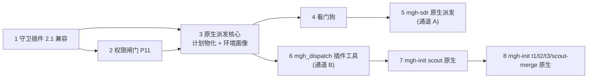

# mgh-sdr 优先的 native 派发 propose 规划(2026-10-20)

> **受众:人类·仅研发仓**。本文回答两个问题:如果先改 `/mgh-sdr`,应该开几个 openspec propose、
> 顺序是什么;`/mgh-init` 怎么顺带排。本文是**规划**,不是已经创建的 change;具体 propose 在
> 拍板后按此顺序开。
>
> 前置事实(已实测,详见
> [opencode2 实测记录](opencode2-native-dispatch-verification-2026-10-20.md)):
> ①opencode 2.1 会**拒载** mgh 现有的 v1 守卫插件;②2.1 的插件可以注册自定义工具、可以在子会话
> 里触发 `tool.execute.before`/`permission.evaluate`;③原生子代理可以并发派发;④权限询问在
> 无人值守时会永久挂起,`permission.evaluate` 可以把 ask 改写成 deny;⑤`opencode run` 在 2.1
> 连的是同一个常驻 service(pid 不变),但企业环境还要做 D8 复核。
>
> **D8 怎么做**:Linux 与 Windows(不用 PowerShell)的具体步骤、记录表和判定规则见
> [docs/opencode2-d8-experiment-2026-10-20.md](opencode2-d8-experiment-2026-10-20.md)。

---

## 0. 结论先行

**推荐 8 个 propose**;如果想少开,可以压到 **6 个**(合并方式见 §5)。

| 序 | propose 名 | 类型 | 一句话目标 | 依赖 |
| --- | --- | --- | --- | --- |
| 1 | `fix-mgh-opencode2-plugin-compat` | P0 基础件 | 让现有守卫插件在 2.1 能加载,行为不变 | 无 |
| 2 | `add-mgh-native-permission-gate` | P0 安全件 | 无人值守永不弹授权(P11 根治) | 1 |
| 3 | `add-mgh-native-dispatch-core` | 基础件 | 确定性计划物化 + 环境画像 + 短单元号 | 1,2 |
| 4 | `add-mgh-native-dispatch-watchdog` | 基础件 | 常驻看门狗:发现挂起/等授权并处置 | 1,2,3 |
| 5 | `fix-mgh-sdr-native-dispatch` | **sdr 主改** | `/mgh-sdr` 改用原生派发,runner 降为回退 | 1–4 |
| 6 | `add-mgh-native-dispatch-tool` | init 基础件 | 插件自定义 `mgh_dispatch` 工具,零 LLM 波次 | 1–4 |
| 7 | `fix-mgh-init-native-scout-dispatch` | init 第一阶段 | scout 层改原生派发 | 6(大仓)/3(小仓) |
| 8 | `fix-mgh-init-native-aggregate-dispatch` | init 第二阶段 | t1/t2/t3/scout-merge 改原生派发 | 7 |

排序原则:

1. **行为保持的迁移先做**:守卫插件 2.1 兼容不改判定逻辑,先把「升级 2.1 当天守卫静默失效」
   这个 P0 关掉。
2. **新安全语义在第一个 native run 之前**:P11 权限闸门必须先于任何无人值守原生派发。
3. **确定性计划先于壳改动**:先把「每个单元的任务消息/路径/波次」物化成文件,再改壳;否则
   壳里的弱模型又要开始手写路径。
4. **看门狗先于无人值守**:没有看门狗,native sdr 只能有人盯着跑。
5. **sdr 先于 init**:sdr 单元数(约 67)小、链路短、报告可对照;init 有 6 个 tier、数百至
   上千单元,必须等 sdr 把通道 A 跑通、再上通道 B。
6. **大仓 init 必须等通道 B**:通道 A(模型每波亲手发 subagent 调用)在 900 批场景会退化为
   数百次编排器回合 + 3–4 次压缩;通道 B(插件一次调用跑完波次)才是那个场景的正解。

---

## 1. 依赖关系图

---

## 2. 逐 propose 说明

### 2.1 `fix-mgh-opencode2-plugin-compat`(第一个,必做)

**为什么单独开**:它只做「让现有守卫在 2.1 加载」,不改任何拦截判定;把兼容性风险和扇出转向
分开评审。2.1 的插件模块只接受 `export default { id, effect|setup }`;mgh 现在是
`export const BlockAdhocScripts = async (ctx) => ({...})`,实测日志已经报
`Plugin must export a default definition...`,而且只是 WARN 后继续——**不迁移等于没有守卫**。

**交付物**:

- 守卫插件改 `export default { id, async setup(ctx) { await ctx.tool.hook(...) } }`;
  事件回调从 v1 的 `(input, output)` 改成读 `event.input`。
- 工具名映射:`bash → shell`、`task → subagent`、`write/edit → edit`;新增 `patch`/
  `webfetch` 的工具面(即使守卫只做归一化,也要保证 HANDLED 集覆盖)。
- agent 定义从 `tools:` 列表迁到 `permissions:` 规则集;fanout 孪生 agent 的
  `mode: primary` 改为 `native` 需要的 `subagent`(可留一个 `primary` 给落回 runner 的旧形)。
- 哨兵锚点适配 2.1 的 location 语义(磁盘哨兵仍是激活主路径)。
- install 自检清单、三端 parity 测试、契约 `core/contracts/hooks/runtime-enforcement.md` 同步。

**验收**:

- 2.1 真机日志中不再出现插件加载失败;
- 用同一套越权样例(越树写/读、微脚本、叶源码读)对照 1.x 与 2.1,拦截结果一致;
- 判定逻辑仍在 Python 守卫里,插件只做事件归一化 + 管道(单一真相源不破)。

**相对规模**:中。**不要**在这个 change 里加新的权限语义(P11),那是第 2 个。

---

### 2.2 `add-mgh-native-permission-gate`(P11 根治)

**为什么单独开**:它是**新行为**(拒绝原本会弹给用户的授权请求),和安全语义有关,应该独立
评审;而且它要覆盖所有 mgh 运行域,不只是 sdr。

**交付物**:

- 插件 `permission.evaluate` 钩子:运行域内 `effect === "ask"` → 改 `deny` + recipe;
  对 `question`、`external_directory` 显式 deny(它们可能默认 allow,ask-only 规则拦不到)。
- config/agent 的硬 deny floor:`external_directory`、`question`、`read *.env`、
  `read *.env.*`;用 deny,不用 ask(历史 always 记录会静默放行 ask)。
- 运行域识别:沿用磁盘哨兵(`.mgh-*/.active`),不依赖 env(插件进程不继承 mid-session env)。
- 诚实边界:Form/MCP elicitation/provider-executed 工具不受 permission 钩子管辖,写明;
  TUI 停在子会话 tab 时授权请求不显示的盲区,写明。
- 测试:无应答会话复现 pending、`reject + message` 恢复、`interrupt` 终止、
  `evaluate` ask→deny 后 pending=0;插件加载失败时 config deny floor 仍生效。

**验收**:

- 无人值守 native smoke 中 `max_pending = 0`;
- 模型能看到明确的 deny 文案并继续,不会整轮挂死;
- 不依赖「用户刚好在旁边点同意」。

**相对规模**:小到中。

---

### 2.3 `add-mgh-native-dispatch-core`(确定性计划)

**为什么单独开**:它是 sdr 和 init 共用的基础件;不改壳、不派发,只产「计划 + 任务文件」,
可以先用单测和 `--check` 验完,再让消费方接入。

**交付物**:

- `fanout_runner.py --emit-native-plan`(或独立薄入口复用其函数):沿用现有 `TIERS` 表、
  模板加载、`_fill_template`、路径锚树校验、配额纯函数;产出
  `<run>/inputs/<unit>.task.md` + `<run>/native_plan.json`(波次表、短单元号、agent 名、
  预期 marker 路径)。
- 短单元号规则(如 `sdr-u17`),任意两个号编辑距离 ≥2;计划里保存「短号 ↔ 完整路径」映射。
- 环境画像 `<项目>/.mgh/env-profile.json`:`dispatch_mode`(auto/runner/native)、
  `native_concurrency`、配额三参数;缺文件 = 现状默认,坏文件 = fail-closed。
- `--emit-native-plan --check`:计划可重复、路径绝对、单元号无歧义、模板无残留占位符、
  与枚举器 pending 一致。
- 契约:fanout runtime 增「native plan」段;测试:计划往返、短号冲突、锚树、配额算术。

**验收**:

- 同一输入两次物化,计划与 task 文件逐字节一致(除时间戳);
- 不 spawn 任何进程、不写凭证、不创建 XDG 目录;
- runner 模式行为零变化。

**相对规模**:中。

---

### 2.4 `add-mgh-native-dispatch-watchdog`(常驻看门狗)

**为什么单独开**:它要常驻、要读 service.json、要发 HTTP 动作,和「计划物化」是两类风险;
先独立做,才能让 sdr 无人值守。

**交付物**:

- 新 `core/scripts/native_watchdog.py`(stdlib):读
  `~/.local/state/opencode/service.json`(Linux/Windows 路径都认),Basic auth;
  轮询 `/api/session?parentID=`、`/api/session/:id/permission`、`/api/session/:id/form`、
  `/api/session/active`、消息时间戳。
- 动作阶梯:pending ask → `reject + message`(首选);pending form → `cancel + message`;
  超期无进展 → `interrupt`;后台 shell → `DELETE /api/shell/:id`;所有动作落
  `<run>/watchdog/events.jsonl` + 原子 `state.json`。
- `--once`(波次边界对账)与常驻两种模式;`--dry-run`;`--deadline-s`;只处理本次 run 的
  root + 后代,不碰共享服务上的其它会话。
- 测试:fake service(本地 HTTP)覆盖 pending/active/超时/拒绝/中断;Windows 路径与
  `service.json` 缺省;interrupt 后 30–60 秒仍 active 时记 `interrupt_unsettled`。

**验收**:

- 故障注入:子代理等授权 → 看门狗 reject,父会话继续;
- 子代理活着不收敛 → 看门狗 interrupt,标记回 pending 重派;
- 看门狗自己的退出不留下孤儿进程;不写 `.done`。

**相对规模**:中到高。

---

### 2.5 `fix-mgh-sdr-native-dispatch`(sdr 主改,第一个消费方)

**为什么单独开**:这是 sdr 的转向本体,牵涉壳、提示词、agent 定义、list/resume/render、
契约和测试;它不应该是「基础件」的附带改动。

**交付物**:

- `releases/opencode/command/mgh-sdr.md`(以及 claude/dsh 面镜像,如果本轮只做 opencode
  就先在规格里写明):step 0 读环境画像;native 模式走「读计划 → 同消息派 N 个 subagent →
  子代理自写 `.done/.failed` → 波次间重枚举」;runner 模式保留为回退。
- 原生 agent `sdr-review-native.md`(`mode: subagent`),正文与 `sdr-review-fanout.md`
  共享 stage 提示词;输出 schema/单行回执纪律一致。
- `list_sdr_steps.py`/`resume_sdr_state.py`:native 模式下的下一步、剩余单元、失败单元、
  重派指示;`render_sdr_report.py`:报告数据与 runner 模式同源。
- P11 权限闸门接线(复用第 2 个 propose 的插件);看门狗在第 4 个 propose 的脚本里,
  sdr 壳按需调用。
- 配额:波次尺寸 = min(native_concurrency, 配额算术结果);波次间等窗指示。
- 契约:`core/contracts/sdr/pipeline.md` 增 native 形态;`sdr-task` 模板增短号/路径约定;
  诚实边界(无进程树杀、波次粒度止损、父会话单点)。

**验收**:

- 小仓 6 单元 native sdr 全链:计划 → 3 并发 → 标记 → 重枚举 → 报告;
- 与 runner 模式同一输入的报告数据一致(允许措辞差异,不允许 finding 丢失);
- 故障注入:单单元 `.failed`、全波限流特征、权限 ask、挂死 interrupt、resume;
- 企业 CAS 真仓 6 单元对照(原失败场景)通过;
- runner 模式在新环境画像关闭时仍能跑(回退路径不被破坏)。

**相对规模**:大。

---

### 2.6 `add-mgh-native-dispatch-tool`(通道 B,init 大仓用)

**为什么单独开**:插件自定义工具要重新实现 subagent 的权限/深度/完成/取消语义,风险高;
sdr 用通道 A 就能跑,不需要它;init 900 批必须有它。

**交付物**:

- 插件工具 `mgh_dispatch`,输入只接受 `wave` 或 `unit_ids[]`(短号),**不接受长路径**;
  插件读 `native_plan.json`,按波次 create/prompt 子会话,wait 收割,写结果摘要。
- 复用/对齐内置 `subagent` 的权限检查(`permission.assert(action:"subagent")`)、深度限制
  (默认 1)、`mode: primary` 拒绝、前台/后台完成语义;漏一项就是安全/完成性缺口。
- 取消:插件工具被中断时,级联中断/取消它创建的子会话。
- 测试:计划→波次→完成;未知短号 fail-loud;重复调用幂等;中断级联;权限/深度不绕过。

**验收**:

- 编排器一次工具调用跑完一波(零 LLM 波次);模型输出里不出现长路径;
- 错误短号/已终态单元被拒绝并给 recipe;
- 中断后没有后台子会话残留。

**相对规模**:高。

---

### 2.7 `fix-mgh-init-native-scout-dispatch`(init 第一阶段)

**为什么单独开**:scout 是 init 最大、最独立的扇出层;先只改 scout,保留 t1/t2/t3/
scout-merge 的 runner 形态,可以把风险限制在一层。

**交付物**:

- `list_scout_batches.py` 产 native plan;`init-scout` agent 增 `mode: subagent` 孪生;
  `mgh-init.md` scout 步 native 分支;scout 的 checkpoint/done marker 语义不变。
- 打包(pack)与预算:pack 的成员/包 id 仍由确定性输入算;native 计划按 pack 或单簇派发;
  `--max-unit-bytes` 的单位物化口径不变。
- 失败/缺口:scout 单元 `.failed` 不阻塞其它单元;scout-merge 之前披露缺口。
- 测试:scout 层 native smoke;pack 幂等;续跑;候选形状错;大仓分批。

**验收**:

- 小/中仓 scout 原生跑通,`controls_candidates.json` 与 runner 模式可比;
- 900 批场景**不在本 change 验收**(它需要通道 B);本 change 只保证通道 A 的小/中仓路径。

**相对规模**:中到大。

---

### 2.8 `fix-mgh-init-native-aggregate-dispatch`(init 第二阶段)

**为什么单独开**:t1/t2/t3/scout-merge 各有各的预算/打包/rollup 语义,一次全改风险大;
建议在 scout 跑通后,再按层接入,必要时再拆成 2–3 个 change。

**交付物**:

- T1 `list_clusters` → native plan;pack/checkpoint/集群闸门不变。
- T2 `plan_aggregate` → native plan;单上下文与 rollup 两条路径;`needs_reduce=false`
  零派发;manifest 消费不变。
- T3 `list_rule_jobs` → native plan;`init-rulewriter` 需要 Edit 权限;done/failed 正向判定;
  孤儿审计。
- scout-merge:分片/96KB 预算/rollup manifest;缺 shard 时不 rollup 并披露。
- 跨层:`run_config` native 模式、`resume_state` 派生、`init_manifest`、报告、`--check`。
- 测试:各 `list_*`/`plan_aggregate`/`assemble_rules`/`validate_t1_records`/`resume_state`
  的 native 分支;pack;rollup;失败缺口;900 批通道 B smoke。

**验收**:

- 全 init native smoke:发现 → scout → T1 → T2 → T3 → rules,产物与 runner 模式可比;
- 900 批场景用通道 B 跑通,编排器回合数不随批次数线性增长;
- 缺口/失败/续跑/预算全部有披露。

**相对规模**:高(可拆)。

---

## 3. mgh-sdr 路径的具体清单(先做这条)

### 3.1 P0(两个 propose,先做)

- [ ] 守卫插件 2.1 加载(default 导出 + async setup + await hook);
- [ ] 工具名映射与事件 payload 迁移;
- [ ] agent `tools:` → `permissions:`,fanout 孪生 `mode: subagent`;
- [ ] install 自检 + 三端 parity 测试;
- [ ] P11 `permission.evaluate` ask→deny + config/agent deny floor;
- [ ] 无应答 pending 复现 + reject/interrupt/evaluate 三处置测试。

### 3.2 P1(sdr 本体)

- [ ] 计划物化:`--emit-native-plan` 产 `native_plan.json` + 每单元 `task.md`;
- [ ] 短单元号 + 计划校验;
- [ ] 环境画像 `.mgh/env-profile.json`;
- [ ] `mgh-sdr` 壳 native 波次纪律(N=3、同消息派发、单行回执、磁盘标记、重枚举);
- [ ] `sdr-review-native` agent(`mode: subagent`)与 `sdr-review-fanout` 提示词对齐;
- [ ] `list_sdr_steps`/`resume_sdr_state`/`render_sdr_report` native 分支;
- [ ] 看门狗接入(reject+message / interrupt);
- [ ] 配额波次尺寸 + 等窗指示;
- [ ] 契约/模板/诚实边界/`--check`;
- [ ] 回归:sdr 面 10 个测试文件 + 新增 native 测试;
- [ ] 实机:6 单元 native 全链 + runner 对照 + 企业 CAS 6 单元。

### 3.3 sdr 的验收门槛

1. 计划可重复、路径绝对、短号无歧义;
2. 原生 6 单元全链跑通,报告 finding 与 runner 模式一致;
3. 无 pending 授权;
4. 注入挂死 → 看门狗能恢复;
5. 失败单元 `.failed` 不阻塞其它单元,重派至多一轮;
6. resume 后不重复已完成单元;
7. runner 回退路径仍可跑。

---

## 4. mgh-init 清单(顺带规划)

### 4.1 分层清单

| 层 | 要改什么 | 不能破什么 | 验收 |
| --- | --- | --- | --- |
| scout | `list_scout_batches` → native plan;`init-scout` subagent 孪生;scout 步壳;pack/预算 | 候选形状、checkpoint 身份、缺口披露 | 小/中仓 scout native 产物与 runner 可比 |
| T1 | `list_clusters` → plan;`init-induct` subagent;cluster 闸门;pack | 簇计数三分、checkpoint 身份、scout 完成闸门 | T1 native 产物通过 `validate_t1_records` |
| T2 | `plan_aggregate` → plan;单上下文/rollup;`needs_reduce=false` | manifest 消费、预算口径、零派发 | 两种路径都跑通,rollup 不缺片 |
| T3 | `list_rule_jobs` → plan;`init-rulewriter` 需 Edit;孤儿审计 | done/failed 正向判定、规则文件格式 | rules 与 runner 模式可比,孤儿有披露 |
| scout-merge | 分片/96KB/rollup manifest;native 派发 | 缺 shard 不 rollup、预算不超 | 分片 native 跑通,rollup 完整 |
| 跨层 | `run_config` native 模式;`resume_state` 派生;`init_manifest`;报告;`--check` | 磁盘真相源、重派生、三面镜像 | resume 跨 tier 正确,报告字段不变 |

### 4.2 init 的额外注意事项

1. **900 批必须走通道 B**:通道 A 每波一次编排器回合,900 批会触发 3–4 次压缩;这是
   `add-mgh-native-dispatch-tool` 的存在理由。
2. **pack 与预算不能丢**:native 计划要按 pack/单簇派发,`--max-unit-bytes` 的物化口径
   与 runner 模式一致;pacing/打包是 init 的省调用核心。
3. **scout-merge 是最后一个手派节点**:它之前实测过「翻全局目录→弹权限→无人值守中断」;
   native 化时要确保 agent 定义/工具白名单/权限都在计划里,不靠模型自己找。
4. **T3 需要 Edit**:`init-rulewriter` 原生 agent 必须有写规则文件的权限;不能照抄
   只读 fanout agent 的权限集。
5. **压缩后再定向**:init 级 3–4 次压缩,压缩后第一步必须按 R5.5 recipe 调重枚举脚本,
   不能靠对话记忆继续。

### 4.3 init 的验收门槛

1. scout/T1/T2/T3/scout-merge 逐层 native smoke;
2. 全链产物与 runner 模式可比(规则文件、inventory、manifest);
3. 900 批通道 B:编排器回合数不随批次数线性增长;压缩次数在预期内;
4. 失败/缺口/续跑/预算都有披露;
5. 非 CAS 环境仍可回退 runner。

---

## 5. 少开几个的合并方案

**推荐 8 个**;如果维护窗口紧,可以压到 **6 个**:

| 合并后 | 合并内容 | 代价 |
| --- | --- | --- |
| 1 | `fix-mgh-opencode2-plugin-compat` + `add-mgh-native-permission-gate` | 兼容迁移与新安全语义同评审,review 面变大 |
| 2 | `add-mgh-native-dispatch-core` + `add-mgh-native-dispatch-watchdog` | 计划物化与常驻进程同 change,测试面变大 |
| 3 | `fix-mgh-sdr-native-dispatch` | 不变 |
| 4 | `add-mgh-native-dispatch-tool` | 不变 |
| 5 | `fix-mgh-init-native-scout-dispatch` | 不变 |
| 6 | `fix-mgh-init-native-aggregate-dispatch` | 不变 |

**不建议**把 sdr 主改和基础件合并:一旦 sdr 出问题,很难判断是壳/提示词问题还是计划/看门狗
问题。也不建议把 init 的 scout 与 aggregate 合并:两层风险不同,分开更容易回滚。

---

## 6. 与在途 change 的关系

| 在途 change | 处理建议 |
| --- | --- |
| `fix-mgh-sdr-fanout-auth-isolation` | 照常归档。它修的是 runner 模式的真实失败;runner 保留为回退,资产不浪费。 |
| `fix-mgh-sdr-quota-adaptive-fanout` | 照常归档。其配额纯函数正是 native 计划器复用的同一份代码。 |
| `adopt-mgh-shared-fanout-dispatcher` | **需要改方向或关闭**。它现在的方向是把 sra/srr 并入 runner;与本规划相反。建议把它的清点交付物升级为「按命令 × 按环境选 runner/native」,或直接关闭并记录理由。 |
| `improve-mgh-sdr-unit-packing` | 保留。packing 在 native 计划里仍然有用。 |
| `test-mgh-sdr-multibranch-rerun` | 保留,作为 native sdr 的对照回归。 |

---

## 7. 建议的 propose 顺序(一句话)

**1 → 2 → 3 → 4 → 5(sdr 可用)→ 6 → 7 → 8(init 全链)**。

如果只能先做三件:**1(守卫迁移)、2(P11)、3(计划物化)**;sdr 主改(5)等这三件
落地后再开。
