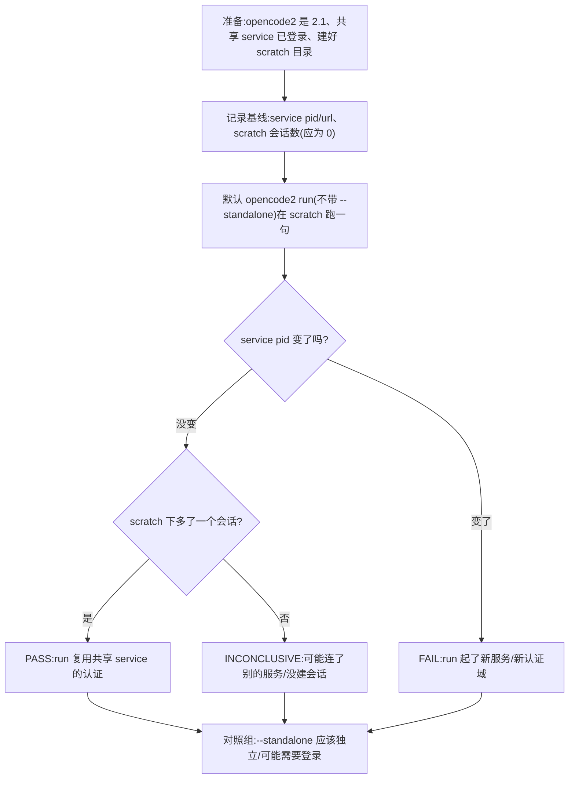
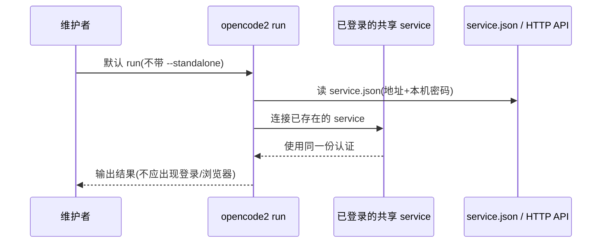

# D8 实验手册:`opencode run` 到底用不用同一个已登录服务(2026-10-20)

> **受众:人类·执行者**(维护者本人或内网执行同事)。本文是一份可以照着敲的实验手册,
> 不需要读源码。目标只有一个:**确认企业内网的 `opencode run` 是复用当前已经登录的后台
> service,还是另起一个独立认证域**。
>
> **为什么这件事重要**:如果复用,旧 fanout_runner 的「子进程派发」在 opencode 2.1 上就可能
> 小改复活,作为 native 模式的兜底;如果不复用,原生派发就是企业内网唯一可持续路线。
> 本实验**不改变任何产品代码**,只读状态、跑一句模型请求、记录结果。
>
> 适用环境:Linux(bash)与 Windows(只用 `cmd.exe` / 批处理,不依赖 PowerShell)。
> 相关术语见 [docs/glossary.md](glossary.md)(服务注册文件、headless、原生派发)。

---

## 0. 一句话结论怎么读

- **PASS**:默认 `opencode2 run` 前后,后台 service 的 **pid 不变**,并且 scratch 目录下
  **多了一个会话**(能在同一个 service 的会话列表里看到),输出里**没有登录/浏览器**。
  → 子进程复用共享 service 的认证,旧 runner 可作兜底。
- **FAIL**:默认 run 之后 service **pid 变了**,或者根本没有 service.json / 新起了一个服务,
  或者出现登录提示。→ 子进程仍是独立认证域,原生派发是企业内网唯一路线。
- **INCONCLUSIVE**:没装 2.1、没有可用模型、没有登录、或 run 在会话创建前就失败;先修环境
  再重跑,不要用这一轮下结论。

---

## 1. 先理解三个东西(不读源码也能懂)

| 名词 | 大白话 |
| --- | --- |
| 共享 service | opencode 2.x 在后台常驻的一个进程,真正的会话、模型调用、插件、认证都在它里面跑。TUI/CLI 只是连它的客户端。 |
| `service.json` | 这个 service 写在本机状态目录里的一个小文件,里面有它的地址、进程号和本机密码。读到它就等于拿到「怎么连上这个已登录服务」的钥匙。**不要把文件内容贴到聊天/工单里**。 |
| 会话的 location | 每个会话都记着自己是在哪个目录创建的。D8 用 scratch 目录当标记:如果 run 之后共享 service 里出现一个 location 等于 scratch 的会话,就说明 run 连的是共享 service。 |

D8 的判断不靠「看起来没弹登录」这一条,而是三条一起看:**service pid 不变 + scratch 会话出现
在共享 service + 没有登录流程**。

---

## 2. 实验总览





---

## 3. 准备(两种系统都做)

1. **确认版本是 2.1**:
   - Linux:`opencode2 --version`
   - Windows cmd:`opencode2 --version`
   - 期望输出 `opencode v2.1.0` 或更高 2.x。1.x 不在本实验范围(1.x 的 run 本来就是独立进程)。
2. **确认共享 service 已登录**:
   - 先正常打开一次 TUI(或在企业环境里完成一次 CAS 登录),确认能对话;
   - 或在终端跑一次 `opencode2 service status`,看到 `http://127.0.0.1:45278` 之类的地址。
   - 如果 service 没起来:Linux/Windows 都可以用 `opencode2 service start`;启动后先确认能
     正常跑一句模型请求,再做实验。
3. **确认有可用模型**:`opencode2 models`;挑一个企业内网可用的模型(后面用
   `<provider/model>` 代替)。例如本机可用的是 `zai-coding-plan/glm-5.3-flash`,内网请换成
   你自己的模型,**不要照抄**。不要用免费模型做这个实验,免费模型可能被 IP 风控拒绝,导致
   误判。
4. **建 scratch 目录**:
   - Linux:`mkdir -p ~/d8_scratch`
   - Windows cmd:`mkdir C:\DEV\d8_scratch`
5. **放一个探针脚本**:把下面这段保存为 scratch 目录里的 `d8_probe.py`。它只读 `service.json`
   和 `/api/session`,**不打印密码**。Linux 用 `python3`,Windows 用 `py`。

```python
import base64, json, os, sys, urllib.request

state = os.environ.get("XDG_STATE_HOME") or os.path.expanduser("~/.local/state")
path = os.path.join(state, "opencode", "service.json")
if not os.path.exists(path):
    print("NO_SERVICE_JSON", path)
    raise SystemExit(2)
svc = json.load(open(path, encoding="utf-8"))
auth = "Basic " + base64.b64encode(f"opencode:{svc['password']}".encode()).decode()

def get(p):
    req = urllib.request.Request(svc["url"] + p)
    req.add_header("Authorization", auth)
    return json.load(urllib.request.urlopen(req, timeout=10))

target = sys.argv[1] if len(sys.argv) > 1 else ""
sessions = get("/api/session?limit=200")["data"]
mine = [s for s in sessions if (s.get("location") or {}).get("directory") == target]
print(json.dumps({
    "service": {"pid": svc["pid"], "url": svc["url"]},
    "target": target,
    "session_count": len(mine),
    "sessions": [{"id": s["id"], "agent": s.get("agent"), "outcome": s.get("outcome")} for s in mine],
}, ensure_ascii=False, indent=2))
```

> Windows 记事本保存时,文件名要加引号写成 `"d8_probe.py"`,避免变成 `.py.txt`。
> 如果 `py` 不可用,用 `where python` 找一个真 Python;不要用 Microsoft Store 的占位符。

---

## 4. 实验步骤

### 第 1 步:记录基线

在 scratch 目录里跑探针:

- Linux:`cd ~/d8_scratch && python3 d8_probe.py "$PWD"`
- Windows cmd:`cd /d C:\DEV\d8_scratch` 然后
  `py d8_probe.py "C:\DEV\d8_scratch"`

记录三件事:

1. `service.pid`(例如 88380);
2. `service.url`;
3. `session_count`(基线应为 0;如果不是 0,换一个全新的 scratch 目录重来)。

### 第 2 步:默认 run(不带 `--standalone`)

在 scratch 目录里执行:

- Linux:`opencode2 run --model <provider/model> "Reply with exactly D8_OK"`
- Windows cmd:`opencode2 run --model <provider/model> "Reply with exactly D8_OK"`

观察:

- 输出里是否出现 `D8_OK`;
- 是否弹出浏览器 / 要求登录 / 长时间停在登录页;
- 命令大概跑了多久。

> 不要加 `--auto`。`--auto` 是自动批准权限,会干扰「是否要登录」的判断;这句 prompt 不需要
> 工具,正常也不会触发权限。

### 第 3 步:验证是否复用共享 service

再跑一次探针,记录:

1. `service.pid` 是否与第 1 步相同;
2. `session_count` 是否从 0 变成 1;
3. 新会话的 `agent`/`outcome` 是否正常。

如果 pid 相同且 scratch 会话出现:**默认 run 复用了共享 service**。
如果 pid 变了、或 `service.json` 指向了新的进程、或 scratch 会话没出现:记录实际情况,
不要猜。

### 第 4 步:对照组 `--standalone`

在 scratch 目录里执行:

- Linux:`opencode2 run --standalone --model <provider/model> "Reply with exactly D8_STANDALONE_OK"`
- Windows cmd:`opencode2 run --standalone --model <provider/model> "Reply with exactly D8_STANDALONE_OK"`

预期:`--standalone` 会起一个私有 server(随机端口/口令),**不应该**在共享 service 的
scratch 会话里多出一条;如果企业 CAS 要求登录,这一步可能出现登录提示。这正是对照组:
它证明「默认 run 与 standalone 不是一回事」,从而证明第 2–3 步的观察有意义。

> `--standalone` 可能弹登录或失败,这是预期现象;记录即可,不要用它来判断默认 run。

### 第 5 步(可选,仅在测试机做):停掉 service 再跑

这一步是「反向对照」,能进一步证明默认 run 平时确实在复用 service。它会中断当前登录,
**只在测试机、且你确认可以重新登录时做**。

1. `opencode2 service stop`
2. 再跑一次默认 `opencode2 run --model <provider/model> "Reply with exactly D8_NOSVC_OK"`
3. 观察:是否新起了一个 service(pid 变)、是否要求登录、`service.json` 是否被重写;
4. 恢复:`opencode2 service start`,必要时重新登录。

如果第 5 步出现「新 pid + 登录」,而第 2–3 步是「同 pid + 新会话」,那 D8 的结论就非常清楚。

---

## 5. 记录表(把实际值填进去)

| 步骤 | 模式 | service pid(前→后) | scratch 会话数(前→后) | 是否出现登录/浏览器 | 备注 |
| --- | --- | --- | --- | --- | --- |
| 基线 | — |  | 0 | — |  |
| 第 2–3 步 | 默认 run |  |  |  |  |
| 第 4 步 | `--standalone` |  |  |  |  |
| 第 5 步(可选) | 停 service 后 run |  |  |  |  |

判定:

- **PASS**:默认 run 行「pid 不变 + 会话数 +1 + 无登录」;standalone 行与默认不同。
- **FAIL**:默认 run 行 pid 变化 / 新服务 / 登录;或根本没有共享 service.json。
- **INCONCLUSIVE**:默认与 standalone 行为完全一样,或 run 在会话创建前失败;检查版本、
  模型、登录、scratch 路径后重跑。

---

## 6. Linux 命令清单(bash)

```bash
opencode2 --version
opencode2 service status
opencode2 models
mkdir -p ~/d8_scratch && cd ~/d8_scratch
python3 d8_probe.py "$PWD"
opencode2 run --model <provider/model> "Reply with exactly D8_OK"
python3 d8_probe.py "$PWD"
opencode2 run --standalone --model <provider/model> "Reply with exactly D8_STANDALONE_OK"
python3 d8_probe.py "$PWD"
# 可选,仅测试机
opencode2 service stop
opencode2 run --model <provider/model> "Reply with exactly D8_NOSVC_OK"
opencode2 service start
```

进程辅助观察(可选):

```bash
ps -eo pid,ppid,etime,args | grep -i '[o]pencode'
```

## 7. Windows 命令清单(cmd.exe,不用 PowerShell)

```bat
opencode2 --version
opencode2 service status
opencode2 models
mkdir C:\DEV\d8_scratch
cd /d C:\DEV\d8_scratch
py d8_probe.py "C:\DEV\d8_scratch"
opencode2 run --model <provider/model> "Reply with exactly D8_OK"
py d8_probe.py "C:\DEV\d8_scratch"
opencode2 run --standalone --model <provider/model> "Reply with exactly D8_STANDALONE_OK"
py d8_probe.py "C:\DEV\d8_scratch"
REM 可选,仅测试机
opencode2 service stop
opencode2 run --model <provider/model> "Reply with exactly D8_NOSVC_OK"
opencode2 service start
```

进程辅助观察(可选,cmd 自带):

```bat
tasklist | findstr /I opencode
```

> 如果 `py` 不存在:`where py` 确认;没有就用 `python`,但先确认 `python --version` 有真实
> 版本号(不是 Microsoft Store 占位符)。

---

## 8. 常见问题与处理

| 现象 | 可能原因 | 处理 |
| --- | --- | --- |
| 探针输出 `NO_SERVICE_JSON` | service 没起,或状态目录不在默认位置 | `opencode2 service start`;`opencode2 debug paths` 看 `state` 实际路径;设置 `XDG_STATE_HOME` 后重跑;若目录里是 `service-<channel>.json` 而不是 `service.json`,把脚本里的文件名改成实际文件 |
| `opencode2 run` 提示登录/CAS | 共享 service 没有有效凭证,或 run 起了独立服务 | 先确保 TUI 能正常对话;记录是否弹出登录,这本身就是 D8 的证据 |
| `service.pid` 变了 | run 新起了一个 service | 记录新 pid/新 `service.json`;这通常是 FAIL 信号 |
| scratch 会话数一直是 0 | run 没建会话、或连了别的 location | 检查 `cd` 是否在 scratch;用探针打印的 `target` 确认路径完全一致(Windows 反斜杠/大小写) |
| 默认与 `--standalone` 结果一样 | 可能默认 run 也起了私有服务,或实验环境不支持共享 service | 记录为 INCONCLUSIVE;检查 `opencode2 service status` 与 `service.json` |
| Windows 上路径对不上 | `~` 解析到 `C:\Users\...`,但 scratch 用了 `C:/DEV/...` | 探针的 `target` 参数用**绝对 Windows 路径**,与 `location.directory` 完全一致;不要用 `/c/...` 的 Git Bash 形式 |
| 免费模型被 IP 风控拒绝 | 免费模型不可用 | 换企业可用的付费/内网模型;不要把风控失败当成 D8 失败 |

---

## 9. 诚实边界

1. 本实验只回答「默认 `opencode2 run` 是否复用同一个已登录 service」,不回答「企业 CAS 的
   token 能活多久」「多进程并发是否被网关驱逐」;后者是另外的实验。
2. 「没有弹出登录」不是唯一证据;必须以 **service pid + scratch 会话 + 运行输出**三条一起
   判断。
3. 如果企业 runner 以前用的是 `opencode run --standalone` 或 `--server <远程>` ,本实验的
   默认形态结论不直接适用;先确认实际 argv。
4. `service.json` 含本机密码,属于敏感文件;不要把它贴进聊天、工单或日志。探针脚本只打印
   pid/url,不打印密码。
5. 第 5 步(停 service)会中断登录,只在测试机做;生产机不要做。
