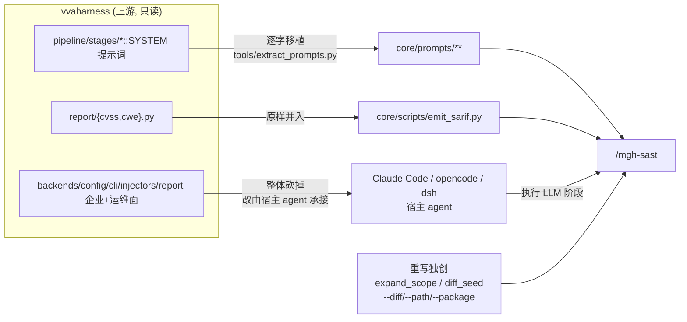

# vvaharness 移植背景与改名历史(自 AGENTS.md 摘出)

> **受众**:人类(维护者)。本文件是**背景资料**,不承载任何现行规则——操作性规则仍在
> AGENTS.md 的 R1(上游引用关系:同步锚点非必要不改 / 溯源注释不删 / NOTICE 保留)与
> R2(零运行时依赖是产品特性);逐项功能映射的**权威处**是 [`upstream-index.md`](upstream-index.md)
> 与 [`upstream/`](upstream/) 分文档。
>
> 2026-10-12 自 AGENTS.md 摘出。理由:AGENTS.md 每个会话全量载入上下文,历史背景常驻
> 只耗 token;且 `/mgh-sast` 已不是当前功能主力,背景降级为按需查阅。

## mgh-sast 与原项目 vvaharness 的关系

`/mgh-sast` 是 **vvaharness**(Visa / Project Glasswing,Apache-2.0)9 阶段 LLM SAST
流水线的**零运行时依赖重写**:

- **LLM 阶段**(s1/s2/s3/s4/s6/s8)由宿主 agent 的 subagent 执行,提示词**逐字移植**;
- **确定性阶段**(s5 prefilter / s7 dedup / s9 SARIF+CVSS+CWE)由 Python ≥3.10 标准库脚本执行;
- **不 import、不 bundle 任何 `vvaharness/` 代码**(install 时有零依赖自检)。

**逐项对应关系**(功能实现 + 提示词 + 保真度 + 未实现清单)见
[`upstream-index.md`](upstream-index.md),分文档在 [`upstream/`](upstream/)。

## 改名/解耦历史(原 AGENTS.md R4 正文)

本仓库已从原 `visa-vulnerability-agentic-harness/vvah-sast/` **迁出为独立仓库**,
磁盘目录名 `m3g4horness`(品牌显示名 `m3g4h⊿rness`,因 `⊿=U+22BF` 放进目录名会让
bash/git/CI 脆弱,故磁盘用 ASCII)。

原 R4 的两条操作性事实已回收进 AGENTS.md 的 R4 存根(工具脚本从仓库根运行 /
`extract_prompts.py` 默认 `--vvaharness` 指向原项目);本文件只留历史叙述,无现行效力。
