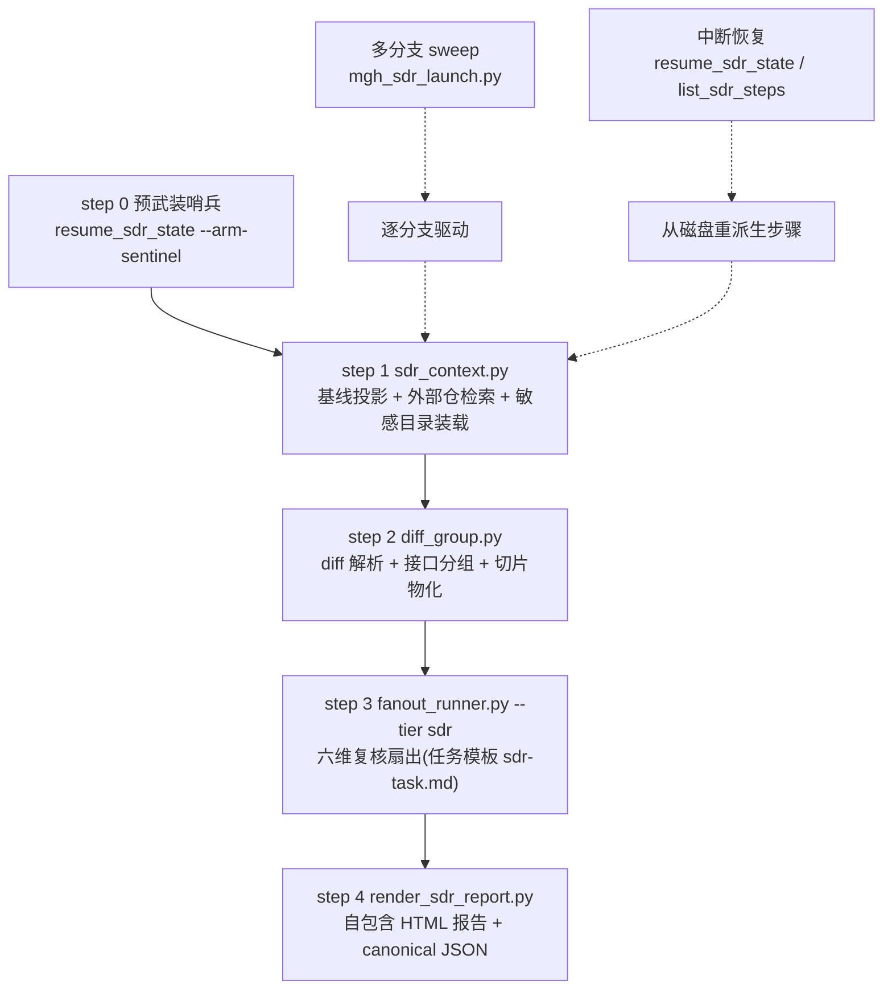

# mgh-sdr 全流程代码评审结果(2026-10-13)

> **受众**:人类 · 仅研发仓(开发者资料,不随 install 分发)。
> **状态**:只评审、未改任何产品代码;评审基线 = main 分支 HEAD `6e6ac63`(干净树)。
> **逐条明细**(位置 / 影响 / 修复建议 / 复现验证方式 / 健康面确认清单):
> [`docs/review-mgh-sdr-pipeline-2026-10-13.md`](docs/review-mgh-sdr-pipeline-2026-10-13.md)。

## 一句话结论

流水线架构主干健康(授权防线、哨兵、超时不变式、三面镜像 flag 面全部经机器与实验双重确认),
但存在 **3 条 critical、6 条 high**(共 9 条,全部经独立二次验证 subagent 复现确认,零误报),
其中两条 critical 直接违反本命令的核心承诺「任何 diff 文件都不得静默丢失」,一条是报告的
`javascript:` 链接注入面;另有 1 条 medium 级竞态使 clean HEAD 的回归套件在本机确定性红。

## 数字与可信度

| 项 | 值 |
| --- | --- |
| 评审面 | 24 个文件(12 脚本 + 敏感目录模板 + 2 份 sdr 契约 + fanout/hooks 契约 + 任务模板 + 三面命令壳 + 三面 agent 定义) |
| 覆盖率 | 24/24 全读,0 skipped(含 `diff_seed.py`——交叉核对证实属 mgh-sast,仍全量评审) |
| critical / high / medium / low | 3 / 6 / 20 / 12(保留有明确价值者) |
| 二次验证 | 9 条 critical/high + 1 条测试红竞态,全部独立复现确认;medium/low 为单批静态分析 + 局部实验证据 |
| 机器 lint 基线(全过) | 壳-flag 对账 459 项全过;分发纯净 0 违例;壳 token 预算全在限内(dsh SKILL 4994/5000 贴顶) |

## 流水线与缺陷落点

| 落点 | 缺陷编号 |
| --- | --- |
| diff 解析与分组(diff_group) | C1、C2、H4、M7、L6 |
| 基线与外部仓(sdr_context) | H6、M8、M9、M10、L4、L5 |
| 报告渲染(render_sdr_report) | C3、H1、H2、H3、M11、L11 |
| 扇出派发(fanout_runner + 任务模板) | H5、M1–M6、L12 |
| launcher / 状态工具 | L1–L3、M12、M13 |
| 壳 / 契约 / 提示词文档面 | M14–M20、L9、L10 |

## Critical(3 条,均端到端复现确认)

| 编号 | 一句话 | 位置 | 修法(一行) |
| --- | --- | --- | --- |
| C1 | git 默认给非 ASCII 路径加引号转义,解析器不识别 → **中文文件名整文件静默丢失**,报告显示「无变更」 | `core/scripts/diff_group.py:352`(正则)+ `:1722`(git 调用) | diff 命令加 `-c core.quotePath=false`;补中文路径回归测试 |
| C2 | 接口单元超预算贪心拆分时,「开启新 part 的那组成员」的 hunk **从不进入任何切片**(装包调用放错了分支),双重绕过兜底 | `core/scripts/diff_group.py:1165-1171` | 去掉 `else`,新建 part 后无条件装入该成员;补「单独≤上限、合并>上限」回归 |
| C3 | 报告「位置」链接的路径清洗不查冒号,LLM 草稿的 file 字段可把 `javascript:` 脚本地址原样送进 `<a href>`,复核人点击即执行 | `core/scripts/render_sdr_report.py:227-256` | 相对路径首段含 `:` 即放弃链接化,降级纯文本 |

## High(6 条,均复现确认)

| 编号 | 一句话 | 位置 | 修法(一行) |
| --- | --- | --- | --- |
| H1 | severity 字段是数组/对象时直接 TypeError 崩溃,渲染与 `--check` 双路径裸 traceback,违反「坏草稿不崩渲染器」承诺 | `core/scripts/render_sdr_report.py:170` | 取值前加 `isinstance(sev, str)` 判断,否则落默认级 |
| H2 | 存在 failed 单元时简报表「前端两列」整列错位:一列残留「—」、一列填入**别的接口**的值;降级运行下数据损坏且校验检不出 | `core/scripts/render_sdr_report.py:476-481` | 前端两列并入第一趟循环(或过滤后再 zip);补 failed+外部仓组合回归 |
| H3 | JSON 内嵌只防了 `</script>`,没防 `<!--`+`<script` 的解析器双转义状态 → 页面全部渲染 JS 被当数据吞掉,**报告成空白壳**,校验盲 | `core/scripts/render_sdr_report.py:552-556` | 追加一次 `"<!--"` → `"<\u0021--"` 转义(parse 等价,一行) |
| H4 | 单元名清洗只替换 `/ \ :` 三个字符,`@GetMapping("/**")` 这类真实注解把 `*` 带进文件名 → Windows 写盘崩溃、退出码违约 | `core/scripts/diff_group.py:244-247` | 替换集扩为 `/ \ : * ? < > | "` |
| H5 | 进程命令行探测依赖 `wmic`,Win11 24H2+ 已移除该工具 → `--kill-stale` **永远杀零个孤儿进程,却照删证据文件**,退出码 0 假成功 | `core/scripts/fanout_runner.py:1371-1377` | 加 PowerShell `Get-CimInstance` 回退(对照实验已验证可行);或探测不可用时 fail-loud 且不删证据 |
| H6 | 外部仓结论目录名只取 basename,两个同名目录的前端仓**互相覆盖检索结论**,前仓证据不可恢复丢失、记录指向错仓内容 | `core/scripts/sdr_context.py:307-308` | 目录名拼上解析后全路径的短哈希;声明去重键改用解析后路径 |

## Medium 速览(20 条,明细见文档第 5 节)

- **fanout_runner.py**(5 条):退出摘要 failed 双计(全败 10 单元会报 20);心跳 `idle` 读的是从未接线的死数据源,健康单元也显示「疑似卡死」;kill-stale 对 sdr 场景结构性扫错目录;**限流截断竞态使 `test_all_rate_limit_storm_truncates_fast` 在本机 5/5 红(clean HEAD 回归套件红,CI 必挂)**;kill-stale 的仓内配方因参数必填而不可原样运行。
- **sdr-task.md**(1 条):敏感目录维度声称「随任务消息下发」,但主路径任务模板没有目录槽位——**六维之一实质拿不到项目敏感目录,且无任何披露**(与 `--dimensions` 的明示披露形成对比)。
- **diff_group.py**(1 条):新增文件的 hunk 归属按符号数而非 hunk 数构造,新增 controller 的路由分簇坍缩为单单元。
- **sdr_context.py**(3 条):目录过滤误用绝对路径全组件判定,外部仓**祖先目录**名叫 build/dist 时整仓被跳过、路由计数静默假零;`--check` 的基线尺寸上限硬编码默认值的 4 倍,合法调大预算的 run 被误否决;外部仓检索对同一棵树最多 6 遍未剪枝全树扫描。
- **render_sdr_report.py**(1 条):前端两列按子串匹配 join,嵌套路由把短路由的计数算到长路由头上(把「无前端使用」标成「有」)。
- **describe_artifact.py**(2 条):`--field` 索引校验与类型转换语义错配,畸形路径即崩;全族唯一缺控制台编码重配置的脚本,中文 Windows 控制台输出即崩。
- **diff_seed.py【属 mgh-sast】**(1 条):与 C1 同族的 quotepath 未关,非 ASCII 路径静默漏出扫描种子。
- **壳/契约文档面**(6 条):dsh 面推荐 launcher 但 launcher 不支持 dsh 宿主;opencode/dsh 两面的超时不变式措辞是压缩歧义形、与 claude 面(及实现)不一致;opencode agent 定义里有运行时永不替换的 `{{ }}` 字面占位符、三面三种措辞;`core/contracts/sdr/pipeline.md` 声称 `--dimensions` 会透传收窄(与壳的诚实披露直接矛盾)且字段清单欠载;`core/contracts/hooks/runtime-enforcement.md` 完全遗漏 sdr 哨兵生命周期、并有「写入器尚未落地」的过时表述。

## Low(12 条)

以表格形式收录在明细文档第 6 节(launcher 空finally 与哨兵残留、外部仓「回退默认分支」实为当前检出分支、URL 被当路径提取进噪声条目、`--limit` 负值静默、报告页死代码转义函数与恒假的校验守卫等);纯卫生项(死 import、重复集合条目)合并为一条。

## 修复顺序建议(待拍板:分组方式二选一)

两条路线,都已按「先堵覆盖丢失与 CI 红、再清外围」排序:

| 选项 | 内容 | 优点 | 缺点 |
| --- | --- | --- | --- |
| **A(推荐):两波收口** | 第一波 = C1–C3 + H1–H6 + M4(CI 红)——全部是一行到数行的小修 + 各自回归测试,集中在 5 个脚本文件;第二波 = 其余 medium/low + 文档面 | 最高危面尽快合入、验证面小而快;第二波含外部仓扫描重构(M10)等较大改动,分开评审更稳 | 两轮版本 bump、两轮全量回归 |
| B:单个 change 一次收口 | 全部 41 条一个 openspec change | 一次全量回归;sdr 六文件互相咬合,拆开也省不了多少协调 | change 体量大(约 12 文件 + ~30 条新回归测试),评审与回滚粒度粗 |

无论选哪条,C1/C2(一行修 + 回归测试)建议最先做——它们直接违反「覆盖不丢」的产品承诺且修法极小。

## 修复后必须跑的定向测试(改哪面跑哪面)

| 改动面 | 测试 |
| --- | --- |
| `diff_group.py`(C1/C2/H4/M7/L6) | `python tests/test_diff_group.py`、`python tests/test_sdr_tier.py` |
| `render_sdr_report.py`(C3/H1/H2/H3/M11/L11) | `python tests/test_render_sdr_report.py` |
| `fanout_runner.py`(H5/M1–M5/L12) | `python tests/test_fanout_runner.py`、`python tests/test_fanout_stale.py`(M4 修复后 `TestRateLimitStorm` 必须转绿) |
| `sdr_context.py`(H6/M8–M10/L4/L5) | `python tests/test_sdr_context.py`、`python tests/test_read_roots_config.py` |
| 任务模板 / agent 定义 / 三面壳(M6/M15–M17/L9/L10) | `python tests/test_distributed_md_purity.py`、`python tests/test_dsh_command_surface.py` + `python tools/check_contracts.py` + `python tools/check_distributed_prompt_budget.py`(dsh SKILL 已 4994/5000 贴顶,改文案注意别超) |
| launcher 与状态工具(L1–L3/M12/M13) | `python tests/test_mgh_sdr_launch.py`、`python tests/test_sdr_failure_chain.py`;`describe_artifact.py` 无专属测试文件,M12/M13 修复时建议补最小回归 |
| `diff_seed.py`(M14,属 sast 面) | sast 确定性阶段测试(`test_deterministic` 等)+ 新增 quotepath 用例 |
| 任意脚本顺手带上 | `python tests/test_zero_deps.py`、`python tests/test_no_compile_warnings.py` |

完整测试映射另见根 `AGENTS.md` 的「改动面 → 测试文件(定向跑映射表)」一节。

## 诚实边界

- 评审发现针对评审时点 HEAD;critical/high 与竞态测试红均有独立复现实验背书,medium/low 未做二次验证,修复时以实际代码为准。
- 所有复现实验均在仓库外临时目录完成,仓库零修改。
- 「健康面确认清单」(明细文档第 8 节)记录了本次已验证无需重审的部分,修复时可直接采信。
