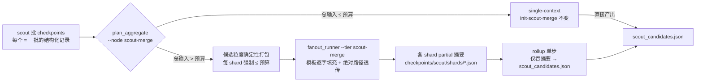

# Design — harden-mgh-init-scout-merge-dispatch

## Context

`/mgh-init` 有两个「聚合节点」(单个 LLM 请求要见多个单元产物的 stage):T2 综合与 S4
scout-merge。两者共用同一硬闸门脚本 `plan_aggregate.py`(`--node t2` / `--node
scout-merge`),但接线程度不同:

- **T2 已 dispatcher 化**(前次 change 落地):`--tier t2` 挂入 `fanout_runner.py` TIERS
  表,枚举 marker-aware,任务消息固定模板逐字填充,失败形态收敛。
- **scout-merge 仍是编排器手派**:当时显式豁免为「hand-paged non-goal」,envelope 保持
  逐字节不变——包括「单批记录超预算 → `oversize:true` + warn + **整份照发**」。

实跑故障(proposal 人话序):(a) 默认预算 256KB 下切出 265/269/83KB 三个 shard,单个请求
就可能顶穿内网 150K-token 模型窗口;(b) 手派路径下模型自行撰写派发、跨目录翻找 agent
定义(`/root/.config/opencode/`),弹权限中断无人值守运行。

## Goals / Non-Goals

**Goals:**

- scout-merge 的**每一个被派发单元**输入 ≤ 聚合预算(硬界,无 warn+照发残余)。
- scout-merge map 段派发 = `fanout_runner` 一条 Bash(与 t2 完全同构),模型零撰写;
  手派仅作宿主 CLI 不可用的回退。
- 聚合预算默认值收紧到 150K-token 模型安全区(定值依据进契约)。
- 给出「已切分现场退回切分点重来」的确定性 runbook(本 change 验证步骤即首跑演练)。

**Non-Goals:**

- 不动 T4(`init-rules-consistency`)软边界与 `--scope`/`--merge` 回退。
- 不动 scout 批 reader 面(`list_scout_batches`/`init-scout-fanout`)与 scout-tier-gate
  完成判据(`merge.json.done` 仍是唯一终态凭证)。
- 不改 single-context 小仓路径(`needs_reduce=false` 行为与 stdout 逐字节不变)。
- 不引入按 token 计量(预算仍统一字节口径,与 `--max-unit-bytes`/`--orch-budget-bytes` 同系)。

## Decisions

### D1 — 聚合预算默认 96KB(256KB → 96KB)

**换算依据**:本仓 token 启发式(tools/ 量测面)最坏口径 CJK ≈ 1.2 字符/token、UTF-8 每
CJK 字符 3 字节 → **≈ 2.5 字节/token(病态最坏 2 字节/token)**。96KB ÷ 2 ≈ 48K token
输入上限,叠加 stage 提示词(~3-5K)、agent 壳与有界回传,单次请求 ≤ ~60K token,对 150K
窗口余量 >2.5×,更远低于维护者给的 120K 红线。**备择**:192KB(与 `--max-unit-bytes` 对齐)
——最坏口径 ≈ 96K token,叠加提示词逼近红线,被否;**按内容类型换算**(ASCII 代码 4B/tok
vs CJK 2B/tok 混合计量)——引入第二口径,破坏「三预算皆字节」的统一性,被否。默认值可被
显式 flag 覆盖(大窗口模型用户自行放大),文档同步点:三面壳预算行、`plan_aggregate`
`DEFAULT_BUDGET`、`write_runconfig`/`write_ut_runconfig`/`render_report` 的
`DEFAULT_MAX_AGGREGATE_BYTES`(同名 flag 默认值 MUST 一致,lint 断言)。

### D2 — scout-merge 打包改为候选粒度 + 复用 t2 的瘦身/fail-loud 阶梯

现状 `_shard_by_batch_cluster` 以「整批记录」为不可分单位贪心装箱,单批超预算 →
`oversize:true` 照发。改为与 t2 同一三级阶梯:

1. **候选粒度装箱**:按 (记录 glob 序, 记录内候选序) 稳定序对**全部候选**贪心装箱,每
   shard ≤ 预算;shard id 仍 `scout-merge-<n>`(n = 装箱序号;同一批的候选可跨 shard)。
   每 shard 的 `batches` 字段改为其覆盖的**去重 batch_id 列表**(envelope BREAKING,消费方
   仅编排器 fragment + 测试);整批同处一 shard 时行为与旧装箱退化等价。
2. **病态单候选瘦身**:单条候选自身 > 预算 → 确定性散文投影(新增 scout 候选字段表:
   `evidence_snippet`/`snippet` 截 4096B、`entry_points` ≤16 项;`file`/`line`/`anchor`/
   `category`/`kind`/`source`/`id` 结构字段永不截——它们正是 `merge_scout._key` 去重锚与
   `--check` 边界校验对象)。原 `checkpoints/scout/*.json` 永不回写,仅物化投影。
3. **瘦身后仍超 → 退出码 2 零物化零派发**(镜像 t2 的 atomic-oversize fail-loud),stderr
   指认来源记录路径。

**为何切批不伤语义**:scout-merge 的职责是跨批去重/归一,去重键 `(file, anchor, category)`
不依赖同批共视;跨 shard 的重复由 rollup 二次归并兜底(与 t2 跨 part 同 category 归并同形)。
**备择**:「只瘦身不切批」(保 batch 完整)——单批 265KB 的候选若各不超预算,瘦身根本触发,
等于继续整发超界单元,被否;「按 candidate 数固定切」——不看字节,预算失去约束力,被否。

### D3 — `--tier scout-merge` 挂入 TIERS 表,t2 的 plan_arg 特例直接复用

TIERS 新行与 t2 同形:`list_script=plan_aggregate.py`、`list_args` 转发
`--node scout-merge --init-dir [--budget] --materialize [--include-failed]`、
`required_args=(init_dir, inputs_dir)`、`plan_arg=init_dir`(沿用 main() 里
`run_config.json` 重锚特例 → sidecar/心跳/liveness 家 = `<init-dir>`,文件名
`fanout_progress.scout-merge.json`)、`agent=init-scout-merge-fanout`、
`id_field=shard_id`、`uses_codegraph/uses_chunk_sources=False`。四级超时/熔断/冷却/树杀零
改动。`plan_aggregate.py` 把 `marker_aware = node=="t2"` 扩为 `node in {"t2",
"scout-merge"}`:`pending[]` 排除终态、stdout 补 `total/done/failed`、shard 项含
`failed_marker`/`part_index/part_count` 语义取消(候选装箱无 part 概念,`slimmed` 沿用)。
`--tier` 闭集字符串同步:`fanout_runner` argparse choices + `--help`、`discipline_core`、
`gen_dsh_tiers.REQUIRED_TIERS`、三面壳 tier 清单、`check_contracts`。

**为何不复用 `--tier t2` 加 node 参数**:TIERS 单点映射表是本脚本的承重结构,一个 tier
一个枚举语义,混 node 会把 `plan_arg`/模板/agent 三处再分叉,反而更大。

### D4 — stage 提示词三裂解:single / partial / rollup

现有 `core/prompts/stages/init-scout-merge.md` 同时承担单上下文合并与「P0 软边界、超了回
`oversize` ack」的旧叙事——闸门已由 `plan_aggregate` 预判,subagent 不再需要超界回传。处理:

- `init-scout-merge.md`(single-context 保留):删「Aggregate context budget P0 软边界」段与
  `oversize` ack 枚举,输出/路径纪律不变;
- `init-scout-merge-partial.md`(新):单 shard 内去重/归一 → 写**结构化摘要 checkpoint**
  (候选子集 + 本 shard unresolved),回传有界 ack(`ok <绝对 checkpoint_path> <n>`);
  禁跨 shard 判断、禁写终态产物;
- `init-scout-merge-rollup.md`(新):仅吞 `rollup.summary_paths` 各摘要 → 跨 shard 二次
  去重/归一 + unresolved 合并 → 写 `scout_candidates.json`(wrapper `{repo, candidates[],
  unresolved[]}`,必须原样通过 `merge_scout.py --check`:`source:"scout"`、`file:line`、
  category ∈ 8 规范类)+ touch `merge.json.done`。

摘要 checkpoint 的 schema 进 `core/contracts/init/scout-plan.md`(或新开
`scout-merge-sharding.md` 契约,倾向前者增段):候选形状与 T1→T2 摘要同构(摘要 = 去水后
候选直存,不另造字段),使 rollup 与 `merge_scout._normalize` 无需新适配。

### D5 — `run_config.json` 存量预算不回迁

新默认只作用于**新写入**的 run_config;在跑 run 的 `budgets.max_aggregate_bytes` 是 step 0
落盘的**用户意图**,`--resume` 静默改写 = 破坏起始态语义。存量现场由 runbook(迁移计划)
人工改一行;三面壳预算行文案改为「默认 96KB」。

### D6 — list_steps / resume_state:scout 步内增 scout-merge 派发契约行

`list_steps.py --step scout` 的 `cli_args` 面增
`--tier scout-merge --init-dir <init-dir> --budget <max-aggregate-bytes> --checkpoints
<init-dir>/checkpoints/scout --inputs-dir <init-dir>/inputs/scout-merge` 一行(镜像 t2 行
@`list_steps.py:134`);`resume_state.py` 步骤派生**零改动**(scout-merge 仍在 scout 步内,
终态凭证仍 `merge.json.done`),仅其 t2 预算 note 的默认值文案随之走查。scout.md fragment
的「spawn init-scout-merge 前先判聚合预算」段重写为 dispatcher-first + 手派回退(见 D3/D4)。

## Risks / Trade-offs

- [96KB 默认 → 大仓 shard 数 ~3×,partial 调用变多、固定提示词开销摊薄] → map 段由
  dispatcher 并行波次消化,单元廉价且可 resume;需要更少 shard 的用户显式传
  `--max-aggregate-bytes`。
- [候选切批丢失「同批共视」,跨 shard 重复候选全部压到 rollup] → 去重键不含批上下文,
  rollup 本就负责跨 shard 归并(t2 同形先例);boundaries 披露批切分数。
- [旧 run 的 clusters.json 可能已含上一次 fold-in 追加的 scout 簇,而重跑 merge 的候选集
  若变化,残留簇的 T1 记录不会自动回收] → runbook 分支 B 显式披露:若新
  `scout_candidates.json` 与旧 fold-in 集合有实质差异,推荐整 run 重 scout 步之后全量
  `--resume`(级联失效 t2/t3/t4);仅微调则接受残留并在报告边界披露。
- [手派回退仍可能出现「找 agent 定义」漂移] → 回退仅在宿主 CLI 不可用(exit 2)时到达;
  fragment 手派段补「定义文件唯一位置 = 枚举 stdout 给定路径,找不到即 `failed`、NEVER
  翻目录」纪律(与模板同文)。
- [marker-aware 推广碰到 t2 的 `--include-failed`/计数分支,回归面扩大] → 既有
  `test_plan_aggregate` t2 用例逐字保留 + 新增 scout-merge 对称用例;`test_fanout_runner`
  新 tier 用例 harness 层 `--cooldown-s 0`(R5.8 陷阱约)。

## Migration Plan

**部署**:改脚本/提示词/三面壳/agent → bump 版本 → 定向回归(改动面映射表命中的
`test_plan_aggregate` `test_fanout_runner` `test_gen_dsh_tiers` `test_list_steps`
`test_init_runtime` + `check_contracts`/`check_distributed_purity`)→ 跨面接线(install
自检、hook 接线不变量)时跑全量。

**存量现场 re-entry runbook(维护者本机执行,即用户第 3 问;实现完成后照此演练)**:

1. 无在飞进程则跳过;疑似有孤儿 →
   `py <install>/mgh-core/scripts/fanout_runner.py --kill-stale --dry-run --checkpoints <target>/.mgh-init/checkpoints/scout`
   审 PID,`killed` 非空再去 `--dry-run` 真杀。
2. 删除(全部位于 `<target>/.mgh-init/`,只删 scout-merge map-reduce 派生物,**保留**
   `checkpoints/scout/<batch>.json` 及其 `.done`——侦察批产物是本次重跑的输入,不重烧):
   - `inputs/scout-merge/` 整个目录(3 个 `.input.json` 大 shard + `.task.md` 审计拷贝);
   - `checkpoints/scout/shards/` 整个目录(shard 摘要 checkpoint 与 `.done`/`.failed` marker);
   - `checkpoints/scout/merge.json`、`checkpoints/scout/merge.json.done`(如存在);
   - `scout_candidates.json`(如存在);
   - `fanout_progress.scout-merge.json`(如存在)。
3. 查 `controls_candidates.json` 是否含 `provenance.scout_merged`:**无**(本例,权限中断在
   fold-in 之前)= 分支 A,直接下一步;**有** = 分支 B,先读该值并预期:重跑 fold-in 经
   `(file,anchor,category)` 去重幂等,新增候选时 `merge_scout.py` 自动级联删 t2/t3/t4
   聚合 `.done`(残留簇风险见上条,接受或全量重跑 scout 步之后)。
4. 装好优化版(`./install.sh` 对应宿主端)后,把 `<target>/.mgh-init/run_config.json` 的
   `budgets.max_aggregate_bytes` 从 `262144` 改为 `98304`(人改一行;脚本面 D5 不自动回迁)。
5. 回会话 `/mgh-init --resume`:`resume_state.py` 纯磁盘派生 → `scout_complete` 因
   `merge.json.done` 缺失判 false → step 仍 `scout`,next_action 落回 plan_aggregate 闸门 →
   96KB 预算下重切 → `--tier scout-merge` 波次跑 map → rollup → `merge_scout.py --check` →
   audit + fold-in → 后续 T1–T4 正常推进。
6. 验证:`merge.json.done` 与 `scout_candidates.json` 存在、每个
   `inputs/scout-merge/*.input.json` ≤ 98304B、`init_manifest.json::boundaries[]` 记录了
   shard 数与批切分、全程无权限提示打断。

**回滚**:纯代码回退(前次 release 重装)即可;marker 布局对新代码前向兼容
(`.done`/`.failed` 形状不变),旧代码读新 shard 目录会判全 pending 重派,故回滚应与
runbook 步骤 2 的删除一同执行。

## Open Questions

(无——预算定值、打包粒度、tier 接线形态、存量 run_config 处置均已在本文件拍板。)
