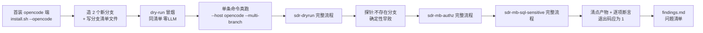

> 受众:双受众(维护者拍板设计决策;apply agent 按此执行验证战役)

## Context

被测能力是 launcher(`mgh_sdr_launch.py`)的 `--multi-branch <file>` 参数:读一个每行一个分支名的清单,对每个分支**串行**执行一遍完整 sdr 流程(上下文准备 → diff 分组 → 扇出复核 → 渲染报告),每分支独立 run 目录与报告,单分支失败记录后继续,最终退出码 0(全成功)/1(有失败)/2(误用)。该行为在产品规格里已有场景条目(多分支串行、失败隔离、退出码语义),但自开发完成起从未在真实仓库执行过——现有信心全部来自单元测试与仿真夹具。

测试床现状(决定设计的三个事实):

1. `C:/DEV/springBootTemplate` 是真实 Spring Boot 项目,当前只装 claude 端(`.claude/mgh-core/`),**opencode 端未装**(本战役首装);当前检出 `sdr-dryrun` 分支(对 master 16 文件 +595/−39:控制器/服务/SecurityUtil/Mapper XML,含 5 种调用链形状)。
2. 仓库根残留 4 个历史报告文件(3 个旧 `.md` + 1 个旧 `.html`)——launcher 按修改时间认领「最新 `mgh-sdr-*.html`」,历史残留是真机条件下必须验证的干扰源。
3. 仓库无存量设计基线(无 mgh-init rules)、敏感目录只有 `.example` 模板——真跑必然走「基线缺失 + 默认模板回退」降级路径。

## Goals / Non-Goals

**Goals:**

- 对规格承诺的多分支行为逐项取得真仓证据:串行性、每分支独立产物、报告与分支 diff 的对应性、失败隔离、退出码语义、哨兵生命周期、降级披露。
- 把真机才暴露的因素纳入观测:真实宿主 spawn 与 LLM 扇出、历史报告文件干扰、分支间状态残留、真实时长与配额消耗、Windows 真机路径形态。
- 产出可立项的问题清单(`findings.md`),后续 fix/improve change 直接引用,无需回访测试现场。

**Non-Goals:**

- 不修任何发现的问题(后续 change 承接);不改 mgh-sdr 任何产品代码与规格。
- 不评估复核质量本身(发现的候选是否是真漏洞)——本次关注 sweep 机制,不关注检出率。
- 不为本次测试补造存量设计基线(见 D6)。

## Decisions

### D1 测试分支:受控新建 2 个,而非复用现成分支

| 方案 | 优点 | 缺点 |
| --- | --- | --- |
| **新建 2 个形状受控分支(选定)** | 每分支预置明确的安全复核形状(越权/校验、SQL/敏感),报告对应性可逐项核对;内容可控、可复现 | 需要一次性造数成本(各 3-5 个文件的提交) |
| 复用远端 `origin/test-batch-insert` | 零准备成本 | 形状不受控、难核对报告对应性;远端分支被他人/流程清理的风险 |
| 只用 `sdr-dryrun` 重复跑 | 零准备成本 | 同一 diff 跑 3 遍,验证不了「报告与各自分支对应」这一核心承诺 |

新建分支自 `master` 切出、**只留本地不推远端**(测试床产物不外溢)。每个新建分支的提交信息写明预置形状,兼作形状说明。

### D2 失败注入:清单中插一个不存在的分支名

| 方案 | 优点 | 缺点 |
| --- | --- | --- |
| **不存在分支名(选定)** | 零代码改动;确定性早败(不 spawn 宿主、不耗 LLM);探针摆在第 2 位恰好镜像规格场景「第 2 分支失败不阻断第 3 分支」 | 只覆盖「上下文准备早败」一种失败形态,不覆盖「扇出中途失败」 |
| 真跑中人工中断宿主会话 | 能造扇出中途失败 | 非确定性、不可复现、且中断本身污染观测 |
| 临时改产品代码注入失败 | 失败点精确可控 | 违背本次「零产品代码改动」边界,且测的不是真实产物 |

扇出中途失败的隔离形态本次不覆盖,在 findings 中作为局限如实披露;若后续认为该形态需要真仓验证,另立 change。

### D3 宿主显式钉死 opencode(维护者拍板)

真跑命令显式 `--host opencode`,消除 launcher 缺省探测(「opencode 优先、否则 claude」)的歧义——且被测宿主就是 opencode(维护者指定)。opencode 并行子会话有已知稳定性前科:多个子进程并发访问 opencode 会话库时报「database is locked」崩溃。本次**不预设降档**(保持产品默认 wave=5),把该形态列为一级观测点——冷却/截断/熔断的真实表现与对 sweep 收敛的影响,正是本次要发现的问题。

| 方案 | 优点 | 缺点 |
| --- | --- | --- |
| **钉 opencode、保默认 wave=5(选定)** | 测的是产品默认形态的真实表现;宿主特有问题(如 DB 锁)充分暴露并记录 | 宿主缺陷可能烧掉部分配额、拉长墙钟 |
| 钉 claude | 并行子会话稳定、结果干净 | 非维护者指定的被测宿主 |
| 钉 opencode 但预降 wave=1 | 规避 DB 锁崩溃 | 回避而非暴露问题,测不出默认形态;wave 由扇出壳取缺省,壳外降档反而偏离产品路径 |

### D4 真跑前重装最新脚本副本

目标仓 opencode 端从未安装,claude 端旧副本虽含 `--multi-branch` 但开发工作区有大量未提交修改——直接用旧副本无法保证「被测 = 当前开发态」。故真跑前从本仓执行 `install.sh --opencode C:/DEV/springBootTemplate` **首装** opencode 端(命令/agent/hook 插件/mgh-core 脚本一次到位),把版本漂移从变量里消掉。

### D5 dry-run 冒烟先行,残哨复用行为本身入观测

同清单同参数先 `--dry-run`:零 LLM 成本验证清单解析、闸门、run 目录与提示词产物。实现语义上 dry-run 会保留哨兵,紧随的真跑首个分支会走「残哨复用」路径——该路径的真机行为(警告文案、复用是否干净)正是值得记录的观测点,而非需要回避的干扰。

### D6 基线缺失按「降级路径验证面」接受,不补造基线

先跑一轮 mgh-init 造基线能让复核更有依据,但那是一次重量级流水线,且会把「多分支 sweep 机制验证」混入「复核质量评估」——本次目标是前者。基线缺失 + 默认模板回退是规格里有明确披露要求的降级路径,真仓正好顺带验证其披露行为。复核候选噪声偏大可接受(findings 不评质量)。

### D7 观测手段零包装:launcher 输出 + run 目录产物 + 文件时间戳

观测只靠三类一手证据:launcher 的 stdout/stderr(逐分支 ok/FAILED 行、失败汇总)、每个 run 目录的落盘产物(manifest/数据 JSON/标记文件)、报告文件修改时间。**不写任何包装/轮询脚本**——与编排黑盒纪律同立场,避免观测工具自身成为新问题源。findings 手工整理。

### 战役流程(一图)

## Risks / Trade-offs

- [LLM 配额限流导致某真实分支失败或长冷却] → provider 瞬断的冷却/重派行为本就是观测点;整分支失败则记录形态后**同参数补跑该分支**(launcher 每次新建 run 目录,天然隔离),findings 区分「环境因素」与「产品缺陷」。
- [opencode 并行子会话数据库锁崩溃(已知前科,默认 wave=5 下可能成批出现)] → 一级观测点,不回避;观测冷却/截断/熔断表现与 sweep 收敛性。若某分支扇出无法收敛,补救 = 带同一 run 目录经 resume 语义换 claude 宿主补收尾(跨宿主 resume 可行),findings 完整记录 opencode 侧证据(`*.run.log`)并区分「宿主/环境缺陷」与「产品缺陷」。
- [3 次完整流水线串行,墙钟可能 30–90 分钟以上] → 接受;dry-run 先行兜底明显误用;不并行(被测语义就是串行)。
- [历史残留报告被误认为新产物] → 这是要验证的断言而非需提前消除的风险;若发生,记问题。
- [目标仓工作区噪声多(未跟踪文件、旧报告、旧日志)] → 不清理,保持真仓真实性;findings 披露环境噪声清单。
- [失败探针只覆盖早败形态] → 见 D2,局限在 findings 披露。
- [dry-run 残哨 + 真跑残哨复用路径若有缺陷,首个分支行为被污染] → 首分支观测单独标记;必要时(且仅必要时)冒烟后手工移除哨兵再真跑,并把两种形态都记入 findings。

## Migration Plan

不适用(无产品部署面)。战役回滚 = 删除 2 个新建本地分支;run 产物与报告留在测试床仓(与既有残留共存),不回灌本仓。

## Open Questions

无阻塞性未知。新分支提交的具体代码内容属执行期细节,按预置形状即兴构造即可(tasks 已给形状清单)。
