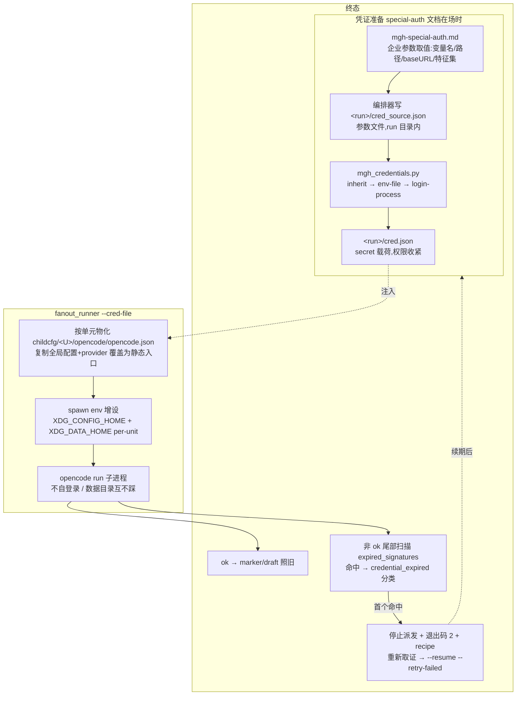

# fix-mgh-sdr-fanout-auth-isolation — design

## Context(现状与约束)

/mgh-sdr 的 fan-out 由 `fanout_runner.py` 共享派发循环承载:每个单元 spawn 一个
`opencode run --agent <tier-agent>` 子进程(任务经 stdin,cwd = repo,env = 本进程环境剥离
`PWD`)。当前 spawn env **没有任何按单元隔离的执行环境变量**,子进程各自以完整 fat client
形态启动:各自解析全局用户配置(`~/.config/opencode/opencode.json`)、各自读写全局数据目录
(`~/.local/share/opencode` 的 log / sqlite 状态库 / repos 缓存)。这在「企业 CAS 单点登录
网关 + 定制 wizard 插件」环境下结构性失败(现象与根因见 proposal「Why」),且 Windows 实测
暴露共享数据目录的并发互踩;本仓已知先科:mgh-sdr 壳规范行早已因「opencode 并行子进程数据
库锁前科」默认 `--wave 1`。

约束:

- R2 零运行时依赖(新脚本仅标准库);
- R5.3 叶脚本 CLI I/O 契约(stdout JSON / stderr 诊断 / 退出码 0-1-2 / 幂等 / 禁 TTY);
- R5.6 三面壳 token 硬预算(dsh 面当前 ~4372/5000,余量有限,壳增量必须极小);
- 运行域守卫的 Bash 面路径净网:命令行里任何家目录形态路径 token(`~/...`、绝对路径)
  resolve 后不在读允许集就会被拦——这直接决定「企业参数怎么传给脚本」(见 D2);
- 超时四级不变式(`stall-timeout-s < call-timeout-s < budget-ms×0.8 < 宿主 per-call 上限`)
  与全部默认值**冻结**:默认值经 mgh-init 专项实验校准(归档 change
  `2026-08-20-improve-mgh-init-fanout-longrun-timeout-visibility`,观测样本 n=84 定出
  stall 地板),本 change 一律不碰;
- 限流 crash 分类(`429`/`too many requests`/`rate limit`/`quota` 子串 → `rate-limit`)
  与限流风暴截断、`--kill-stale` 孤儿清理、配额三 flag 均已存在,本 change 复用其形状
  而不复制的机制。

## 现状与根因复核(独立分析 + 事实分级)

原始定位来自企业内网弱模型会话 + Windows 补充实测。按要求对其做独立复核:能对上本仓
代码的标 B(已核实),企业侧实测标 A(采信),推断或未实测标 C(需 apply/真仓验证)。

| # | 事实 | 级别 | 复核 |
| --- | --- | --- | --- |
| F1 | 子进程 env 仅剥 `PWD`,无 XDG/配置/数据隔离 | B | `fanout_runner._run_unit`:`env = {k:v for k,v in os.environ.items() if k != "PWD"}` |
| F2 | 每个子进程重复整套 CAS 交互登录(票据单次有效 + 127.0.0.1 回调端口互抢)→ 除波次最前一个外全部不收敛,300s 零输出转 stall | A | 机制自洽:CAS ST 一次性 + 端口独占是单点登录插件的标准形态;与「降 wave 5→2 无改善、6 单元仅 1 standalone 活」的实测表象吻合 |
| F3 | 共享全局数据目录 → `database is locked` / `filesystem.open …opencode.log` / `EPERM …uv_spawn git` 随机崩溃,重试吃满槽位转 stall;重单元全灭、轻 standalone 能过 | A | 本仓独立先科吻合(壳规范行「数据库锁前科」);重单元路径长、撞锁窗口大,与「重全灭轻能过」自洽 |
| F4 | slice→draft→marker→report 链路本身正常 | A | 1 个 standalone 单元全程跑通即是证据;修环境不碰链路 |
| F5 | 网关为 OpenAI 兼容入口(`…/code_pilot/api/v1`,Bearer token,`@ai-sdk/openai-compatible`);Linux 有 `~/.config/wizard/env` 落盘凭证;Windows token 只在进程 env `AIMAX_AUTH_TOKEN`,无盘上凭证、插件不读预设 env | A | 企业实测;注意 URL 以原始记录为准(含 `vi` 拼写),只写进 special-auth 文档 |
| F6 | `XDG_CONFIG_HOME` 指向子配置目录后子进程只见子配置、原 provider 消失;`opencode run -c <file>` 疑似非配置加载(`-c` 疑为 continue) | A/C | 隔离行为企业实测(A);`-c` 语义未查证(C,apply 时以 `opencode run --help` 核实并在文档记录,方案不依赖它) |
| F7 | `XDG_DATA_HOME` 随变量隔离 log/sqlite/repos(企业称两平台同效) | A/C | Linux 实测可信;**Windows 构建是否同尊重两变量为 C**,apply 首个验证项 |
| F8 | 子配置保留 plugin 列表 + 静态 provider 后子进程不再自登录 | C | 企业判断,未单测端到端;风险与备选见 D4(keep_plugins 开关) |
| F9 | `fanout_runner --dry-run` 会起真子进程 | B(否) | 代码核实:派发路径 dry-run **不 spawn**(每单元打 `dry-run — no spawn`);真副作用 = 写 `<inputs-dir>/<unit>.task.md` 审计副本(以及 `--kill-stale --dry-run` 写审视标记)。「起真子进程」的观感更可能来自**壳级** `--dry-run`(跑 step 1,真实产生 run 目录/context.json/哨兵)——两侧分别处理:runner 零写盘,壳披露如实(见 D7) |
| F10 | 宿主 per-call 超时上限强杀 runner → 子进程孤儿累积 | B/A | runner 自身的 stall/timeout 树杀完善,但 runner 被外层强杀时不及清理;liveness 登记 + `--kill-stale` 机制已在(收口见 D9) |
| F11 | 慢首 token + 宿主 cap 小 → 四级不变式无参数空间 | A | 采纳用户告诫:**不动不变式**;登录等待被移出子进程后首 token 时延显著下降,剩余场景由既有 wave/配额/软时限机制消化(D8) |

弱模型分析之外,本设计补充识别的缺口:

- **守卫路径净网 vs 取证命令**:任何 `~/.config/wizard/env` 字面路径出现在编排器 Bash
  命令行都会被自家守卫拦(不在读允许集)——取证必须走「参数文件 + 脚本内 expanduser」
  形态(D2),否则方案在真机第一步就撞墙。
- **agent 不能替用户写探测插件**:`.js` 在脚本扩展名集里,编排器 `Write` 会被
  block-adhoc-scripts 拦——login-process 模式的探测插件模板必须内嵌在
  `mgh_credentials.py` 里由脚本物化(D3)。
- **secret 卫生面**:token 会经 cred.json → 子配置文件两处落盘,且 runner stdout/日志/
  报告/遥测多面存在泄漏路径,需显式约束(D12)。
- **磁盘代价**:per-unit `ocdata` 各含一份 opencode 数据目录(repos 缓存等),N 单元 =
  N 份;正确性优先,清理策略进文档(D5)。

## 方案总览

缺席路径(默认):不传 `--cred-file` / `--isolate-data` → 派发行为与现状逐字节一致;
special-auth 文档缺席 → 壳/清单/runner 全部按通用流程,唯一可见差异是
`special_auth{present:false}` 字段与零输出。

## Goals / Non-Goals

**Goals:**

- 企业 CAS 网关环境下,fan-out 的 N 个 opencode 子进程**零登录闭环**跑完(共享一份静态
  注入凭证),共享数据目录互踩消除;
- 凭证过期与 stall/限流分开治理:快停、零丢失续跑;
- 机制命令无关:runner 侧对全部 tier 生效,文档通用,mgh-init 等其余流程零改壳即可获得
  advisory 引导;
- 企业定制内容(插件/网关/取证细节)不出现在任何进 git 的通用面;
- `--dry-run` 纯计划零写盘;
- 超时不变式与默认值零改动。

**Non-Goals:**

- 不实现 dsh host 的同构注入(配置布局不同,文档记 follow-up;`--cred-file` 对 dsh 形
  拒识而非静默忽略);
- 不做 claude host 凭证(走 claude 自身认证);
- 不做进程内凭证热更新/常驻 relay(暂停-续跑形态覆盖同诉求;常驻进程与叶脚本模型冲突);
- 不改 mgh-init / mgh-ut-init 的壳与步骤清单(通用 advisory 已覆盖其扇出;各自清单字段
  是后续小改);
- 不动四级超时不变式、配额三 flag、限流截断的既有语义(新增分类只在其上层抢优先级);
- `mgh-special-auth.md` 与 `docs/enterprise-environment.md` 的**内容维护**是维护者私事,
  本 change 只交付机制 + 首版内容。

## Decisions

### D1 通用机制进代码,企业参数住文档(split of concerns)

提交进 git 的只有通用机制:runner 的 `--cred-file` / `--isolate-data`、`mgh_credentials.py`
的参数化取证、清单在场字段、install 可选复制。wizard 插件名、CAS 细节、`AIMAX_AUTH_TOKEN`
变量名、网关地址、取证三步的企业取值**只**写在 `mgh-special-auth.md`(不进 git,维护者
随包分发)。

- 备选 1:企业逻辑直接硬编码进脚本——被否:违背用户明确要求(定制内容不进 git),且
  公开仓携带内网细节是卫生问题;
- 备选 2:纯文档引导编排器徒手 Bash 取证——被否:多步徒手编排对弱模型宿主不可靠,且
  命令行携带家目录路径会被自家守卫拦(见 D2),本质走不通。

### D2 参数文件传参,命令行零家目录路径(守卫相容的传递形态)

编排器把文档给出的参数写进 `<run>/cred_source.json`(JSON 非脚本扩展名、run 目录在
sdr 域写允许集内,`Write` 合法),再以
`py <mgh-core>/scripts/mgh_credentials.py acquire --source <run>/cred_source.json --out <run>/cred.json`
调用——命令行 token 全在目标子树内,净网放行;`~` 前缀路径由脚本内部 `expanduser` 解析。
secret 交接面收敛为一个文件 `cred.json`(schema 闭集 `{v, baseURL, apikey, provider_id,
global_config, keep_plugins, expired_signatures[]}`),runner 启动时读取一次。

- 备选:token 走环境变量透传——被否:编排器 `export` 会把 secret 留进宿主会话转录,且
  dsh 形 env 不随会话导出,不可靠;
- 备选:把 wizard 路径加进 `.mgh/read-roots.json` 后命令行直传——被否:给全部运行会话
  开了永久家目录读授权,授权面大于需要。

### D3 取证三模式与 login-process 的外科式还原

`mode` 优先级 inherit → env-file → login-process,与用户企业验证的顺序一致:

- `inherit`:读本进程 env(宿主会话已登录则零登录;Linux/Windows 通吃,理论上宿主会话
  在企业环境恒已登录);
- `env-file`:解析 KEY=VALUE 文件(Linux 桌面插件落盘凭证);
- `login-process`:物化内嵌泛型探测插件模板(参数化:env 变量名 + 输出路径;在插件
  生命周期钩子里把 `process.env[<var>]` 写出)→ 重读全局 opencode 配置、追加该插件到
  plugin 列表(先备份)→ spawn `opencode run --print-logs --model <model> "Reply OK"`
  (cwd 取中性目录,不附目标仓)→ 轮询输出文件拿 token → **try/finally 外科式还原**
  (还原前重新读盘、仅摘除自己追加的条目;NEVER 整文件盲回写,避免覆盖用户并发修改)→
  写 cred.json。超时可配,超时/失败同样还原,退出码 2 + recipe(预期浏览器弹窗、检查
  登录自动化插件与回调端口占用)。

插件模板的**触发钩子**(就绪/退出哪个事件能拿到已注入的 env)属 apply 期按 opencode
插件 API 实测项(开放点 O2);模板保持泛型,不含企业词汇。

### D4 静态注入 = 子配置目录 + provider 覆盖,provider id 不动

`--cred-file` 激活时按单元写 `<run>/childcfg/<U>/opencode/opencode.json`:全局配置的副本,
仅把 `provider_id` 定位的 provider 改为静态入口(`baseURL` + `apikey`,openai-compatible
结构形),**provider id 保持不变**——model id 形如 `<provider>/<model>`,改 id 会断前缀
耦合。plugin/agent/model 默认保留(`keep_plugins:false` 时摘 plugin 列表,作为 F8 风险的
运行时备选)。spawn 设 `XDG_CONFIG_HOME=<run>/childcfg/<U>`,子进程只见子配置(不自
登录)。**不使用** `opencode run -c <file>`(其语义疑为 continue,F6-C;apply 时以
`--help` 核实并记入文档,方案不依赖)。

### D5 数据目录隔离:cred-file 联动 + 独立开关,默认关

`XDG_DATA_HOME=<run>/ocdata/<U>` 消除并发互踩(F3)。激活面:`--cred-file` 隐含开启
(企业场景两者同需);独立 `--isolate-data` 供无认证诉求场景单独使用(纯治数据库锁)。
**默认关**:fat client 的插件/会话状态可能存于数据目录,默认开会让非企业用户的子进程
丢失既有状态——保守缺省,缺席零变化是硬承诺。磁盘代价(N 份 ocdata)以运行后清理
`<run>` 兜底(文档承载);后续可优化为 per-slot 目录复用,不在本 change。

- 备选:默认开——被否,理由如上;备选:wave=1 时共享单份数据目录——被否,引入 wave
  敏感分支,正确性换磁盘不划算。

### D6 凭证过期分类:镜像限流分类的形状,暂停 + recipe + `--retry-failed` 续跑

非 ok 终态(crash/timeout/stall/failed ack)的输出尾部(与既有 crash 原因分类同数据面)
按 `expired_signatures[]`(大小写不敏感子串)扫描;首个命中 → `credential_expired`
独立计数、立即停止派发(优先级:凭证过期 > 限流风暴截断 > 快败冷却 > 零推进熔断)、
在飞照常收割、退出码 2 + recipe(重取证 → 更新 cred.json → 同参 `--resume
--retry-failed`)。磁盘 marker 语义不变——命中单元 `.failed` 如实落盘,续跑靠既有
`--retry-failed` 重派,已完成单元零丢失。空特征集 = 扫描面不激活。签名漂移时优雅退化到
既有 stall/冷却兜底(签名层 NEVER 唯一防线,同限流分类立场)。

- 备选:命中单元不写 `.failed` 改写专用 marker——被否:新增 marker 语义扩散到 resume/
  枚举/报告多面,收益仅是省掉 `--retry-failed` 一个 flag。

### D7 dry-run 纯净化:runner 零写盘,壳披露如实

runner `--dry-run`:去掉审计副本写入与一切目录/文件创建,计划(单元清单、将写的审计与
marker 路径、命令形)只走 stdout;`--kill-stale` / `--purge-audit` 的 `--dry-run` 前置
审视守卫语义不动。壳级 `--dry-run`(跑 step 1 + `--check`)的副作用(run 目录、
context.json、哨兵)是**有意的最小验证路径**而非缺陷——壳披露行改为如实列出会产生哪些
产物,消除「误以为零副作用」(F9)。审计副本的「无 LLM 冒烟」既有用法改走 stdout 摘要
或非 dry-run 路径,测试随迁。

### D8 超时不变式冻结

四级不变式与全部默认值零改动(用户明示告诫 + 归档实验 `2026-08-20-…-timeout-visibility`
的地板结论)。本 change 对时延的贡献是**移出登录等待**:子进程不再各花最长 300s 等
CAS,首 token 即业务时延;剩余慢模型场景由既有 `--wave 1` 规范行、配额三 flag、软时限
干净早退消化。special-auth 文档记录企业实测的推荐取值区间,但只作为文档建议,不改码内
默认。

### D9 孤儿收口:复用 liveness + `--kill-stale`,加启动期 advisory

既有机制已覆盖大半:子进程 PID 登记 liveness `children[]`(spawn 写、终态删),runner
被外层强杀后来不及删 → `--kill-stale --dry-run` 列出可杀目标、复核后真杀。缺口是
「下一次 run 不会被主动提醒」。补一条通用 advisory:runner 启动时若 liveness 文件存在
存活 PID → stderr 一行提示 + kill-stale recipe(非阻塞、不改退出码)。不引入新清理
机制。

### D10 special-auth 覆盖机制:命令无关文件 + 双路引导 + NEVER 链不放宽

文件名 `mgh-special-auth.md`(命令无关,全部 mgh-* 流程共用);install 复制收敛(目标
副本当且仅当源存在,缺席安装移除残留——防止维护者停止携带后目标侧永挂旧版)。引导:

- sdr 面:`list_sdr_steps.py` 顶层 `special_auth{present, path}`(探测
  `<mgh-core>/mgh-special-auth.md`,该清单唯一允许的磁盘探测,docstring 同步收窄承诺)
  + 三面壳 fan-out 步前一行引导(在场 → 先读文档,凭证准备与配套 flag 以文档为准;
  缺席 → 逐字节现状)+ `resume_sdr_state.py` 在 fanout 步且在场时 notes 一行;
- 通用面:`fanout_runner.py` 在文档在场且未传 `--cred-file` 时发一行 stderr advisory
  ——mgh-init / mgh-ut-init 等扇出**零改壳**即被覆盖(用户要求的「对所有流程通用」的
  结构性落点)。

文档优先范围仅限凭证/执行环境准备与配套 flag;NEVER 链硬边界(脚本扩展名 Write、内联
解释器、越树读写)永不可被文档放宽——守卫是确定性兜底,文档不是提权面。壳增量控制在
每面 ~80 tok 内(dsh 预算余量 ~600),apply 后跑 budget lint。

### D11 企业环境备忘整合:docs 独立文件 + AGENTS.md 只留必读指引

`docs/enterprise-environment.md`(不进 git)汇总:150K 上下文窗口/弱模型、100 次/10 分钟
限频、CAS/wizard 登录闭环、共享数据目录危害、宿主 per-call 上限、登录自动化插件等
(即 AGENTS.md「用户画像与设计目标」的运行环境约束表 + 本次新增定制情况)。AGENTS.md
该节改为一句概括 + 必读指引,并注明文件缺席(公开 clone)时按通用语境理解、铁律自身
自足。`docs/glossary.md` 补通用词条(凭证中心、静态注入、子配置目录、数据目录隔离),
不含企业词汇。**接受的代价**:公开 clone 不再有企业环境细节——用户明示选择。

### D12 secret 卫生

apikey 只存在于 cred.json 与子配置文件两处(run 目录内);权限 best-effort 0600。
**NEVER** 出现在:命令行 argv、stdout/stderr(摘要只报路径/provider_id/baseURL)、
marker、run.log、报告产物、遥测 params(`mgh_credentials.py` 与 runner 均不挂 token 进
遥测载荷)。run 终态后 `<run>` 整体清理即消灭两处落地(resume 期间保留是必要的);文档
承载清理指引。不额外做加密存储(内网本地盘,威胁模型不支撑)。

### D13 范围:opencode host 先行

注入与隔离只实现 opencode host 形(`--cred-file` 对 claude/dsh 形退出码 2 拒识);
dsh 形的同构改造(插件同源、配置布局不同)记入 special-auth 文档 follow-up 节。

## 风险与开放点

- [F8/C:子配置保留 plugin 后子进程仍尝试登录] → `keep_plugins:false` 运行时备选(摘
  plugin 列表);真仓首验项之一。
- [F7/C:Windows 构建不尊重 XDG 变量] → apply 冒烟第一验证项(`opencode debug paths`);
  若失效,Windows 侧改走 `%USERPROFILE%` 重定向或暂以 Linux 为准,文档如实记录。
- [O2:探测插件触发钩子不确定] → apply 时按 opencode 插件 API 实测选定(就绪/退出钩子
  或周期写盘);模板泛型,钩子选择不影响契约。
- [F6/C:`-c` 语义] → `opencode run --help` 核实,结论记文档;方案不依赖。
- [凭据生命周期:长任务中途被服务端强制重登] → D6 的分类-暂停-续跑闭环正是为此设计;
  真仓演练任务(tails:改坏 apikey 末位模拟 401)。
- [per-unit ocdata 磁盘放大] → 接受 + 运行后清理 `<run>`;后续 per-slot 复用优化。
- [弱模型宿主执行多步文档指引走样] → 文档以「单命令 + 参数文件」为最小执行单元(一次
  Write + 一次 Bash 即完成取证),避免长 choreography;runner advisory 兜底提醒。
- [企业网关 URL/字段拼写(`api/v1`)] → 以企业原始记录为准只进文档;通用面不含。
- [三面壳预算回涨] → 引导行极简 + budget lint 门禁。

## 测试与验证策略

单测(先红后绿):`test_fanout_runner` 扩(注入模式 env 形状/子配置物化幂等/cred 损坏
fail-lail/非 opencode 拒识/过期分类与截断优先级/空特征集零变化/dry-run 零写盘 spy/
resume 幂等/advisory 两态);新增 `test_mgh_credentials`(三模式/外科还原含失败路径/
`--check`/stdout 无 token);`test_list_sdr_steps`(special_auth 两态与其余字段不变);
`test_resume_sdr_state`(fanout 步在场提示);安装面(install.sh/ps1 复制收敛三态)。
定向回归按 AGENTS.md 映射表;四件 lint(contracts/purity/budget/plain)过,purity 需先
把本 change 登记进 SDD 豁免清单(交付物含 docs/ 路径)。实机:隔离小仓端到端冒烟
(注入/隔离/dry-run/坏 token 演练);企业真仓重跑对照(原失败场景 6 单元全活)。

## `mgh-special-auth.md` 文档结构(apply 时撰写首版)

1. 已知事实(网关入口/鉴权头/provider 结构/Linux 凭证文件/Windows env-only 语义/插件
   不读预设 env);
2. Linux 取证一步(env-file 参数示例);
3. Windows 取证三步(inherit → env-file 缺席说明 → login-process 全流程含预期浏览器
   弹窗与登录自动化插件依赖);
4. `cred_source.json` 字段取值表(企业值)+ 编排器执行序列(Write 参数文件 → 一条 Bash
   acquire → 传 `--cred-file` 派发);
5. 验证步骤(`opencode debug paths` 确认隔离;单单元试跑确认不自登录);
6. 故障对照表(登的不收敛/回调端口占用 → 单次登录+静态注入;db locked/EPERM → 数据
   隔离;401/强制重定向 → 过期分类与续期流程;300s 零输出 → 先查凭证再查 stall);
7. 凭证续期 runbook(分类命中 → 重取证 → resume --retry-failed);
8. 并发与超时映射(quota 三 flag ↔ 网关 QPS/TPM;wave 口径;**不变式不可改**告诫);
9. dsh host follow-up 与硬边界不可放宽声明。

## `docs/enterprise-environment.md` 文档结构(apply 时撰写首版)

1. 模型服务(150K 窗口/弱模型/慢);2. 限频(100 次/10 分钟与 quota flag 映射);
3. 认证(CAS/wizard 闭环/自动化插件/token 生命周期);4. fat client 共享目录危害;
5. 宿主 per-call 上限与孤儿处置;6. 与 AGENTS.md 铁律的对应关系(原运行环境约束表
全量迁入)。
