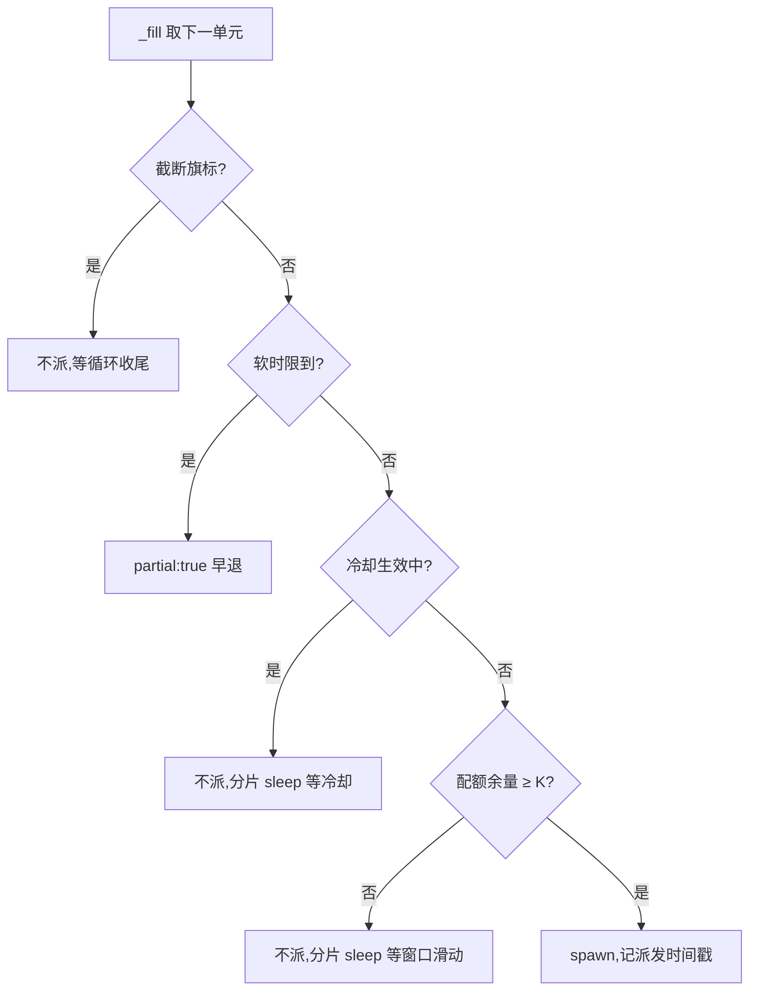

# Design — fix-mgh-sdr-quota-adaptive-fanout

## Context

见 proposal.md「Why」。需要补充的现状机理(改动落点的锚):

- `fanout_runner.py` 的派发循环 = 槽位补位:`_fill()`(约 :2811)在 `--wave`(默认 5,常量
  `DEFAULT_WAVE`)内在飞上限内无限补位,**无配额意识**;冷却由快败滑动窗口(120s 内 ≥3 个
  requeue)触发,时长固定 `--cooldown-s`(默认 300,`DEFAULT_COOLDOWN_S`),按剩余时间预算
  封顶;限流特征 crash(`RATE_LIMIT_SIGS` = `429`/`too many requests`/`rate limit`/`quota`)
  累计 ≥ `--wave` 且全命中时走**截断退出**(exit 2 + 等窗 recipe),`_RATELIMIT_RECIPE` 里已有
  手工 wave 校准公式 `floor(8 ÷ 每子每分钟调用数)`——需求早被证明,只是靠人算。
- 每单元的模型调用发生在宿主 CLI 子进程(`opencode run`/`claude -p`/dsh)内部的子代理会话里,
  **派发器不可观测**:这是配额节流只能做成估算式闸门的根本约束,也是既有规格「跨配额窗口的
  收敛归编排器 `--resume`」立场的原因(单次调用等窗受宿主 Bash 超时钳制)。
- `fanout_runner --tier sdr` 每次调用都重跑 `diff_group` 物化(`TIERS["sdr"].list_args`),
  切片上限默认值变化会改变 `-partN` 单元切分份数 → 单元 id 漂移 → 已 done 单元被当新单元
  重派。这催生了 delta 里的「resume 预算粘滞」条款。
- 单单元上下文栈的最坏构成:interface 切片(默认 256KB)+ 基线投影(`sdr_context.py`
  `--baseline-budget-bytes` 默认 32KB)+ 外部仓结论(每仓默认 64KB)+ 任务消息 `sdr-task.md`
  (约 3.4KB)+ agent 定义与输出。按代码 ≈ 3–4 字节/token 折算 ≈ 95–120K token,对 150K 窗口
  的弱模型已在边缘。
- dsh 面 `mgh-sdr` 壳 token 预算 4997/5000(只有个位数余量),opencode/claude 面 ~4770——壳面
  任何新增指引必须找到真正的瘦身来源(见 D8)。
- **壳体量的历史成因与先例**:mgh-init 壳三面仅 ~3.4–3.9K,因为 `harden-mgh-init-shell-budget`
  (归档 2026-08-12)做过结构性瘦身——壳只留骨架,确切调用行下沉 `list_steps.py --step <id>`
  stdout、步骤纪律下沉按需 fragment(工具输出会被宿主压缩定期清理,壳常驻不膨胀)。mgh-sdr
  壳起源是自包含短流程,后续多个 change 逐次往里内联建议(外部仓审批环、快败风暴三层、
  launcher 指针、可读性评审步……)累积到 ~4.8K;mgh-ut-init(4976)同病。**sdr 侧基础设施
  已半建成**:`list_sdr_steps.py --step <id>` 现在就能输出每步 invocation + discipline JSON,
  只是主流程没用它(仅恢复指引段引用)。
- **fanout 参数的 init 侧真仓验证史**(维护者评审点 2):`improve-mgh-init-fanout-longrun-
  timeout-visibility`(归档 2026-08-20,实测 n=84 单元标定超时口径)与
  `harden-mgh-fanout-crash-storm-resilience`(归档 2026-09-17,真仓背景即「每 10 分钟
  100 次」限流,引入快败冷却 300s/限流特征集/风暴截断)在 mgh-init 流程上验证过现有参数组。
  **同一归档明确把「配额探测/自适应限速/token-bucket 派发节奏」列为非目标**(当时判断
  「冷却已覆盖」)——本 change 是对该缓做决策的重启,依据是 sdr 真仓新证据:67 单元规模下,
  冷却层只在 429 之后反应、截断后要人工节奏 resume 十几轮,「冷却已覆盖」不成立(见 D9
  的隔离论证:重启不触碰当年验证过的非配额路径)。
- 既有休眠提案 `improve-mgh-sdr-unit-packing`(打包降单元数)与本案正交:它降单元数,本案降
  每单元调用数与失败重试;先做谁都会改对方的量化前提,不冲突。

## Goals / Non-Goals

**Goals**

- 调用次数限流网关(100 次/10 分钟量级)上,一次多单元 sdr run 能在配额内自洽跑完或干净
  分段 resume,不自我放大(429 → 重派 → 再 429)。
- 配额能力做成**可选模式**:不传配额 flag 的全部既有调用面(init 各 tier + sdr + 手动直跑)
  行为逐字节不变,零迁移成本。
- 单元输入按目标环境(150K 窗口弱模型)校准默认值,并把校准算术写成机器可对账的文档面。
- 中途升级不破坏进行中 run 的单元身份(预算粘滞)。

**Non-Goals**

- 不做精确调用计数(结构性不可观测;网关侧度量不在工具边界内)。
- 不实现接口单元打包(属 `improve-mgh-sdr-unit-packing`,另案)。
- 不改 init 命令壳的规范派发行(init 侧是否也默认串行,待该面真实故障驱动,另案)。
- 不做 mgh-sdr 壳的 init 式全量重构(per-step 按需 fragment 体系、bootstrap 循环)——本案只
  把**本就因新增指引而触碰的分节**外包给运行时清单与 `--help`;mgh-ut-init 壳(4976/5000)
  的同病另案处理。
- 不改 `--wave` 的脚本级默认值(见决策 D1)。
- 不引入运行时依赖(承 R2,全部改动 stdlib 内)。

## Decisions

### D1 — 串行缺省落壳面,不改脚本级 `DEFAULT_WAVE`(待拍板,推荐壳面)

维护者原始建议 1.2 是「无配置时回落 `--wave 1`」。两种落法:

| 方案 | 优点 | 缺点 |
| --- | --- | --- |
| (a) 脚本级 `DEFAULT_WAVE` 5→1 | 所有调用面一次到位,包括忘了改壳的路径 | 全局行为变化:init 各 tier、宿主外手动直跑、既有文档/测试全部受累;不限流环境吞吐无谓降 5×;「默认值是给谁定的」这个口径问题被掩盖 |
| (b) sdr 壳规范行 + launcher 显式 `--wave 1`(推荐) | 增量精确:只有真实受害面(sdr 内网 run)改行为;opencode 并行子进程另有数据库锁前科,串行是双理由收敛;`--help` 默认值不动,契约面零震荡 | 只覆盖壳驱动的 run;人手动直跑不传 `--wave` 仍吃到 5(recipe 已教校准公式,配额模式激活后准入节流会自动压住) |

选 (b),但配额模式激活时准入节流天然把有效并发压到配额算术内(见 D2),所以 (b) 的缺口
(手动直跑)被 D2 兜住。**若维护者倾向 (a),delta 只需改一处默认值声明,其余设计不变。**

### D2 — 配额准入 = 派发器内估算式滑动窗口(而非壳层节流或纯 resume 循环)

三个候选:

| 方案 | 优点 | 缺点 |
| --- | --- | --- |
| 壳层节流(编排器手工控制派发节奏) | 零脚本改动 | 编排器是弱模型,靠提示词维持节奏不可靠;resume/重派每次都要它重算;违背「机械重活下沉确定性脚本」的分层原则 |
| 纯 resume 循环(截断后等窗重派) | 零新机制 | 已验证不够:截断 exit 2 → 编排器等 10 分钟 → resume,一次 run 要十几次人工节奏的循环;429 发生在窗口内时固定 300s 冷却提前恢复,照样打穿 |
| 派发器内估算式准入(推荐) | 确定性、对全部 tier 生效、与既有冷却/截断/软时限机制同域协作 | 估算不精确(结构性,见 D5);新增状态与 flag | 

机制:配额模式激活时,派发器维护本 run 的**派发时间戳滑动窗口**;`_fill()` 每次准入判定
`最近 W 秒派发数 × K + K ≤ N`,不满足则不派,派发循环分片 sleep 等最早时间戳滑出窗口。
有效并发 = `min(--wave 槽位, 配额余量 ÷ K)`——`--wave` 仍是槽位上限,配额是第二重闸门,
两者正交组合而非替代(维护者建议 1.1 的「替代固定 --wave」按此理解落地)。

与既有机制的协作(配额模式下的派发闸门顺序):

零推进熔断不受影响:熔断观察锚在「每 K 个**新派发**单元」上重派生磁盘终态,准入等待期间
零派发 → 零观察 → 不误触熔断(测试锚定这一点)。

### D3 — 限流特征事件的冷却 = 等满配额窗口(而非改 `--cooldown-s` 语义)

维护者建议 2 给了两个形态:检测到配额签名后 sleep 窗口剩余,或把 `--cooldown-s` 语义改成
复位时刻。选**前者**(按事件特征覆盖冷却终点),不改 `--cooldown-s` 的既有语义:

- `--cooldown-s` 是全部 tier、全部非配额风暴的共用旋钮,改语义 = 全局面行为变化,违背
  「未配置零变化」原则;
- 覆盖式终点(`max(常规终点, 最近特征时刻 + W)`)保留「非限流事件仍固定冷却」的正确性
  (零进度/纯瞬断不该等窗口);
- 终点仍受既有「剩余时间预算 − 在飞收敛余量」封顶——这与既有规格「跨配额窗口收敛归
  `--resume`」的立场相容:单次调用至多等一个窗口,预算盖不住就干净早退,不赖着。

### D4 — 配额模式截断 = 「等满窗口后才截断」(而非改阈值为配额算术)

维护者建议 1.3 是把阈值从 `≥ --wave` 改成「窗口内 429 计数 ≥ 配额余量」。分析后不采纳
字面形态,采纳其意图:串行(`--wave 1`)下旧阈值意味着**第一个** 429 crash 就截断退出——
配额环境下这把「窗口耗尽」这一可自愈状态当成了终态。改为:限流特征 crash 先吃 D3 的窗口
复位冷却自我恢复;只有等满一个完整窗口后**仍**出现限流特征才截断(说明配额参数配错),
recipe 增「核对配额三 flag」一行。非配额模式阈值逐字节不变(既有测试全部沿用)。

### D5 — 每单元调用数估算 `--quota-calls-per-unit` 默认 10(保守上界)

实测 5–10 次/单元(维护者真仓数据);单遍纪律(见 D7)落地后预期降到 ~4–6。默认取上界 10:
宁可节流过严(慢)NEVER 打穿配额(429 连环),且默认值即「最坏实测」——用户拿真仓数据
校准后向下调是安全方向。算术:100/600/10 → 每窗口 10 单元,67 单元 ≈ 67 分钟纯排队;
调到 8 → ~54 分钟;配合 D7 压到实际 5 次/单元 → ~34 分钟。估算偏小仍可能吃 429,由 D3/D4
兜底——这是分层防御,不是单点。

### D6 — interface 默认 96KB / standalone 维持 64KB(对建议 4 的一半偏离)

- interface 256KB→96KB:**采纳**。最坏上下文栈 256+32+64KB ≈ 95–120K token,顶 150K 窗口
  边缘(弱模型 + 会话内工具结果累积,实际更紧);96KB 后最坏 ≈ 55–70K token,留足余量。
  代价:大接口切出更多 `-partN` 续单元(单元数↑ = 调用数↑)——但溢出失败的代价是**重试
  烧整份配额**,比确定性多切几份贵得多,取舍明确。
- standalone 64KB→32KB:**不采纳**。最坏栈 64+32+64KB ≈ 53K token,无溢出风险;该上限是
  归并上限,调小只会让小残渣簇更难合并 → 单元数增加 → 反噬配额,与本案第一目标(建议 1)
  直接冲突。降它的唯一收益是单单元更快,但 53K token 输入对慢模型的处理时长落在既有
  `--call-timeout-s 540` 的标定范围内。
- resume 预算粘滞:`grouping.json` 预算记录存在且未显式传 flag → 沿用记录值,堵住「中途
  升级 → 单元 id 漂移 → done 单元重派烧配额」的迁移缺口。

### D7 — 单遍往返纪律 = 提示词级(而非宿主级调用上限)

「一次主调用 + 单次 write」若要硬保证,需要宿主 CLI 暴露会话内调用上限——三宿主都没有这个
钩子,自造 = 不可行。落为任务措辞:`sdr-task.md` 增一段「全部输入第一批并行读入 → 一次
判断 → 写 draft + touch marker 同批 → 单行 ack,NEVER 逐文件多轮往返」+ 三面 agent 定义单行
指针。机理:三宿主的子代理都支持在一条消息里并行发多个工具调用,批读把「每读一个文件两轮
调用」压成「一批读两轮」,是调用数减半的来源。诚实边界写进规格与报告披露:纪律降低但不
保证调用数。

### D8 — 壳瘦身来源 = 运行时清单/`--help` 外包(维护者评审点 1),净零删并仅作兜底

维护者指出 init 壳(~3.5K)靠 `harden-mgh-init-shell-budget`(归档 2026-08-12)的机制瘦身:
确切调用行与步骤级 recipe 下沉到 `list_steps.py --step` stdout、纪律下沉按需 fragment——工具
输出会被宿主压缩机制定期清理,壳常驻历史不膨胀。核实结论:**mgh-sdr 可以走同路,且基础设施
已半建成**——`list_sdr_steps.py --step <id>` 现已输出每步 invocation + discipline JSON
(`--step fanout` 含派发行与 gate recipe),只是主流程没引用它。4997 的成因 = 自包含起源
(基线 4776)+ 后续 change 逐次内联建议的累积 + dsh 方言五类白名单(frontmatter/执行边界/
召唤语义等,约 +221,镜像策略规定不可省)。

落法(本案范围,**A 为主案、B 为降级备选**):

| 方案 | 内容 | 收益 | 风险 |
| --- | --- | --- | --- |
| (A) 步骤清单外包(推荐) | 壳的编排流改为:init 式「每步先 `py …/list_sdr_steps.py --step <id>`,按 stdout invocation + discipline 执行」;步骤级 recipe(快败风暴三层、gate 细则、预算判据)随步骤清单走;`diff_group`/`fanout_runner` 的 `--help` 承载参数语义与校准算术 | 预计腾出数百 token 真实余量(不止抵消本次增量);后续 change 加建议不再撞顶 | 编排器多一层间接(每步一次清单调用)——init 已在同款弱模型群体上验证该模式可行;需实机冒烟确认 sdr 线性流程下弱模型不漂移 |
| (B) 分节外包(降级备选) | 只把本案触碰的分节(快败风暴三层 → 清单 discipline;预算判据 → `diff_group --help`)外包,调用行仍内联 | 改动小、模式不一致 | 余量有限(~150–250 token),下次扩建议仍撞顶 |
| (C) 纯删并净零(原案,降为兜底) | 按 D8 原三来源删并冗余措辞 | 零结构变化 | 只是刮字节,不解决「壳是唯一没有下沉出口的厚壳」的结构问题 |

选 A,冒烟若见弱模型漂移则降 B;C 只作残余微调。规格面(delta)对调用行载体写成**载体无关**
(壳内联或清单 invocation 均可,并存时须一致),A/B 皆满足。顺带:`list_sdr_steps.py --step
fanout` 的 invocation 本案要增 `--wave 1` 与配额三 flag 示例,`test_list_sdr_steps` 锚同步。

### D9 — init 影响面隔离:重启归档缓做项,但不触碰当年验证过的路径(维护者评审点 2)

维护者指出 fanout 参数在 mgh-init 流程上经真仓测试优化(归档 2026-08-20 超时标定 n=84、
2026-09-14/09-17 失活与风暴韧性),须确认本案无负面影响。逐文件暴露面:

| 本案改动文件 | init 是否消费 | 隔离机制 |
| --- | --- | --- |
| `fanout_runner.py` | **是**(scout/t1/t2/t3 共享) | 全部行为变化(准入节流/窗口复位冷却/等满窗口截断)在配额三 flag 之后;不传 = 逐字节不变(delta 场景锚定 + 既有风暴/冷却/失活测试全绿为闸门) |
| `diff_group.py` | 否(init 枚举器 = `list_scout_batches`/`list_clusters`/`plan_aggregate`/`list_rule_jobs`) | sdr 专属,零暴露 |
| `sdr-task.md` 模板 / `sdr-review-fanout` agent ×3 | 否 | sdr 专属 |
| mgh-sdr 三壳 / `mgh_sdr_launch.py` | 否 | sdr 专属 |

**参数级确认**:init 各 tier fragment 调 `fanout_runner` 不传 `--wave`(吃脚本默认 5,已核
实);`DEFAULT_WAVE`/`DEFAULT_COOLDOWN_S`/requeue 窗口 120s·阈值 3/截断 `≥ --wave`/失活
超时标定全部不动(D1 选壳面落法正是为此)。**对归档非目标的翻案论证**:09-17 归档把「配额
探测/自适应限速」列为非目标的依据是「冷却已覆盖」——那是 init 时代风暴形态(瞬时段配额
打穿,冷却 300s 后自愈)下的正确判断;sdr 真仓新证据(67 单元 × 5–10 次调用,持续 35–67
分钟满配额运行)表明长稳态下冷却层只在 429 后反应且截断要人工 resume 十几轮,不覆盖。重启
的方式是**加一条 opt-in 通道**而非修改当年验证的默认通道——当年验证的参数组与非配额行为
一字不动,既有 `test_fanout_runner` 风暴/冷却/失活套件(即 init 验证参数的锁定器)全绿是
本案的硬闸门。

## Risks / Trade-offs

- [估算偏小仍吃 429] → D3 窗口复位冷却 + D4 等满窗口截断兜底;stderr 披露估算口径,真仓
  数据回流后向下校准 `--quota-calls-per-unit`。
- [配额模式引入回归,破坏既有 tier] → 未配置路径逐字节回归测试(既有 `test_fanout_runner`
  全量 + 新增「不传配额 flag 输出逐字节一致」锚);harness 层显式 `--cooldown-s 0` 纪律,
  配额测试用小窗口值(如 `--quota-window-s 2`)控墙钟。
- [准入等待被误判为零推进] → 熔断观察只锚在新派发上,补一条「准入等待期间零派发不触发
  熔断」测试。
- [96KB 默认变化改变既有用户的切分形态] → 预算粘滞保 run 内身份;`--help`/参数表/示例行
  同步;显式传旧值合法。分发面纯度与契约 lint 全量过。
- [单遍纪律措辞与既有刚性三元组/读闭集措辞冲突造成弱模型困惑] → 新段落只约束往返次数,
  显式声明读/写路径闭集不变;三面 agent 定义单行指针措辞与模板逐字对账(测试锚)。
- [`--quota-*` 新 flag 泄漏进错误调用面(壳写了脚本不认)] → R5.1 契约 lint 自动对账
  (`--help` 即契约);dsh 命令面测试同步。
- [壳外包(A 案)致弱模型步骤漂移(漏调清单、凭记忆拼调用行)] → 实机冒烟专测每步先调清单的
  忠实度;漂移则降 B 案;`list_sdr_steps` invocation 逐字可执行 + `script_abs` 绝对路径防
  cwd 漂移;调用行迁出壳后 R5.1 契约 lint 的壳扫描面变小,步骤清单内容改由
  `test_list_sdr_steps` 断言锚定(任务 7.4)。
- [重启 09-17 归档的非目标被未来读者误读为「当年判断错了」] → D9 记录翻案依据(新证据形态
  不同:瞬时段风暴 vs 长稳态满配额),归档不回溯改写。

## Migration Plan

实现顺序(tasks.md 展开):先 `fanout_runner.py` 配额三机制 + 单测(红→绿),再 `diff_group.py`
默认值 + 粘滞 + 单测,然后分发面(模板/agent/三壳/launcher)与 lint,最后实机冒烟 + VERSION/
CHANGELOG。回滚:配额模式纯 opt-in,回滚 = 不传 flag;96KB 默认回滚 = 还原常量(预算粘滞
保证进行中 run 不受跨版本影响);壳面回滚 = 还原三面镜像文件。

## Open Questions

- 准入等待的 stderr 措辞精确形态(实现期定,不影响规格语义)。
- init 命令族是否同样在壳面默认串行 + 配额指引(本案 Non-Goal,待 init 面真实故障驱动)。
- `--quota-calls-per-unit` 默认 10 在真仓数据回流后是否下调(维护者拿网关侧计数校准)。
